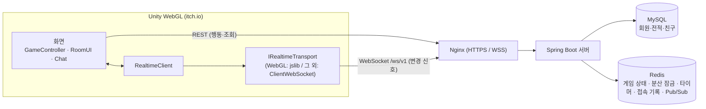
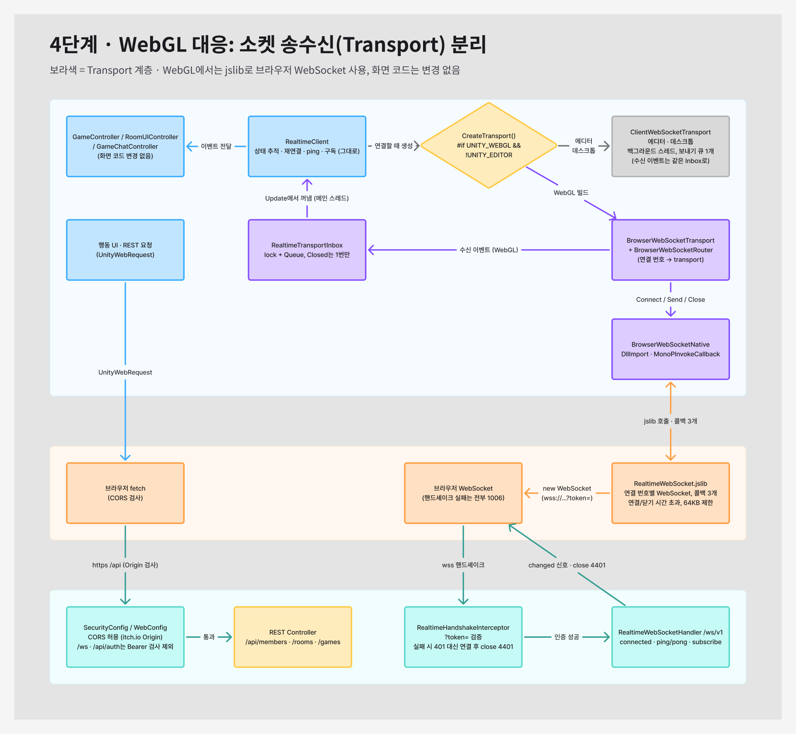
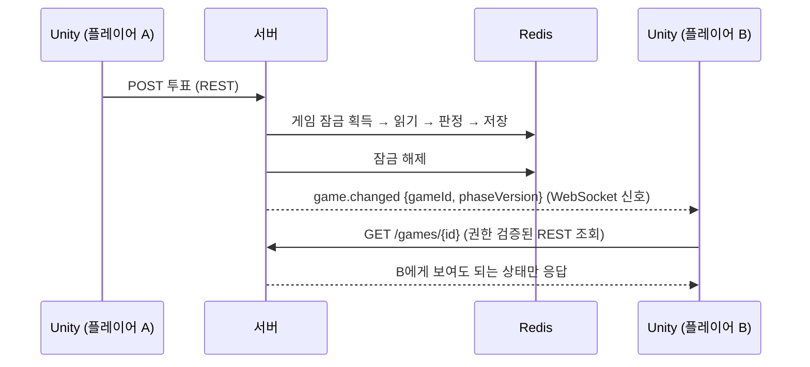
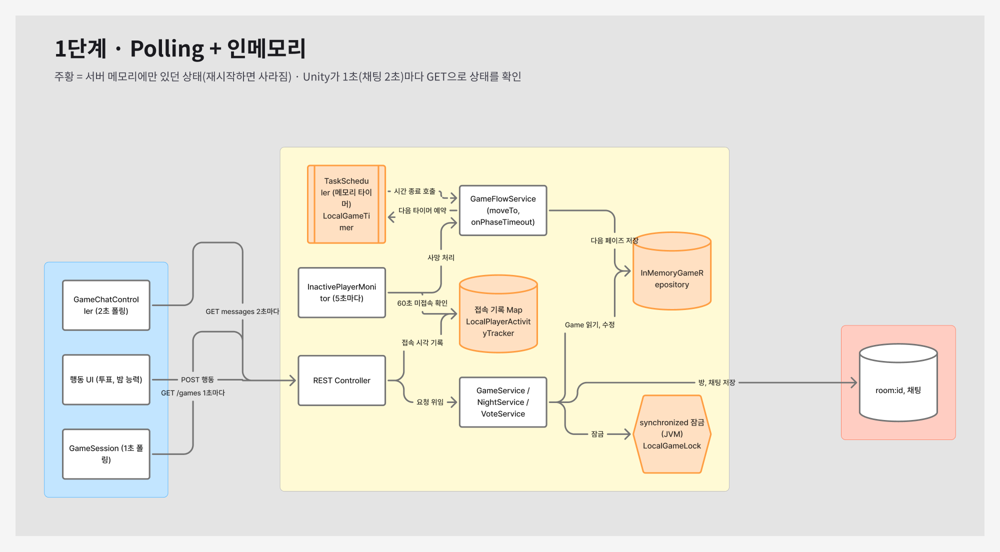
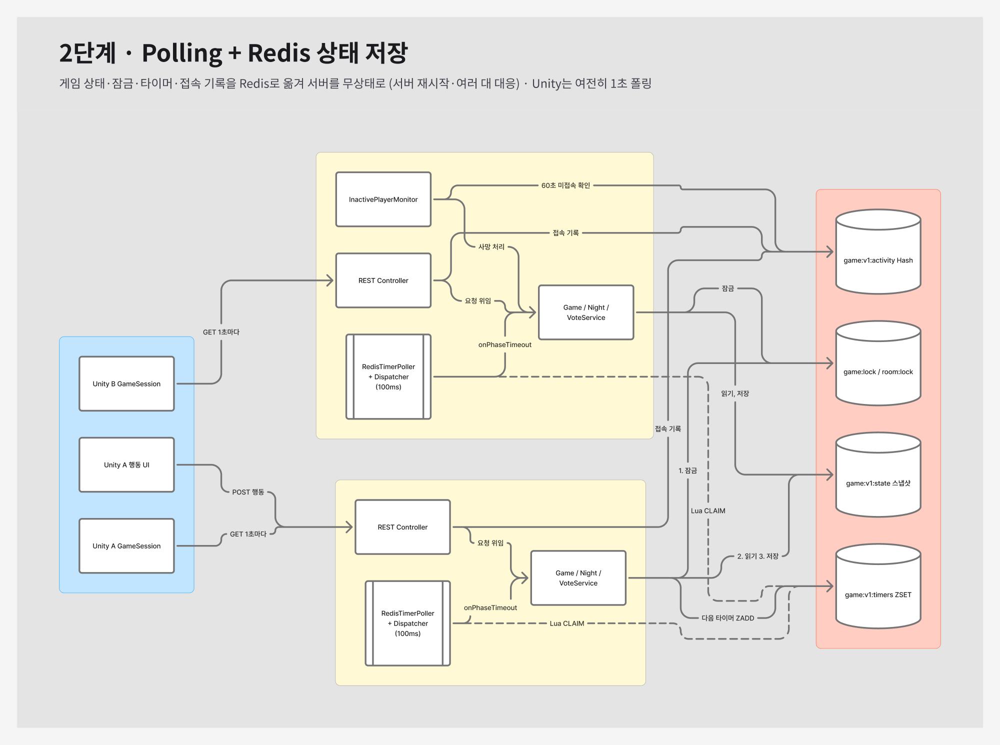
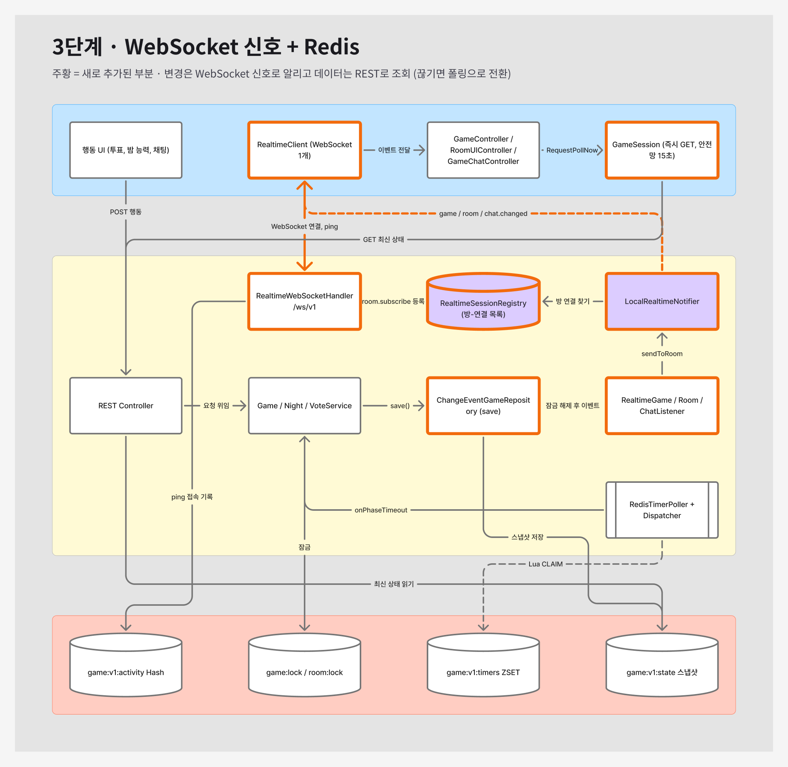

# 🏴‍☠️ Crew Check — 실시간 웹 마피아 게임

> 4~12명이 한 배에 올라 채팅으로 해적을 찾아내는 **브라우저 온라인 소셜 추리 게임**
> 저는 **게임 진행 코어 설계, Unity 실시간 네트워크 클라이언트, WebSocket 신호 구조·Redis 상태 외부화**를 맡았습니다.

| 직업 능력 사용 | 밤 결과·낮 토론 | 투표 결과·처형 |
| :---: | :---: | :---: |
|  |  |  |

**[▶️ 플레이 영상](https://youtube.com/shorts/5H5USoOzqMk)** · **[🎬 기능 소개 영상](https://youtu.be/92MvCmUjpVk)** · 원본 팀 저장소 [Server](https://github.com/IamREALcitizen/project_server) / [Client](https://github.com/IamREALcitizen/project_client)

> 서버 운영이 종료되어 현재는 플레이할 수 없습니다. 실제 플레이 모습은 위 영상에서 확인할 수 있습니다. ([itch.io 배포 페이지](https://youjin-43.itch.io/crewcheck))

## 한눈에 보기

| 항목 | 내용 |
| --- | --- |
| 기간 / 인원 | 2026.09.28 ~ 10.20 (약 3주) / 5명 · 내일배움캠프 단기심화 9기 최종 프로젝트 |
| 내 역할 | **Server / Realtime** — 게임 진행 코어 설계, Unity `RealtimeClient`·WebGL WebSocket 연결, WebSocket 신호 서버, 멀티서버 전환을 위한 Redis 상태 외부화 |
| 기술 스택 | **Unity 6 · C# · WebGL** / Java 21 · Spring Boot · Redis(Redisson, Lua) · MySQL · WebSocket / AWS EC2 · Docker · Nginx / k6 · Prometheus · Grafana |
| 내 기여 | 서버 커밋 **128개** (팀 서버 커밋의 약 57%) · 클라이언트 커밋 **30개** |

## 내가 해결한 것

**1. WebGL 실시간 통신 구현 (Unity)**
- WebGL의 스레드·`ClientWebSocket` 미지원 → `IRealtimeTransport` 추상화 + 브라우저 WebSocket `.jslib` 연결층
- 화면 코드 수정 없는 배포본 실시간 통신, 지수 백오프 재연결과 폴링 폴백으로 끊김 대응

**2. 서버 주도 게임 진행 코어 설계**
- 페이즈 진행 루프·밤 판정·투표·승패 판정·직업 배정의 초기 구조 설계, 팀원의 14개 직업 확장 기반
- 밤 행동 수집 후 일괄 판정 구조, `phaseVersion` 기반 늦은 타이머 무시

**3. 1초 폴링 → WebSocket 신호 구조 전환**
- 변경 신호만 소켓으로, 화면 데이터는 권한 검증된 REST로 가져오는 구조
- 12인 게임 유휴 요청 **약 18 → 1.6 req/s**(폴링 간격 기준 계산), 변경 즉시 반영으로 최대 1~2초 폴링 지연 제거

**4. 멀티서버 전환을 위한 Redis 상태 외부화**
- 게임 상태·잠금·타이머·접속 기록의 인터페이스 분리 후 단계별 Redis 이전
- Redisson 분산 잠금, ZSET + Lua 분산 타이머, 멈춘 게임 감시, 서버 재시작 시 게임 유지와 서버 2대 가정 통합 테스트 검증

**5. 부하 테스트 환경 구축과 병목 분석**
- k6 + Prometheus·Grafana 측정 환경, 잠금 대기·보유 지표 추가, 로그인 대조군으로 원인을 스레드 포화(**200/200**)로 특정
- 구조 변경 후 남은 조회 잠금 제거, 방 목록 p99 **13.4s → 215ms (62배)**, 로그인 p99 **1.18s → 92ms**

## 구조



**서버가 판정하고, 클라이언트는 보여주기만 한다.** 행동은 REST로 요청하고, 변경은 WebSocket 신호로 받아 REST로 다시 조회합니다.

> [!NOTE]
> 팀 저장소 두 개를 **커밋 기록째로 합친** 포트폴리오용 저장소입니다. `server/`는 원본 그대로, `client/`는 코드와 문서만 남겼습니다(에셋 제외).

---

## 상세 내용

필요한 항목을 펼쳐서 보세요.

<details>
<summary><b>🎲 게임 소개</b></summary>

배 위에서 펼쳐지는 채팅 기반 마피아 게임입니다. 설치 없이 **브라우저 링크 하나로** 플레이하도록 WebGL로 배포했습니다(현재 서버 운영 종료).

1. 4~12명이 방에 모여 각자 비밀 직업(3개 진영, 14개 직업)을 받습니다.
2. **밤**: 해적은 선원 한 명을 습격하고, 다른 직업은 각자의 능력으로 단서를 모읍니다.
3. **낮**: 모두 채팅으로 토론한 뒤 투표로 해적으로 의심되는 사람을 바다에 던집니다.
4. 한 진영의 승리 조건이 충족될 때까지 `밤 → 결과 공개 → 토론 → 투표 → 처형`을 반복합니다.

구조의 핵심은 **"서버가 판정하고, 클라이언트는 보여주기만 한다"** 입니다. 페이즈 전환, 능력 판정, 승패, "누가 무엇을 볼 수 있는지"는 모두 서버가 결정하고, Unity는 행동을 요청하고 서버가 내려준 상태를 그립니다.

</details>

<details>
<summary><b>👤 담당 역할 상세 (내가 한 것 / 팀원이 한 것)</b></summary>

**포지션: Server / Realtime — 게임 진행 코어, 실시간 통신, Unity 네트워크 클라이언트**

#### 내가 한 것

| 영역 | 담당 내용 |
| --- | --- |
| **Unity 네트워크 클라이언트** | `RealtimeClient` 설계·구현 (메인 스레드 큐, 10초 ping, 지수 백오프 재연결, 신호 필터, 연결 상태별 폴링 간격) · 게임·방·채팅 화면을 실시간 신호에 연결 |
| **WebGL 대응** | `IRealtimeTransport`로 소켓 추상화, 브라우저 WebSocket을 쓰는 `.jslib` 연결층 작성 |
| **Unity UI (초기)** | 투표 패널·플레이어 프로필 아이템 프리팹, 하단 탭·Drawer 전환, 채팅 기록 패널 |
| **게임 진행 코어 설계** | 게임 도메인 모델(`Game`), 서버 주도 페이즈 진행 루프(`GameFlowService`)·`phaseVersion` 타이머, 밤 행동 일괄 판정(`NightActionResolver`)·투표·승패 판정·직업 배정의 초기 구조, 게임 시작·밤 능력·투표 API |
| **멀티서버 전환 준비** | 게임 상태·잠금·타이머·접속 기록을 인터페이스로 분리 후 Redis로 이전, Redisson 분산 잠금, Redis + Lua 분산 타이머, 멈춘 게임 감시 |
| **WebSocket 서버** | `/ws/v1` 신호 서버, 연결 인증·종료 코드(4401/4408), 볼 수 있는 사람에게만 보내는 채팅 신호 |
| **성능·배포** | 잠금 지표와 k6 + Prometheus/Grafana 부하 테스트 환경, 측정으로 찾은 조회 잠금 제거(잠금 없는 읽기), Nginx HTTPS·CORS 설정 |
| **문서화** | 아키텍처 변천사, 멀티서버 단계별 설계(5편), WebSocket 프로토콜 문서 |

#### 팀원이 한 것

회원·인증(JWT·소셜 로그인), 친구·접속 상태, 채팅 기능과 욕설 필터, Redis Pub/Sub 서버 간 신호 전달, 직업 능력 구현과 신규 직업 5종(14개 직업으로 확장), 게임씬 연출·컷씬, 로비·대기실, 사운드, WebGL 빌드 최적화·itch.io 배포. 자세한 분담은 맨 아래 팀 구성에 있습니다.

</details>

<details>
<summary><b>🛠 주요 구현 (문제 → 설계 → 핵심 코드 → 결과)</b></summary>

#### 1. Unity `RealtimeClient` — 끊겨도 멈추지 않는 실시간 연결

**문제**
WebSocket 수신은 백그라운드 스레드에서 일어나는데 Unity API는 메인 스레드에서만 쓸 수 있습니다. 또 서버가 재시작되면 모든 클라이언트가 같은 순간에 끊기고 같은 간격으로 다시 붙으려 해서 접속이 한꺼번에 몰립니다.

**설계**
- 수신한 사건은 스레드에 안전한 수신함(`RealtimeTransportInbox`)에 넣고, `Update`(메인 스레드)에서 꺼내 처리합니다. 그래서 이벤트를 받는 화면 코드는 Unity API를 그대로 쓸 수 있습니다.
- 재연결은 **지수 백오프(1→2→4…최대 30초) + ±20% 지터**로 시도를 흩뜨립니다.
- 같은 프레임에 같은 종류의 신호가 여러 번 오면 하나로 합치고(`RealtimeSignalFilter`), 다른 방의 신호는 버립니다.
- 연결 상태에 따라 폴링 간격을 바꿉니다: 연결 중에는 15초(안전망), 끊기면 1초(채팅 2초). **WebSocket이 끊겨도 게임은 폴링으로 계속 진행됩니다.**
- 시간과 난수를 외부에서 주입받게 만들어, 기다리지 않고 바로 끝나는 EditMode 테스트로 검증했습니다.

**핵심 코드** — [`ReconnectBackoff.cs`](client/Assets/02_Scripts/Network/Realtime/ReconnectBackoff.cs)

```csharp
public double NextDelaySeconds()
{
    double baseDelay = BaseDelaySeconds(Attempt);   // initial × 2^n, 상한 30초
    if (Attempt < int.MaxValue) Attempt++;
    if (jitterRatio <= 0) return baseDelay;

    // r ∈ [0, 1) → factor ∈ [0.8, 1.2): 동시에 끊긴 클라이언트들의 재접속 시각을 흩뜨린다
    double r = random();
    if (double.IsNaN(r) || r < 0 || r >= 1) r = 0.5;
    double factor = 1.0 + jitterRatio * (2.0 * r - 1.0);
    return Math.Min(maxSeconds, baseDelay * factor);
}
```

**결과**: 서버 재시작 시 즉시 끊김을 감지하고 1초 폴링으로 게임을 이어간 뒤, 백오프로 재연결·재구독하고 GET 한 번으로 놓친 변경을 채웁니다.

#### 2. WebGL 대응 — 소켓을 인터페이스로 분리하고 브라우저 WebSocket 연결

**문제**
배포 대상인 WebGL에는 스레드가 없고 .NET `ClientWebSocket`도 동작하지 않습니다. 에디터·데스크톱에서 쓰던 연결 코드를 WebGL 빌드에서는 그대로 쓸 수 없었습니다.

**설계**
- 소켓을 `IRealtimeTransport` 인터페이스로 분리하고, `RealtimeClient`는 이 인터페이스만 알게 했습니다.
- 모든 구현이 지키는 약속을 정했습니다: 객체 하나 = 연결 한 번, 사건 순서는 `Opened? → Message* → Closed`, `Closed`는 정확히 한 번, 메서드는 예외를 던지지 않음.
- WebGL용 `BrowserWebSocketTransport`는 `RealtimeWebSocket.jslib`로 브라우저의 JavaScript WebSocket을 쓰고, 이벤트를 C# 콜백으로 돌려줍니다(`_malloc`/`_free`로 문자열 메모리 관리).
- 브라우저는 WebSocket에 헤더를 붙일 수 없어 토큰은 `?token=`으로 보내고, 로그에는 토큰을 가립니다.



**핵심 코드** — [`RealtimeClient.cs`](client/Assets/02_Scripts/Network/RealtimeClient.cs)

```csharp
/// 이번 연결에 쓸 transport를 만든다. 플랫폼별 구현을 고르는 곳은 여기 한곳이다.
///  - WebGL 플레이어 빌드: 브라우저 WebSocket(jslib). 스레드·ClientWebSocket을 쓸 수 없기 때문.
///  - 그 밖(에디터·데스크톱·모바일): .NET ClientWebSocket.
private static IRealtimeTransport CreateTransport()
{
#if UNITY_WEBGL && !UNITY_EDITOR
    return BrowserWebSocketNative.CreateTransport();
#else
    return new ClientWebSocketTransport();
#endif
}
```

**결과**: 화면 코드와 `RealtimeClient`는 한 줄도 바꾸지 않고 WebGL 배포본에서 실시간 연결이 동작하게 했습니다.

#### 3. 서버 주도 게임 진행 코어

**문제**
마피아 게임은 플레이어마다 볼 수 있는 정보가 다르고, 밤 능력은 서로 영향을 주고받습니다(보호가 공격을 막는 등). 클라이언트가 판정하거나 도착한 순서대로 처리하면, 같은 선택에도 결과가 달라지고 정보가 새어 나갑니다.

**설계**
- **판정 권한은 서버에만**: 클라이언트는 행동을 요청만 하고, 페이즈 전환·능력 결과·승패는 서버가 계산합니다. 페이즈를 넘기는 API는 없고 서버 타이머가 넘깁니다. 밤·투표는 전원이 제출하면 타이머를 기다리지 않고 바로 넘어갑니다.
- **밤 행동은 모았다가 한 번에 판정**: 밤 동안 행동을 모으고, 밤이 끝날 때 `NightActionResolver`가 정해진 순서로 한 번에 계산합니다. 그래서 제출 순서와 관계없이 결과가 같습니다. 이 구조 위에 팀원이 직업을 14개까지 확장했습니다.
- **타이머는 취소하지 않고 버전으로 거름**: 페이즈가 바뀔 때마다 `phaseVersion`을 올리고, 늦게 울린 타이머는 버전이 다르면 무시합니다. 클라이언트도 이 버전으로 오래된 응답을 거릅니다.
- **모듈은 이벤트로 분리**: 게임은 `GameEndedEvent` 등을 발행만 하고, 로비·채팅·전적이 각자 받아 처리합니다.

**핵심 코드** — [`GameFlowService.java`](server/src/main/java/com/WhoisntCitizen_server/game/service/GameFlowService.java)

```java
private void moveTo(Game game, GamePhase next, int seconds) {
    Instant endsAt = clock.instant().plusSeconds(seconds);
    game.changePhase(next, endsAt);                   // phaseVersion++
    gameRepository.save(game);
    scheduleTimeout(game.getGameId(), game.getPhaseVersion(), endsAt);
}

public void onPhaseTimeout(String gameId, long expectedVersion) {
    gameLock.runWithLock(gameId, () -> {
        Game game = gameRepository.findById(gameId).orElse(null);
        if (game == null || game.getPhaseVersion() != expectedVersion || game.isEnded()) {
            return;                                   // 이미 넘어간 페이즈의 늦은 타이머는 무시
        }
        // ... 다음 페이즈로 진행
    });
}
```

**결과**: 이 버전 방식 덕분에 이후 타이머를 Redis로 옮길 때 진행 로직을 바꾸지 않았고, 여러 서버에서 같은 타이머가 중복 실행돼도 안전했습니다.

#### 4. 서버 메모리 → Redis 외부화

**문제**
게임 상태와 타이머가 서버 메모리에만 있어서 서버가 꺼지면 진행 중인 게임이 사라졌고, 서버가 2대면 서로 다른 게임을 봤습니다. `synchronized`는 같은 JVM 안에서만 동시 수정을 막습니다.

**설계**
- **0단계**: 동작은 그대로 두고 `GameRepository` / `GameLock` / `RoomLock` / `GameTimer` / `PlayerActivityTracker`를 인터페이스로 분리했습니다. 이후 단계는 서비스 코드를 거의 건드리지 않고 구현만 바꿨습니다.
- **상태**: 게임을 JSON 스냅샷으로 저장하고, 저장과 목록 갱신을 `MULTI/EXEC`로 묶었습니다.
- **잠금**: Redisson 분산 잠금. 교착을 막기 위해 순서를 **방 → 게임** 한 방향으로만 허용하고, 위반하면 바로 예외를 던집니다.
- **알림은 잠금 밖에서**: 잠금 안에서는 상태 변경·저장만 하고, 알리는 일은 `GameLockScope.afterUnlock()`에 모아 잠금이 풀린 직후 실행합니다.
- `SERVER_MODE=single/multi` 설정 하나로 메모리 구현과 Redis 구현을 바꿉니다.

**결과**: 서버를 재시작해도 게임과 타이머가 유지되고, 서버 2대를 가정해 같은 게임을 보는 것을 통합 테스트(`DistributedLockMultiServerTest`, `RedisActivityMultiServerTest`, `LockOrderTest`)로 확인했습니다.

서버 간 실시간 신호 전달(Redis Pub/Sub)은 팀원(박재영)이 구현했고, 실제로 서버 여러 대를 EC2에 띄운 검증까지는 진행하지 못했습니다.

#### 5. Redis + Lua 분산 타이머

**문제**
페이즈 타이머가 서버 메모리에 있으면 그 서버가 죽을 때 게임이 멈추고, 서버가 여러 대면 같은 타이머가 두 번 실행될 수 있습니다.

**설계**
- 타이머 예약을 Redis ZSET(`score = 실행 시각`)에 저장하고, 모든 서버가 100ms마다 확인합니다.
- **가져가기(CLAIM)를 Lua 한 번으로** 처리합니다. 시간이 된 예약을 읽으면서 점수를 "lease 만료 시각"으로 바꿔, 다른 서버가 같은 예약을 동시에 가져가지 못하게 합니다.
- 실행한 서버가 lease 안에 끝내지 못하고 죽으면, lease가 지난 뒤 다른 서버가 다시 가져갑니다.
- 이미 넘어간 페이즈의 늦은 타이머는 `phaseVersion`을 비교해 무시합니다.
- `StuckGameWatchdog`이 끝날 시각이 지났는데 예약이 없는 게임을 찾아 다시 예약합니다.

**핵심 코드** — [`RedisGameTimer.java`](server/src/main/java/com/WhoisntCitizen_server/game/scheduling/redis/RedisGameTimer.java)

```lua
-- CLAIM: 시간이 된 예약을 가져가면서 점수를 lease 만료 시각으로 바꾼다 (원자적)
local due = redis.call('ZRANGEBYSCORE', KEYS[1], '-inf', ARGV[1], 'WITHSCORES', 'LIMIT', 0, tonumber(ARGV[3]))
for i = 1, #due, 2 do
  redis.call('ZADD', KEYS[1], ARGV[2], due[i])
end
return due
```

**결과**: 게임 진행 전체를 Redis 타이머로 돌리는 통합 테스트(`RedisTimerGameFlowTest`)에서 서버 재시작·서버 2대·lease 만료 상황을 확인했습니다.

#### 6. WebSocket 신호 서버 `/ws/v1`

**설계**
- 서버는 내용 없이 `game.changed` / `room.changed` / `chat.changed` **신호만** 보냅니다. 신호에는 id와 `phaseVersion`·`lastMessageId`만 담습니다.
- 모든 변경이 반드시 지나는 `save()`에서 이벤트를 내고, 잠금이 풀린 뒤 한 번 보냅니다. 기능마다 알림 코드를 넣다가 빠뜨리는 일을 막기 위해서입니다.
- 해적 밤 채팅, 유령 채팅처럼 볼 사람이 정해진 채팅은 **볼 수 있는 사람에게만** 신호를 보냅니다.
- 30초 동안 메시지가 없으면 `4408`, 토큰이 만료되면 `4401`로 연결을 닫고, 클라이언트는 코드에 따라 재연결하거나 재로그인으로 보냅니다.
- ping을 받으면 게임 접속 기록을 남겨, 폴링이 줄어도 끊김 판정이 유지되게 했습니다.

</details>

<details>
<summary><b>⚖️ 기술적 의사결정</b></summary>

#### WebSocket으로 "상태"가 아니라 "신호"만 보낸다

| 선택지 | 판단 |
| --- | --- |
| 폴링 간격 단축 | 요청 수가 그만큼 늘어남 → 탈락 |
| WebSocket으로 전체 상태 전송 | 플레이어별로 정보를 가리는 규칙을 소켓 경로에 한 번 더 구현해야 하고, 메시지를 놓치면 화면이 어긋남 → 탈락 |
| WebSocket으로 변경분 전송 | 순서·버전·재동기화 관리가 복잡함 → 탈락 |
| SSE | Unity 기본 클라이언트가 없음 → 탈락 |
| **신호 + 기존 REST GET** | **채택** |

- **이유**: 마피아 게임은 "누가 무엇을 볼 수 있는가"가 핵심이라, 화면 데이터의 출처를 **권한을 검증하는 REST 하나**로 유지하고 싶었습니다. 턴제라 GET 왕복 한 번은 체감되지 않습니다.
- **효과**: 신호는 놓쳐도 다음 GET이나 15초 안전망 폴링이 최신 상태를 가져오므로, 메시지 보관이나 재전송 로직이 필요 없습니다. 12인 게임에서 변화가 없을 때 요청이 **약 18 → 1.6 req/s**로 줄었습니다(폴링 간격 기준 계산).

#### 바로 Redis로 바꾸지 않고, 먼저 인터페이스로 분리했다

한 번에 Redis로 옮기면 게임 규칙 버그와 분산 환경 버그가 섞여 원인을 찾기 어렵습니다. 그래서 동작을 바꾸지 않는 **0단계(인터페이스 분리)** 를 먼저 하고, 이후 상태 → 잠금 → 타이머 → 접속 기록 순서로 구현만 하나씩 교체했습니다. 접속 기록처럼 메모리 구현과 Redis 구현이 함께 있는 부분은 **같은 계약 테스트**를 두 구현에 모두 돌려 동작이 같은지 확인했습니다.

#### 타이머 취소 대신 버전으로 거른다

분산 환경에서는 "예약 취소"를 모든 서버에 확실히 전달하기 어렵습니다. 대신 페이즈가 넘어갈 때마다 `phaseVersion`을 올리고, 타이머가 울렸을 때 버전이 다르면 무시합니다. 처음 메모리 타이머를 만들 때부터 이 방식을 써서, Redis로 옮길 때 로직을 바꿀 필요가 없었습니다.

#### 끊김 판정은 WebSocket close가 아니라 활동 기록으로

탭을 옮기거나 잠깐 네트워크가 흔들렸다고 게임에서 탈락하면 안 됩니다. 그래서 소켓이 닫힌 순간이 아니라 **GET·ping 기록이 60초 동안 없을 때만** 사망 처리합니다.

</details>

<details>
<summary><b>🔥 트러블슈팅</b></summary>

#### 1. 부하 테스트로 찾은 스레드 포화 병목 분석

- **배경**: 메모리 저장소 시절에는 모든 요청이 같은 `Game` 객체를 공유해서, **조회도 잠금 안에서 읽는 것이 맞는 설계**였습니다. Redis로 옮긴 뒤 매번 새 복사본을 읽게 되며 이 전제가 바뀌었지만, 조회 코드에는 잠금이 그대로 남아 있었습니다.
- **문제**: 방 10개 부하에서 게임 잠금과 **무관한 로그인·방 목록까지** 느려졌습니다(로그인 p99 1.18초, 방 목록 p99 13.4초, 드롭 요청 약 240건).
- **원인 추적**
  - `RedisGameLock`에 **잠금 대기·보유 지표**를 추가하고, 잠금을 쓰지 않는 로그인을 **대조군**으로 함께 측정했습니다. 로그인까지 느려졌으므로 원인은 잠금이 아니라 **스레드 부족**이었습니다.
  - 화면 표시용 상태 조회까지 게임 잠금 줄에 서서, 잠금 대기 p99가 3.5초로 늘고 **Tomcat 스레드 200개가 모두 찼습니다.** 방 목록은 게임 10개의 잠금을 차례로 잡아 대기가 더해졌습니다.
  - 잠금 보유 시간은 평소와 같았습니다. 작업이 느린 게 아니라 **줄 서는 요청이 너무 많은** 문제였습니다.
- **해결**: Redis GET 한 번은 원자적이라 잠금 없이 읽어도 반쯤 바뀐 상태를 볼 일이 없습니다. 이 성질을 근거로 `SnapshotRead`를 만들어 **화면 표시용 읽기 5곳과 방 목록의 게임 확인을 잠금 밖으로** 옮겼습니다. 쓰기는 그대로 잠금 안에서 처리하고, 잠금 횟수를 검증하는 테스트 7개를 추가했습니다.
- **결과** (방 10개, k6 `lock-contention.js`, 조건마다 2회 측정)

  | 지표 | 개선 전 | 개선 후 |
  | --- | --- | --- |
  | 방 목록 p99 | 13.4s | **215ms** (62배) |
  | 상태 조회 p99 | 3.81s | **71ms** (54배) |
  | 로그인 p99 (대조군) | 1.18s | **92ms** (13배) |
  | 바쁜 Tomcat 스레드 | **200 (포화)** | **74** |
  | 드롭 요청 | 212~266건 | **0건** |

  잠금 보유 시간은 그대로이고 줄 서는 요청 수만 줄었습니다. 코드를 바꾸지 않은 채팅·투표도 4~6배 빨라졌습니다.
- **한계**: 노트북 한 대에서 측정해 배수는 이 환경에서만 성립합니다. 방 10개는 여전히 임계점 근처이고(투표 p99 862ms), 다음 병목은 **쓰기 경합**입니다.
- 측정 방법·회차 통제·전체 수치는 [부하 테스트 결과 보고서 (PDF)](server/docs/loadtest/lock-contention-snapshot-read-report.pdf)에 정리했습니다.

**핵심 코드** — [`SnapshotRead.java`](server/src/main/java/com/WhoisntCitizen_server/game/lock/SnapshotRead.java)

```java
/** read는 저장소에서 게임을 읽어 응답을 만드는 일만 한다. (저장하지 않는다) */
public static <T> T of(GameRepository repository, GameLock gameLock, String gameId, Supplier<T> read) {
    Objects.requireNonNull(read, "read");
    if (repository.returnsSnapshots()) {
        return read.get();                       // Redis: 매번 복사본 → 잠금 없이 읽어도 온전한 상태
    }
    return gameLock.withLock(gameId, read);      // 메모리: 같은 객체 → 지금처럼 잠금 안에서
}
```

#### 2. Redis 이전 후 채팅이 오래된 게임 상태로 규칙을 판단하던 문제

- **배경**: 채팅 전송은 게임 상태(밤인지, 보내는 사람이 살아 있는지)를 보고 규칙을 정합니다. 기존 코드는 게임을 **잠금 밖에서 먼저 읽은 뒤** 잠금을 잡고 판단했는데, 메모리 저장소에서는 같은 객체를 공유해 늦게 잠금을 잡아도 최신 상태가 보였습니다.
- **문제**: Redis로 옮기자 읽는 순간 **복사본**이 만들어졌습니다. 읽은 직후 밤이 시작되거나 플레이어가 죽어도, 채팅은 이전 상태로 판단할 수 있었습니다. 예를 들어 밤에 일반 플레이어의 채팅이 전체 공개로 저장될 수 있었는데, 마피아 게임에서는 정보 유출입니다.
- **해결**: 잠금을 잡은 **뒤에** 저장소에서 읽고, 규칙 판단까지 잠금 안에서 끝내도록 바꿨습니다(`withActiveGame`). 게임 객체 대신 판단 결과만 잠금 밖으로 가지고 나오고, 전송 한 번에 잠금을 두 번 잡던 것도 한 번으로 줄였습니다.
- **검증**: `ChatGameLockTest`로 잠금 밖 조회 0회, 잠금 1회, 그리고 다른 스레드가 밤으로 바꾸면 **바로 다음 전송부터 새 규칙이 적용**되는지 확인했습니다.
- **정리**: 1번과 함께, 화면에 **보여주기만 하는 읽기는 잠금 밖**에서, **읽고 판단하는 읽기는 잠금 안**에서 처리한다는 기준으로 정리했습니다.

#### 3. WebGL에서 연결 실패 이유를 알 수 없던 문제

- **문제**: 토큰이 만료된 상태로 연결하면 데스크톱에서는 재로그인 화면으로 갔는데, WebGL에서는 같은 상황에서 재연결만 계속 반복했습니다.
- **원인**: 서버는 핸드셰이크 단계에서 HTTP 401로 거절하고 있었습니다. 그런데 **브라우저 WebSocket API는 핸드셰이크 실패의 HTTP 상태 코드를 알려주지 않아서**, 클라이언트가 "토큰 문제"와 "네트워크 문제"를 구분할 수 없었습니다.
- **해결**: `/ws`는 Security의 Bearer 검사에서 빼고, **연결을 일단 받은 뒤 close 코드 `4401`로 닫도록** 바꿨습니다. close 코드는 브라우저에서도 읽을 수 있습니다. 클라이언트는 `4401`이면 재연결을 멈추고 재로그인으로 보냅니다(`RealtimeFailurePolicy`).
- **결과**: WebGL과 데스크톱이 같은 규칙으로 토큰 만료를 처리합니다.

#### 4. itch.io 배포 후 서버에 연결되지 않던 문제

- **문제**: itch.io에 올린 WebGL 빌드에서 API 요청과 WebSocket이 모두 막혔습니다.
- **원인**: itch.io는 HTTPS 페이지라 HTTP 서버로의 요청이 혼합 콘텐츠로 차단됐습니다. 또 CORS 처리가 보안 필터보다 뒤에 있어서, 브라우저의 사전 요청(OPTIONS)이 인증 단계에서 거절됐습니다.
- **해결**: EC2에 **Nginx 역방향 프록시 + Let's Encrypt(Certbot 자동 갱신)** 로 HTTPS/WSS 입구를 만들었습니다. CORS를 보안 필터 앞에서 처리하고, `PATCH` 허용·`Retry-After` 헤더 노출·사전 요청 캐시를 추가했습니다.

#### 5. 그 밖의 문제

| 문제 | 원인 | 해결 |
| --- | --- | --- |
| 서버 재시작 후 방이 "게임 중"으로 멈춰 새 게임을 시작할 수 없음 | 게임은 서버 메모리에서 사라졌는데 방은 Redis에 `IN_GAME`으로 남음 | 진행 중인 게임이 없는 `IN_GAME` 방은 방 잠금 안에서 다시 확인 후 대기 상태로 복구 |
| 멀쩡한 플레이어가 끊김으로 사망 처리될 수 있음 | 늦게 도착한 예전 요청이 최신 접속 기록을 덮어씀 | 더 늦은 시각일 때만 기록하도록 Lua로 비교·저장을 한 번에 처리 |
| 잠금 안에서 알림을 보내 대기 시간이 길어짐 | 잠금을 쥔 채로 채팅 안내·이벤트 발행 | `GameLockScope.afterUnlock()`으로 잠금이 풀린 뒤 실행 |

</details>

<details>
<summary><b>🏗 기술 구조 상세 (흐름도 · 아키텍처 변천 · 폴더 구조)</b></summary>

#### 한 번의 변경이 화면에 닿는 흐름



#### 아키텍처 변천

이미지를 클릭하면 원본 크기로 볼 수 있습니다. 단계별 상세 다이어그램과 스크립트별 메모는 [Figma](https://www.figma.com/design/e7K67B7CGJ4mYYceojkKvv/WhoIsntCitizen?node-id=105-2)에서 확인할 수 있습니다.

**1단계 · Polling + 인메모리** — Unity가 1초마다 상태를 묻고, 게임 상태·잠금·타이머는 서버 1대의 메모리에만 있습니다.



**2단계 · Polling + Redis 상태 저장** — 상태·잠금·타이머·접속 기록을 Redis로 옮겨, 서버를 재시작해도 게임이 유지되고 여러 대로 늘릴 수 있는 구조로 바꿨습니다.



**3단계 · WebSocket 신호 + Redis** — 변경은 WebSocket 신호로 즉시 알리고, 데이터는 권한을 검증하는 REST로 가져옵니다. 끊기면 폴링으로 돌아갑니다. (주황 = 새로 추가된 부분)



| 구분 | 처음: Polling + 서버 메모리 | 중간: Redis 외부화 | 지금: WebSocket 신호 |
| --- | --- | --- | --- |
| 게임 상태 | 서버 메모리 | Redis JSON 스냅샷 | 같음 |
| 잠금 | `synchronized` (JVM 1개만) | Redisson 분산 잠금 | 같음 |
| 페이즈 타이머 | 서버 메모리 스케줄러 | Redis ZSET + Lua | 같음 |
| 화면 갱신 | 1초마다 GET | 같음 | 신호 오면 GET + 15초 안전망 폴링 |
| 서버 재시작 | 진행 중 게임 소실 | 게임·타이머 유지 | 같음 + 클라이언트 자동 재연결 |

자세한 과정은 [아키텍처 변천사](server/docs/design/%EB%A7%88%ED%94%BC%EC%95%84%EA%B2%8C%EC%9E%84_%EC%84%9C%EB%B2%84_%EC%95%84%ED%82%A4%ED%85%8D%EC%B2%98_%EB%B3%80%EC%B2%9C%EC%82%AC.md) 문서에 정리했습니다.

#### 폴더 구조

```text
CrewCheck/
├── client/                         Unity 클라이언트 (코드·문서만)
│   ├── Assets/02_Scripts/
│   │   ├── Network/                ★ RealtimeClient, RealtimeSession, API 통신
│   │   │   └── Realtime/           ★ 프로토콜·transport·백오프·필터 (+ Tests/)
│   │   └── Auth/ Lobby/ Room/ Chat/ Friend/ Profile/ Common/ Game/ GameUI/ Vote/
│   ├── Assets/Plugins/WebGL/       ★ RealtimeWebSocket.jslib
│   └── Docs/                       화면·연출 설계 문서
└── server/                         Spring Boot 서버 (원본 그대로)
    ├── src/main/java/.../
    │   ├── game/                   ★ 상태·잠금·타이머·접속 기록 (memory / redis)
    │   ├── realtime/               ★ WebSocket 핸들러·신호
    │   └── member/ lobby/ night/ vote/ chat/ friend/ ...
    ├── loadtest/                   k6 부하 테스트 (★ lock-contention)
    ├── deploy/                     EC2 배포 (Nginx, systemd, Docker Compose)
    └── docs/design/                ★ 설계 문서 (멀티서버·WebSocket·변천사)
```

★ = 제가 주로 작성한 곳

</details>

<details>
<summary><b>📜 주요 스크립트</b></summary>

#### Client (Unity / C#)

| 스크립트 | 역할 |
| --- | --- |
| [`RealtimeClient.cs`](client/Assets/02_Scripts/Network/RealtimeClient.cs) | WebSocket 연결·재연결·ping·방 구독·이벤트 발행 (앱 전체에 연결 1개) |
| [`RealtimeSession.cs`](client/Assets/02_Scripts/Network/RealtimeSession.cs) | 로그인·로그아웃·토큰 만료에 맞춰 연결과 해제를 한곳에서 처리 |
| [`RealtimeTransport.cs`](client/Assets/02_Scripts/Network/Realtime/RealtimeTransport.cs) | `IRealtimeTransport` 인터페이스와 사건 타입 |
| [`BrowserWebSocketTransport.cs`](client/Assets/02_Scripts/Network/Realtime/BrowserWebSocketTransport.cs) | WebGL용 transport (jslib 호출) |
| [`RealtimeWebSocket.jslib`](client/Assets/Plugins/WebGL/RealtimeWebSocket.jslib) | 브라우저 WebSocket ↔ C# 콜백 연결층 |
| [`RealtimeTransportInbox.cs`](client/Assets/02_Scripts/Network/Realtime/RealtimeTransportInbox.cs) | 스레드에 안전한 사건 수신함 (순서 보장, Closed 한 번 보장) |
| [`ReconnectBackoff.cs`](client/Assets/02_Scripts/Network/Realtime/ReconnectBackoff.cs) | 지수 백오프 + 지터 |
| [`RealtimeSignalFilter.cs`](client/Assets/02_Scripts/Network/Realtime/RealtimeSignalFilter.cs) | 다른 방 신호 제거, 프레임당 중복 합치기 |
| [`RealtimePolling.cs`](client/Assets/02_Scripts/Network/Realtime/RealtimePolling.cs) | 연결 상태별 폴링 간격 규칙 |
| [`RealtimeFailurePolicy.cs`](client/Assets/02_Scripts/Network/Realtime/RealtimeFailurePolicy.cs) | 종료 코드별 처리 (4401 멈춤, 4408 재연결 등) |
| [`Realtime/Tests/`](client/Assets/02_Scripts/Network/Realtime/Tests) | 위 규칙들의 EditMode 테스트 9종 |

#### Server (Spring Boot / Java)

| 스크립트 | 역할 |
| --- | --- |
| [`RedisGameLock.java`](server/src/main/java/com/WhoisntCitizen_server/game/lock/redis/RedisGameLock.java) | Redisson 분산 게임 잠금 (`game:lock:{id}`) |
| [`GameLockScope.java`](server/src/main/java/com/WhoisntCitizen_server/game/lock/GameLockScope.java) | 잠금 해제 후 실행할 일 모으기, 잠금 순서 위반 차단 |
| [`SnapshotRead.java`](server/src/main/java/com/WhoisntCitizen_server/game/lock/SnapshotRead.java) | 조회 전용 읽기는 잠금 없이 |
| [`RedisGameTimer.java`](server/src/main/java/com/WhoisntCitizen_server/game/scheduling/redis/RedisGameTimer.java) | Redis ZSET + Lua 분산 타이머 |
| [`StuckGameWatchdog.java`](server/src/main/java/com/WhoisntCitizen_server/game/scheduling/redis/StuckGameWatchdog.java) | 멈춘 게임 타이머 재예약 |
| [`RealtimeWebSocketHandler.java`](server/src/main/java/com/WhoisntCitizen_server/realtime/RealtimeWebSocketHandler.java) | `/ws/v1` 연결·인증·ping·구독 처리 |
| [`lock-contention.js`](server/loadtest/lock-contention.js) | 게임 잠금 경합 k6 부하 테스트 |

</details>

<details>
<summary><b>📊 결과 / 성과</b></summary>

| 항목 | 결과 |
| --- | --- |
| 배포 | itch.io WebGL + AWS EC2 서버 (HTTPS/WSS). 프로젝트 종료 후 서버 운영 종료 |
| 실시간 반영 | 폴링 간격만큼(최대 1\~2초) 늦던 화면 갱신을 변경 즉시 반영. 방 신호 → GET 약 1ms, 채팅 신호 → 화면 14\~25ms (에디터 봇 스크립트로 4인 게임 수동 확인) |
| 요청 수 | 12인 게임 유휴 상태 요청 약 **18 → 1.6 req/s** (폴링 간격 기준 계산) |
| 안정성 | 서버 재시작 후에도 게임·타이머 유지, 클라이언트 자동 재연결 |
| 부하 테스트 (방 10개) | 잠금 없는 읽기로 방 목록 p99 **13.4s → 215ms**, 로그인 p99 **1.18s → 92ms**, 바쁜 Tomcat 스레드 **200 → 74**, 드롭 요청 **239 → 0** |
| 테스트 | 서버 2대 가정 통합 테스트(잠금·타이머·접속 기록·잠금 순서), Unity Realtime EditMode 테스트 9종 |
| 문서 | 아키텍처 변천사, 멀티서버 설계 5편, WebSocket 프로토콜 → [`server/docs/design/`](server/docs/design) |

</details>

<details>
<summary><b>💭 회고</b></summary>

**배운 점**

- **처음 설계의 중요성**: 게임 상태를 Redis에 두는 방식이 일반적이지 않다는 것을 깨닫고, 실시간 게임 서버가 왜 방 단위 샤딩·라우팅을 쓰는지 이해하며 인메모리 방식으로 돌아갈 필요성을 느꼈습니다. 저장소·잠금·타이머를 처음부터 인터페이스로 분리해 둔 덕분에 구현만 바꿔 끼우면 되므로, 방향을 바꾸더라도 프로젝트를 크게 뒤집지 않아도 되는 구조였습니다.
- **AI 활용과 개발자의 판단**: 구조 설계와 작은 단위 구현에는 AI를 활용했지만, 결과물의 최종 검토와 개선 방향은 직접 결정했습니다. 구현이 빨라진 만큼 코드를 읽고 판단하는 시야가 더 중요하다는 것을 배웠습니다.
- **클라이언트·서버 전체 흐름**: 클라이언트와 서버를 모두 구현하며 두 쪽이 어떻게 통신해 하나의 게임을 완성하는지, 온라인 게임 개발의 기초적인 전체 시야를 얻었습니다.

**아쉬운 점**

- **이해보다 빨랐던 구현**: 후반에는 일정에 쫓겨 충분히 이해하지 못한 라이브러리와 개념을 먼저 적용했습니다.
- **구조 선택의 트레이드오프**: 장애 대응과 인프라 비용을 근거로 Redis 공유 상태 구조를 택했지만, 일반적인 방식(방 단위 라우팅)과의 비교 검토가 부족해 분산 잠금의 비용을 부하 테스트에서야 확인했습니다.
- **남은 검증**: 쓰기 경합 개선, 클라우드 환경 재측정, 다중 서버 + 로드밸런서 통합 검증.

</details>

## 팀 구성

6조 "저진짜 시민이조" (5명)

| 이름 | 담당 | GitHub |
| --- | --- | --- |
| 박재영 (팀장) | 채팅 · Redis Pub/Sub | [kimdandy](https://github.com/kimdandy) |
| **정원우** | **게임 코어 · 실시간 통신 · Redis 상태 외부화** | [klik075](https://github.com/klik075) |
| 정지용 | 직업 · 게임 화면 연출 | [ST0PDragon](https://github.com/ST0PDragon) |
| 장현교 | 인증 · 소셜 | [DoroNyong](https://github.com/DoroNyong) |
| 김유진 | 로비 · 사운드 · itch.io 배포 | [youjin-43](https://github.com/youjin-43) |

팀원별 상세 역할과 팀 원본 문서는 [서버 README](server/README.md) · [클라이언트 README](client/README.md)에 있습니다.
