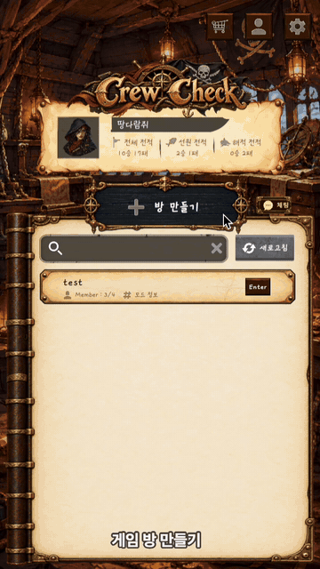
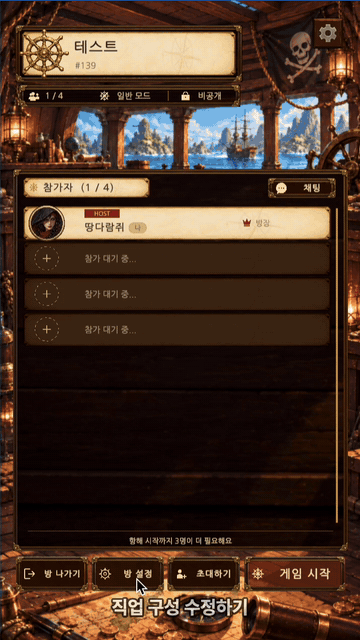
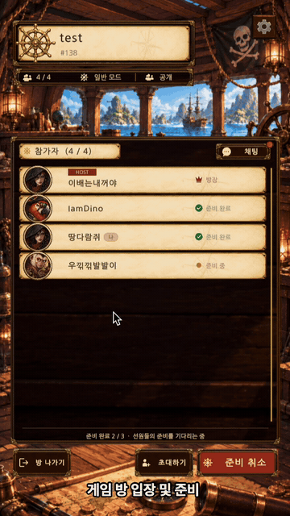
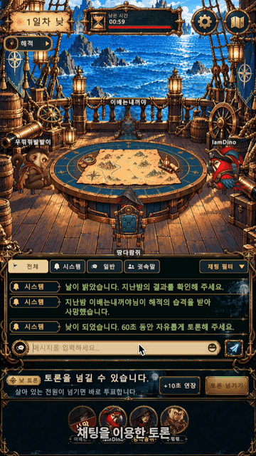

# CrewCheck Client

> 항해 중인 이 배 안에, 해적이 숨어 있습니다.
>
> 해적과 선원이 한 배를 타고 채팅으로 속고 속이는 **실시간 웹 마피아 게임 "CrewCheck"** 의 Unity 클라이언트입니다.
> 설치 없이 브라우저에서 링크 하나로 플레이할 수 있도록 **WebGL** 로 빌드해 itch.io에 배포합니다.

- 🎮 플레이 (WebGL, PC 크롬 권장): https://youjin-43.itch.io/crewcheck
- ▶️ 플레이 영상: https://youtube.com/shorts/5H5USoOzqMk · 기능 소개 영상: https://youtu.be/92MvCmUjpVk
- 🌐 API 서버: https://3-38-222-51.sslip.io
- 📄 개인정보처리방침 · 홈페이지: https://doronyong.github.io/CrewCheck/
- 🖥 서버 저장소: https://github.com/IamREALcitizen/project_server


</br>
## 목차

1. [게임 소개](#1-게임-소개)
2. [플레이 방법](#2-플레이-방법)
3. [핵심 기능과 주요 화면](#3-핵심-기능과-주요-화면)
4. [기술 구성](#4-기술-구성)
5. [프로젝트 구조](#5-프로젝트-구조)
6. [실행 방법 및 개발 환경](#6-실행-방법-및-개발-환경)
7. [ERD 및 API 명세](#7-erd-및-api-명세)
8. [핵심 사용자 시나리오와 검증 결과](#8-핵심-사용자-시나리오와-검증-결과)
9. [기술적 의사결정](#9-기술적-의사결정)
10. [트러블슈팅](#10-트러블슈팅)
11. [알려진 한계](#11-알려진-한계)
12. [팀원별 역할 분담](#12-팀원별-역할-분담)

---
</br>
## 1. 게임 소개

배 위에서 펼쳐지는 채팅 기반 **온라인 마피아 게임(소셜 추리 게임)** 입니다.

1. 4~12명의 플레이어가 한 배에 올라 각자 비밀 직업을 받습니다.
2. 밤이 되면 해적은 몰래 선원을 습격하고, 선원들은 각자의 능력으로 단서를 모읍니다.
3. 날이 밝으면 모두 모여 토론하고, 투표로 해적이라고 의심되는 사람을 바다에 던집니다.

- 직업 대사는 팀원이 직접 녹음했고, 밤 결과와 처형은 컷씬으로 보여 줍니다.
- 구조의 핵심: **서버가 판정하고, 클라이언트는 보여주기만 합니다.** Unity는 투표나 능력을 서버에 요청하고, 서버가 내려주는 상태를 그립니다.

</br>
### 진영과 직업 (3개 진영, 14개 직업)

| 진영 | 직업 | 능력 |
| --- | --- | --- |
| 🏴‍☠️ 해적 | 해적 | 밤에 1명 습격 |
| | 요리사 | 밤에 1명의 다음 투표를 금지 (같은 대상 연속 불가) |
| | 앵무새 | 다른 사람의 행동을 엿봄. 해적과 접선하면 활동 해적이 됨 |
| ⚓ 선원 | 선장 | 1명의 진영 조사 |
| | 선의 | 1명 보호 |
| | 망루지기 | 대상을 찾아온 방문자 감시 |
| | 갑판장 | 대상의 능력 차단 |
| | 주정뱅이 | 시체의 직업 확인 |
| | 원숭이 | 다른 직업으로 위장. 흔적은 남지만 효과는 없고 가짜 결과를 받음 |
| | 선원 | 능력 없음 |
| 🌀 중립 | 세이렌 | 유혹해 세이렌 팀으로 끌어들임 (성공한 다음 밤은 쉼) |
| | 크라켄 | 표식을 남기고, 발동하면 표식된 사람 모두 처치 |
| | 유령 선장 | 밤에 죽지 않음 |
| | 인어 | 처형되면 단독 승리 |

**승리 조건**: 선원은 해적을 모두 찾아내고, 해적은 선원을 모두 제거하며, 중립은 각자의 목표를 달성하면 이깁니다. 판정 순서는 [서버 README](https://github.com/IamREALcitizen/project_server#승리-조건)에 있습니다.

</br>
## 2. 플레이 방법

1. **접속**: [itch.io 링크](https://youjin-43.itch.io/crewcheck)를 PC 크롬에서 엽니다. 설치는 필요 없습니다.
2. **로그인**: 게스트로 바로 시작하거나, 구글·카카오 또는 아이디/비밀번호로 로그인합니다. 게스트 계정은 나중에 소셜 계정과 연동할 수 있습니다.
3. **방 만들기 / 입장**: 로비에서 방을 만들거나 목록·제목 검색으로 방을 찾아 들어갑니다. 비밀방은 숫자 4자리 이상 비밀번호가 필요합니다.
4. **대기실**: 방장은 인원·공개 여부·직업 구성(추천 / 커스텀 / 랜덤)을 정합니다. 4명 이상이 모이고 **모든 플레이어가 준비**하면 방장이 게임을 시작합니다.
5. **게임 진행**: `밤 → 밤 결과 공개 → 낮 토론 → 투표 → 처형` 을 승리 조건이 충족될 때까지 반복합니다.
   - **밤**: 능력이 있는 직업은 원탁의 캐릭터를 눌러 대상을 고릅니다. 해적끼리는 밤 채팅으로 상의합니다.
   - **낮**: 전체 채팅으로 토론합니다. 토론 넘기기, 토론 시간 +10초 연장(낮마다 1인 1회)을 쓸 수 있습니다.
   - **투표**: 바다에 던질 사람을 고르거나 기권합니다.
   - 죽은 사람은 유령 채팅으로 계속 대화할 수 있습니다.
6. **종료**: 결과 화면을 본 뒤 모두 대기실로 돌아갑니다. 전적은 프로필에서 확인할 수 있습니다.

</br>
## 3. 핵심 기능과 주요 화면

| 영역 | 내용 |
| --- | --- |
| 로그인·계정 | 게스트, 아이디 가입, 구글·카카오 소셜 로그인(웹 팝업), 게스트 → 소셜 계정 연동, 토큰 자동 갱신, 중복 로그인 시 강제 퇴장 안내 |
| 프로필·친구 | 닉네임·프로필 이미지(직업 초상화 21종, 인게임 아바타와 연결), 친구 요청·삭제, 친구 접속 상태, 친구 전적 조회 |
| 로비·대기실 | 방 만들기·검색, 비밀방, 준비, 방장 위임·추방, 방 설정 변경, 직업 구성 편집("해적 항해일지"), 새 채팅 레드닷 |
| 인게임 | 원탁에 둘러앉은 캐릭터, 밤 능력 선택, 밤 결과·조사 결과 연출, 낮 토론(넘기기 / +10초 연장), 투표·기권, 처형 컷씬, 결과 화면, 대기실 자동 복귀 |
| 채팅 | 전체 / 해적 / 유령 / 세이렌 채팅, 채팅 탭·필터(일반·시스템·특정 유저), 서버 욕설 필터·도배 방지 안내 |
| 사운드·설정 | BGM, 효과음, 직업별 고유 대사(직접 녹음), 모든 씬에서 볼륨·해상도 설정 |
| 실시간 | WebSocket "변경 신호" 수신 → REST 재조회, 연결이 끊기면 폴링으로 전환 후 지수 백오프로 자동 재연결 |


</br>
### 주요 화면

#### 계정·소셜

| 게스트·소셜 로그인 | 회원가입·계정 로그인 | 친구 목록 |
| :---: | :---: | :---: |
|  |  |  |

#### 로비·대기실

| 방 만들기 | 직업 구성 수정 | 방 입장·준비 |
| :---: | :---: | :---: |
|  |  |  |

#### 게임 진행

| 직업 능력 사용 | 밤 결과 공개·낮 토론 | 투표하기 |
| :---: | :---: | :---: |
|  |  |  |

| 투표 결과·처형 | 게임 결과 | 대기실 복귀 |
| :---: | :---: | :---: |
|  |  |  |

</br>
#### 채팅

| 대기실 채팅 | 채팅으로 토론 |
| :---: | :---: |
|  |  |

</br>
## 4. 기술 구성

| 항목 | 내용 |
| --- | --- |
| 엔진 | **Unity 6000.3.11f1** (`ProjectSettings/ProjectVersion.txt`), C# |
| 렌더 파이프라인 | URP 17.3 |
| 입력 | Input System 1.19 |
| UI | uGUI, TextMesh Pro, DOTween(`Assets/Plugins/Demigiant`) |
| 웹 입력 | [WebGLInput](https://github.com/kou-yeung/WebGLInput) (한글 조합 입력용, UPM Git 패키지) + 자체 jslib(`ImeEnterFix.jslib`) |
| 통신 | REST(UnityWebRequest) + WebSocket (WebGL은 브라우저 WebSocket을 jslib으로 연결) |
| 테스트 | Unity Test Framework / NUnit (EditMode) |
| AI 도구 | Claude, Unity MCP(MCPForUnity), ChatGPT(처형 연출 캐릭터 이미지 20종) |
| 배포 | WebGL 빌드 → itch.io |

REST는 조회·행동, WebSocket은 "상태가 바뀌었다"는 신호만 받는 구조입니다. 신호를 받으면 REST로 다시 조회합니다. 브라우저에서는 Unity 기본 WebSocket을 쓸 수 없어서 송수신(transport) 부분만 웹용(`BrowserWebSocketTransport`, `RealtimeWebSocket.jslib`)으로 분리했습니다.

</br>
## 5. 프로젝트 구조

```text
Assets/
├── 01_Scenes/        씬
├── 02_Scripts/
│   ├── Auth/         로그인·회원가입·게스트·소셜 로그인(SocialAuthConfig, WebGLSocialAuthProvider)
│   ├── Network/      REST 클라이언트(ApiClient), ApiConfig, 토큰 갱신
│   │   └── Realtime/ WebSocket 신호 처리·재연결·폴링 전환 (Realtime.Core.asmdef)
│   ├── Title/ Lobby/ Room/   타이틀·로비·대기실 화면
│   ├── Game/         게임 진행 컨트롤러, 화면(Screen), Core(규칙·DTO, Game.Core.asmdef)
│   ├── GameUI/ Vote/ Chat/ Friend/ Profile/ Common/(오디오·씬 전환·표시 설정)
├── 03_Prefabs/ 04_UI/ 05_Audio/ 06_Data/ 07_Animations/ 08_Materials/ 09_Image/ 10_Shaders/
├── Plugins/WebGL/    RealtimeWebSocket.jslib, SocialAuthWeb.jslib, ImeEnterFix.jslib
├── Editor/           씬·UI 세팅 에디터 도구
└── 99_Test/          테스트용 씬 (GameTest, LobbyTest, RoomTest)
Docs/                 UI·연출·사운드 작업 문서, README 이미지(Docs/images)
Tools/                화면 점검 스크립트
```

### 씬 구성

Build Settings에 포함된 씬 (`ProjectSettings/EditorBuildSettings.asset` 기준):

| 순서 | 씬 | 역할 |
| --- | --- | --- |
| 0 | `Title` | 타이틀·로그인 |
| 1 | `Lobby` | 로비 (방 목록, 친구, 프로필) |
| 2 | `GameScene` (비활성) | 이전 게임 씬 |
| 3 | `GameScene3` | 인게임 |
| 4 | `Room` | 대기실 |

`AuthTestScene`, `LobbyTestScene`, `Title_test`, `Vote_test`, `GameScene2/4` 등은 개발·실험용입니다.

## 6. 실행 방법 및 개발 환경

### 개발 환경

| 항목 | 버전 |
| --- | --- |
| Unity | 6000.3.11f1 (WebGL Build Support 모듈 포함) |
| Git | UPM Git 패키지(WebGLInput) 설치에 필요 |
| 브라우저 | 크롬 (WebGL 실행·테스트) |
| 서버(로컬 테스트 시) | JDK 21, Docker — [서버 README](https://github.com/IamREALcitizen/project_server) 참고 |

### 시작하기

1. **Unity Hub** 에서 **Unity 6000.3.11f1** (WebGL Build Support 모듈 포함)을 설치합니다.
2. 이 저장소를 clone한 뒤 Unity Hub에서 `project_client` 폴더를 프로젝트로 추가해 엽니다. 처음 열 때 UPM 패키지(WebGLInput 등)를 Git에서 내려받습니다.
3. `Assets/01_Scenes/Title.unity` 를 열고 Play 하면 기본적으로 **배포 서버**에 접속합니다.

### 서버 주소 설정

서버 주소는 `Assets/02_Scripts/Network/ApiConfig.cs` 의 `ApiConfig.DefaultBaseUrl` 에 모여 있습니다.

```csharp
public const string DefaultBaseUrl = "https://3-38-222-51.sslip.io";
public static string BaseUrl = DefaultBaseUrl;   // 모든 API 호출이 이 값을 사용
```
</br>

### 소셜 로그인 설정

웹(WebGL)에서는 구글·카카오 로그인 팝업에서 **인가 코드**를 받아 서버(`/api/members/login/{google,kakao}/code`)에 보내고, 서버가 토큰으로 교환합니다. 설정은 `Assets/02_Scripts/Auth/SocialAuthConfig.cs` 에 있습니다.

| 항목 | 설명 |
| --- | --- |
| `GoogleWebClientId` | 구글 "웹 애플리케이션" OAuth 클라이언트 ID. 서버의 `GOOGLE_CLIENT_ID` 와 같은 값. Google Cloud Console의 "승인된 JavaScript 원본"에 게임 도메인(로컬은 `http://localhost:8000`)을 등록해야 함 |
| `KakaoRestApiKey` | 카카오 REST API 키. 서버의 `KAKAO_REST_API_KEY` 와 같은 앱의 키 |
| `KakaoCallbackPath` | `/kakao-callback.html` — **서버**가 서비스하는 콜백 페이지. `ApiConfig.BaseUrl + 경로` 가 카카오 콘솔 Redirect URI와 서버 `KAKAO_ALLOWED_REDIRECT_URIS` 에 똑같이 등록되어 있어야 함 |

- 위 값은 브라우저에도 드러나는 **공개 값**이라 클라이언트에 둬도 됩니다. **클라이언트 시크릿은 절대 클라이언트에 넣지 마세요.**
- 코드 흐름: `WebGLSocialAuthProvider` ↔ `Plugins/WebGL/SocialAuthWeb.jslib`. 에디터에서는 `MockSocialAuthProvider` 가 쓰입니다.

</br>
## 7. ERD 및 API 명세

클라이언트는 DB를 직접 다루지 않고 서버 REST API와 WebSocket만 사용합니다. ERD와 API 명세는 서버 저장소에 있습니다.

- **ERD**: [서버 README — ERD](https://github.com/IamREALcitizen/project_server#6-erd)
- **API 명세**: [서버 README — API 명세](https://github.com/IamREALcitizen/project_server#7-api-명세), Postman 컬렉션 `postman/mafia-game.postman_collection.json`
- **WebSocket 프로토콜**: 서버 저장소 `Claude outputs/websocket-protocol.md`
- 클라이언트 쪽 API 호출은 `Assets/02_Scripts/Network/ApiClient` 와 `Game/Core` 의 `IGameApi` 에 모여 있고, 응답 JSON 형식은 `GameDtoParseTests` 로 고정해 두었습니다.

## 8. 핵심 사용자 시나리오와 검증 결과

| # | 시나리오 | 클라이언트에서 보장하는 것 | 검증 |
| --- | --- | --- | --- |
| 1 | 게스트로 들어와 구글·카카오로 연동한다 | 웹 팝업 → 인가 코드 → 서버 교환, 토큰 자동 갱신 | 배포 빌드에서 플레이 테스트 (GIF 01·02) |
| 2 | 방장이 직업 구성을 편집하고 게임을 시작한다 | 서버와 같은 규칙(`RoleSetupRules`)으로 버튼을 누르기 전에 바로 알려 줌. 최종 판정은 서버 | `RoleSetupRulesTests` |
| 3 | 밤에 능력을 쓴다 | 직업·페이즈별로 고를 수 있는 대상만 활성화 | `AbilityRulesTests`, `NightRoomRulesTests` |
| 4 | 남은 시간이 모든 사람에게 똑같이 보인다 | 기기 시계와 상관없이 서버 기준으로 카운트다운, 오래된 응답 무시 | `PhaseClockTests`, `PhaseTrackerTests` |
| 5 | 투표 결과와 처형 대상을 본다 | 서버 득표 리스트를 파싱해 연출 | `GameDtoParseTests`, `GameApiTests` |
| 6 | 서버 없이도 게임 흐름이 이어진다 | `FakeGameApi` 로 페이즈 전환·폴링 검증 | `GameSessionTests`, `GameSessionPollingTests`, `FakeGameApiTests` |
| 7 | WebSocket이 끊겨도 게임이 멈추지 않는다 | 끊기면 폴링 전환, 지수 백오프 + 지터로 재연결, 신호 중복·순서 필터 | `ReconnectBackoffTests`, `RealtimePollingTests`, `RealtimeFailurePolicyTests`, `RealtimeSignalFilterTests` |
| 8 | 브라우저(WebGL)에서도 실시간 신호를 받는다 | 브라우저 WebSocket 전송층 분리 | `BrowserWebSocketTransportTests`, `RealtimeTransportInboxTests`, `RealtimeProtocolTests` |
| 9 | 맥에서도 한글 채팅이 Enter 한 번에 전송된다 | macOS IME 조합 중 Enter 보정 | WebGL 빌드에서 macOS·Windows 크롬 수동 확인 |
| 10 | itch.io에서 바로 실행된다 | 업로드 제한 안의 빌드 용량 | 압축 빌드 470MB → **130MB** ([트러블슈팅 1](#1-webgl-빌드-용량-최적화)) |

- EditMode 테스트 클래스 21개 (`Game.Core.Tests`, `Realtime.Core.Tests`)
- UI·연출은 플레이 테스트와 버전별 WebGL 빌드로 검증했습니다.

## 9. 기술적 의사결정

### 1. WebSocket은 "신호"만 받고 REST로 다시 조회한다

- 처음에는 GET 폴링만 써서, 12인 게임에서 변화가 없어도 약 18 req/s가 계속 나갔습니다.
- 전체 상태나 변경분을 소켓으로 받으면 플레이어별 가리기 규칙을 소켓 경로에도 구현해야 하고, 메시지를 놓치면 화면이 어긋납니다.
- 그래서 `game.changed` / `room.changed` / `chat.changed` 신호만 받고, 받으면 기존 REST GET으로 조회합니다. 연결 중에도 15초 안전망 폴링을 유지하고, 끊기면 1초/2초 폴링으로 돌아갑니다.
- 결과: 변화가 없을 때 요청이 약 18 → 1.6 req/s 로 줄어듭니다(폴링 간격으로 계산한 값).

### 2. WebGL용 전송층 분리 (`IRealtimeTransport`)

- WebGL에서는 `System.Net.WebSockets.ClientWebSocket` 을 쓸 수 없습니다.
- 송수신만 `IRealtimeTransport` 로 분리해, WebGL은 브라우저 WebSocket(`RealtimeWebSocket.jslib`), 그 밖의 플랫폼은 `ClientWebSocket` 을 씁니다. 신호 해석·재연결·폴링 전환 로직은 공통입니다.

### 3. Unity 의존성이 없는 Game.Core

- 게임 세션·페이즈 추적·남은 시간·능력 선택 규칙을 순수 C# 어셈블리(`Game.Core.asmdef`)에 두었습니다.
- 서버 API와 시간을 주입받게 해서 `FakeGameApi` 와 테스트용 시계로 서버 없이 흐름을 검증합니다.
- UI는 코어가 주는 상태를 그리고 입력을 전달만 합니다. 덕분에 레이아웃과 컷씬을 여러 번 바꾸면서도 게임 규칙은 그대로 유지할 수 있었습니다.

### 4. 판정은 서버, 클라이언트는 표시만

- 능력·투표 결과를 클라이언트가 확정하지 않습니다. 직업 구성 규칙처럼 클라이언트에도 있는 검사(`RoleSetupRules`)는 "누르기 전에 알려 주기" 용도이고, 최종 판정은 서버가 합니다.

### 5. WebGL 배포 방식

- itch.io는 HTTPS만 허용해 서버를 EC2 nginx로 HTTPS/WSS 제공합니다.
- 압축은 Brotli 대신 **Gzip + Decompression Fallback** 을 써서 서버 헤더 설정 없이도 열리게 했고, 탭을 바꿔도 ping이 끊기지 않도록 **Run In Background** 를 켰습니다.

</br>

## 10. 트러블슈팅

### 1. WebGL 빌드 용량 최적화

- **문제**: itch.io는 압축을 푼 기준 500MB 제한이 있는데 빌드가 이를 넘었습니다.
- **원인**
  - 텍스처가 빌드의 약 93%를 차지했습니다.
  - UI 팩의 `Resources` 폴더(약 260MB)가 통째로 빌드에 들어갔습니다.
  - 압축이 꺼진 텍스처와 Max Size 4096 이상인 텍스처가 있었습니다.
  - 116개 이미지가 4의 배수 크기가 아니라 압축되지 않고 RGBA32로 들어갔습니다.
- **해결**
  - 실제로 쓰는 스프라이트 19개만 옮기고 `Resources` 폴더 이름을 바꿨습니다.
  - 텍스처를 압축하고 Max Size를 1024~2048로 낮췄습니다.
  - 쓰지 않는 씬을 빼고, 1~3px 패딩으로 크기를 4의 배수로 맞췄습니다.
- **결과 (압축 빌드)**: 470MB → 447 → 355 → 353 → 349 → **130MB** (약 72% 감소)

</br>

## 11. 알려진 한계

- 모바일 브라우저는 검증하지 못했습니다. PC 크롬을 권장합니다.
- 브라우저 탭을 오래 숨기면 ping이 끊겨 탈락할 수 있습니다.
- 직업 튜토리얼이 없습니다.
- 이미지·사운드 지연 로딩은 개선 과제입니다.

</br>

## 12. 팀원별 역할 분담

6조 "저진짜 시민이조" (내일배움캠프 단기심화 9기 최종 프로젝트)

5명 전원이 서버와 클라이언트를 함께 맡아, 기능 단위로 서버 API부터 Unity 화면까지 끝까지 책임졌습니다.

| 이름 | 포지션 | 담당 | GitHub |
| --- | --- | --- | --- |
| 박재영 (팀장) | Server / Client (채팅) | 로비·룸·게임 채팅, 채팅 탭·필터, 시스템 공지 UI, 게임 종료 시 메시지 정리, 욕설 필터·도배 방지, WebGL 한글 채팅 버그 수정, 낮 토론 넘기기, 투표 기권·결정 로직, 레드닷·입력바 공용 프리팹 | [kimdandy](https://github.com/kimdandy) |
| 정원우 | Server / Realtime | 게임 상태·잠금·타이머·접속 기록 Redis 외부화, Redisson 분산 잠금, WebSocket 신호 서버(`/ws/v1`)·Unity RealtimeClient, WebGL 브라우저 WebSocket 전송층 | [klik075](https://github.com/klik075) |
| 정지용 | Server / Client (게임 진행) | 직업 능력, 신규 직업 5종(요리사·세이렌·크라켄·유령 선장·인어), 직업 배정(추천·커스텀·랜덤), 게임씬 레이아웃, 투표·처형 컷씬, 밤 결과 연출, 토론 시간 연장, 프로필 외형 반영, 로비·룸 레이아웃 | [ST0PDragon](https://github.com/ST0PDragon) |
| 장현교 | Server / Client (인증·소셜) | 회원가입·로그인, JWT·Refresh Token, 중복 로그인 강제 퇴장, 게스트·구글·카카오 로그인 및 연동, 프로필·친구, WebSocket 기반 접속 상태(Presence), 타이틀 씬 UI | [DoroNyong](https://github.com/DoroNyong) |
| 김유진 | Server / Client (로비·룸·사운드) | 방 생성·참가, 비밀방, 제목 검색, 준비, 방장 위임·추방, 방 설정 변경, 대기실 접속 기록, 사운드 시스템(BGM·효과음·직업별 대사), 볼륨·해상도 설정, WebGL 빌드 설정·용량 최적화 | [youjin-43](https://github.com/youjin-43) |
