# CrewCheck Server

> 항해 중인 이 배 안에, 해적이 숨어 있습니다.
>
> 해적과 선원이 한 배를 타고 채팅으로 속고 속이는 **실시간 웹 마피아 게임 "CrewCheck"** 의 서버입니다.
> **서버가 판정하고, 클라이언트는 보여주기만 합니다.** 밤·낮·투표 전환, 능력 판정, 승패 판정, "누가 무엇을 볼 수 있는지"는 모두 이 서버가 결정합니다.

- 🎮 플레이 (WebGL, 크롬 권장): https://youjin-43.itch.io/crewcheck
- ▶️ 플레이 영상: https://youtube.com/shorts/5H5USoOzqMk · 기능 소개 영상: https://youtu.be/92MvCmUjpVk
- 🌐 API 서버: https://3-38-222-51.sslip.io
- 📄 개인정보처리방침 · 홈페이지: https://doronyong.github.io/CrewCheck/
- 🖥 클라이언트 저장소: https://github.com/IamREALcitizen/project_client


## 목차

1. [게임 소개](#1-게임-소개)
2. [플레이 방법](#2-플레이-방법)
3. [핵심 기능과 주요 화면](#3-핵심-기능과-주요-화면)
4. [기술 스택](#4-기술-스택)
5. [시스템 구조](#5-시스템-구조)
6. [ERD](#6-erd)
7. [API 명세](#7-api-명세)
8. [실행 방법 및 개발 환경](#8-실행-방법-및-개발-환경)
9. [핵심 사용자 시나리오와 검증 결과](#9-핵심-사용자-시나리오와-검증-결과)
10. [기술적 의사결정](#10-기술적-의사결정)
11. [트러블슈팅](#11-트러블슈팅)
12. [팀원별 역할 분담](#12-팀원별-역할-분담)
13. [문서](#13-문서)

---

## 1. 게임 소개

배 위에서 펼쳐지는 채팅 기반 **온라인 마피아 게임(소셜 추리 게임)** 입니다.

1. 4~12명의 플레이어가 한 배에 올라 각자 비밀 직업을 받습니다.
2. 밤이 되면 해적은 몰래 선원을 습격하고, 선원들은 각자의 능력으로 단서를 모읍니다.
3. 날이 밝으면 모두 모여 토론하고, 투표로 해적이라고 의심되는 사람을 처형합니다.

### 진영과 직업 (3개 진영, 14개 직업)

| 진영 | 직업 | 능력 |
| --- | --- | --- |
| 🏴‍☠️ 해적 | 해적 | 밤에 1명 습격 |
| | 요리사 | 밤에 1명의 다음 투표를 금지 (같은 대상 연속 불가) |
| | 앵무새 | 다른 사람의 행동을 엿봄. 해적과 접선하면 활동 해적이 됨 |
| ⚓ 선원 | 선장 | 1명의 진영 조사 |
| | 선의 | 1명 보호 |
| | 망루지기 | 대상을 찾아온 방문자 감시 |
| | 갑판장 | 대상의 능력 차단 |
| | 주정뱅이 | 시체의 직업 확인 |
| | 원숭이 | 다른 직업으로 위장. 흔적은 남지만 효과는 없고 가짜 결과를 받음 |
| | 선원 | 능력 없음 |
| 🌀 중립 | 세이렌 | 유혹해 세이렌 팀으로 끌어들임 (성공한 다음 밤은 쉼) |
| | 크라켄 | 표식을 남기고, 발동하면 표식된 사람 모두 처치 |
| | 유령 선장 | 밤에 죽지 않음 |
| | 인어 | 처형되면 단독 승리 |

### 승리 조건

선원은 해적을 모두 찾아내고, 해적은 선원을 모두 제거하며, 중립은 각자의 목표를 달성하면 이깁니다.
누군가 죽을 때마다(밤 결과 직후, 처형 직후, 연결 끊김 사망 직후) 아래 순서로 검사하고, **여러 조건이 동시에 맞으면 위의 조건이 이깁니다.** 머릿수는 모두 생존자 기준입니다.

| 순서 | 승리 | 조건 |
| --- | --- | --- |
| 1 | 🧜 인어 | 인어가 처형됨 |
| 2 | 🦑 크라켄 | 크라켄이 살아 있고, (생존자 − 활동 해적) ≤ 2 |
| 3 | 🎶 세이렌 팀 | 세이렌 생존 시: 활동 해적 0명이고 세이렌 팀 ≥ 선원, 또는 선원 0명이고 세이렌 팀 > 활동 해적 / 세이렌 사망 시: 해적·선원 전멸 후 세이렌 팀이 남음 |
| 4 | 👻 유령 선장 | 유령 선장이 살아 있고, 사망자 > 생존자 |
| 5 | ⚓ 선원 팀 | 활동 해적 0명, 크라켄 전멸, 그리고 세이렌이 죽었거나 선원 > 세이렌 팀 |
| 6 | 🏴‍☠️ 해적 팀 | 활동 해적 1명 이상이고, 살아 있는 해적 진영 ≥ 나머지 생존자 |

> 활동 해적 = 해적, 요리사, 접선한 앵무새. 판정은 `WinConditionChecker` 에 있습니다.

## 2. 플레이 방법

1. **접속**: [itch.io 링크](https://youjin-43.itch.io/crewcheck)를 크롬에서 엽니다. 설치는 필요 없습니다.
2. **로그인**: 게스트로 바로 시작하거나, 구글·카카오 또는 아이디/비밀번호로 로그인합니다. 게스트 계정은 나중에 소셜 계정과 연동할 수 있습니다.
3. **방 만들기 / 입장**: 로비에서 방을 만들거나 목록·제목 검색으로 방을 찾아 들어갑니다. 비밀방은 숫자 4자리 이상 비밀번호가 필요합니다.
4. **대기실**: 방장은 인원·공개 여부·직업 구성(추천 / 커스텀 / 랜덤)을 정합니다. 4명 이상이 모이고 **모든 플레이어가 준비**하면 방장이 게임을 시작합니다.
5. **게임 진행**: `밤 → 밤 결과 공개 → 낮 토론 → 투표 → 처형` 을 승리 조건이 충족될 때까지 반복합니다.
   - **밤**: 능력이 있는 직업은 대상을 고릅니다. 해적끼리는 밤 채팅으로 상의합니다.
   - **낮**: 전체 채팅으로 토론합니다. 토론 넘기기, 토론 시간 +10초 연장(낮마다 1인 1회)을 쓸 수 있습니다.
   - **투표**: 처형할 사람을 고르거나 기권합니다. 최다 득표자가 처형됩니다.
   - 죽은 사람은 유령 채팅으로 계속 대화할 수 있습니다.
   - 전원이 제출하면 타이머를 기다리지 않고 바로 다음 단계로 넘어갑니다.
6. **종료**: 승패가 결정되면 결과 화면이 나오고, 전적이 저장된 뒤 모두 대기실로 돌아갑니다.

## 3. 핵심 기능과 주요 화면

| 영역 | 내용 |
| --- | --- |
| 회원·인증 | 게스트 / 아이디 가입 / 구글·카카오 소셜 로그인, 게스트 → 소셜 계정 연동, JWT Access + Refresh Token(7일) 자동 갱신, 중복 로그인 시 기존 접속 강제 퇴장 |
| 프로필·친구 | 닉네임·프로필 이미지(직업 초상화 21종, 인게임 아바타와 연결) 변경, 친구 요청·수락·삭제, 친구 접속 상태(온라인·대기실·게임 중·오프라인), 친구 프로필·전적 조회 |
| 로비·대기실 | 방 생성·제목 검색, 비밀방, 준비, 방장 위임·추방, 방 설정 변경, 대기실 채팅, 연결 끊긴 참가자 정리 |
| 직업 구성 | 추천 / 커스텀 / 랜덤 3가지. 같은 검증 규칙을 **서버 시작·저장·게임 시작** 세 시점에 검사 |
| 게임 진행 | 14종 직업 능력, 고정 순서 밤 판정(`NightActionResolver`), 낮 토론 넘기기·연장, 투표·기권, 처형, 승패 판정, 전적 저장, 대기실 자동 복귀 |
| 끝나지 않는 게임 방지 | 10초 ping, 60초 무응답 시 사망 처리, 전원 이탈 시 게임 취소, 10일 동안 사망자가 없으면 취소 |
| 채팅 | 로비 / 방 / 해적 / 유령 / 세이렌 채팅. 볼 수 있는 사람은 서버가 결정. 욕설 필터(정규화 후 패턴 매칭), 도배 방지(경고 3회 → 10회 시 3분 채팅 금지) |
| 실시간 알림 | WebSocket `/ws/v1` 으로 "바뀌었다"는 **신호만** 보내고, 상태는 REST로 다시 조회 |
| 멀티서버 | 게임 상태·잠금·타이머·접속 기록·실시간 신호를 Redis로 외부화 (`SERVER_MODE=multi`) |
| 운영 | `/actuator/health`, graceful shutdown, 응답 헤더 `X-Server-Id` |

### 주요 화면

#### 계정·소셜

| 게스트·소셜 로그인 | 회원가입·계정 로그인 | 친구 목록 |
| :---: | :---: | :---: |
| 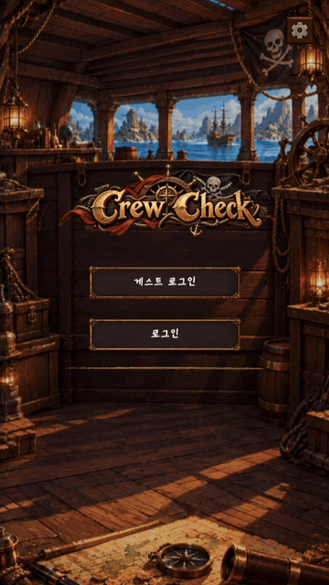 | 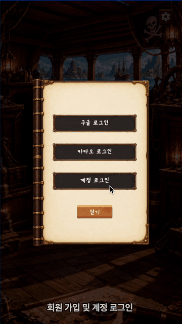 | 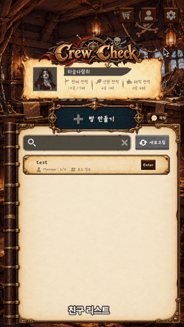 |

#### 로비·대기실

| 방 만들기 | 직업 구성 수정 | 방 입장·준비 |
| :---: | :---: | :---: |
|  |  | 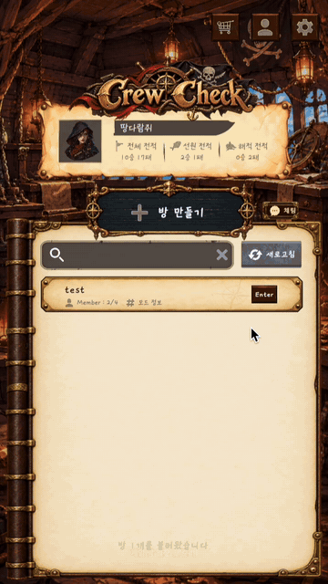 |

<!-- 📷 [사진 4] (선택) 직업 구성 편집 화면("해적 항해일지") image.png → docs/images/role-setup.png -->

#### 게임 진행

| 직업 능력 사용 | 밤 결과 공개·낮 토론 | 투표하기 |
| :---: | :---: | :---: |
| 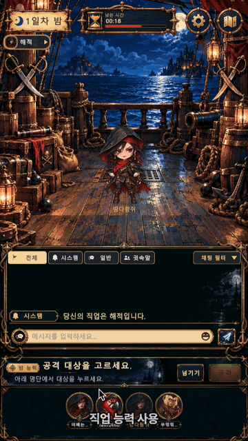 | 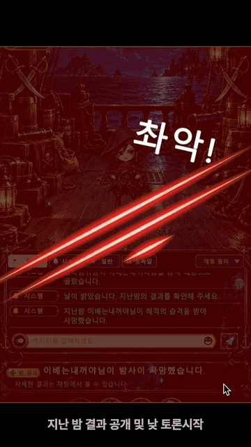 | 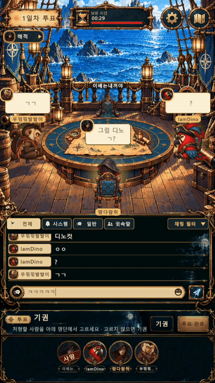 |

| 투표 결과·처형 | 게임 결과 | 대기실 복귀 |
| :---: | :---: | :---: |
| 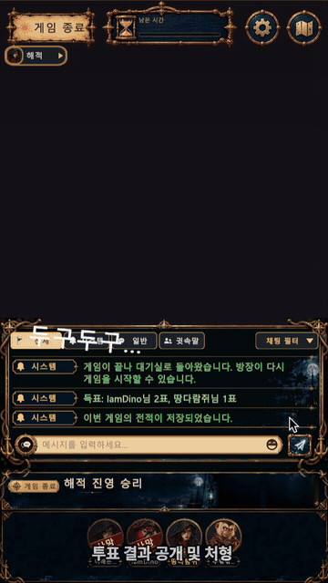 | 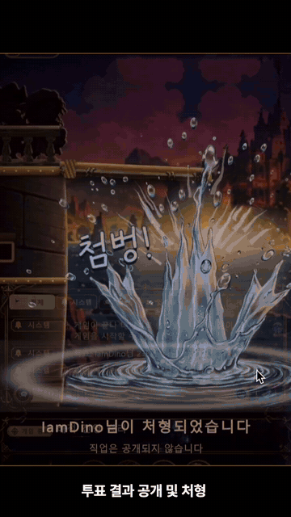 | 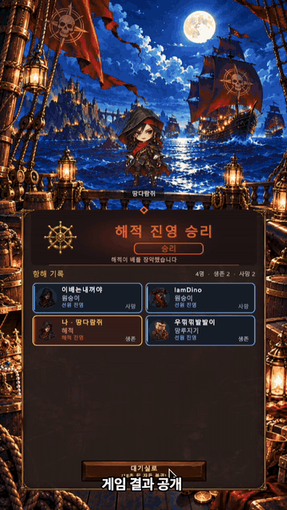 |

#### 채팅

| 대기실 채팅 | 채팅으로 토론 |
| :---: | :---: |
|  |  |

## 4. 기술 스택

| 구분 | 기술 | 선택 근거·목적 |
| --- | --- | --- |
| 서버 | Java 21, Spring Boot 4.1.1 | 인증·데이터 접근·스케줄링·실시간 연결을 한 서버에서 구성 |
| 인증 | Spring Security, JWT(jjwt 0.12), Google/Kakao OAuth | 요청자 식별·접근 제어, 소셜 로그인과 토큰 갱신 |
| 영속 데이터 | Spring Data JPA, MySQL 8.4 | 계정·프로필·친구·전적 등 관계형 데이터 |
| 스키마 관리 | Flyway | DB 변경 이력을 코드와 함께 관리 |
| 공유 데이터 | Redis 7 | 방·채팅·접속 데이터와 multi 모드 게임 상태를 서버 밖에서 공유 |
| 동시성 | Redisson 4.7.0 | 여러 서버가 같은 방·게임을 동시에 바꿀 때 분산 잠금 |
| 분산 타이머 | Redis ZSET, Lua, phaseVersion | 예약 작업의 원자적 획득, 오래된 타이머의 중복 진행 방지 |
| 실시간 통신 | WebSocket, REST, Redis Pub/Sub | 변경은 신호로, 상세 데이터는 권한을 검증하는 REST에서. 서버 간 알림 공유 |
| 테스트 | JUnit 5, H2, Testcontainers(Redis), k6 | 게임 규칙, Redis 통합 동작, JSON 계약, 부하 테스트 |
| 실행·배포 | AWS EC2, systemd, Docker Compose, Nginx, Certbot | 앱 실행·재시작, 의존 서비스 구성, HTTPS/WSS 입구 |
| 클라이언트 | Unity 6 (6000.3.11f1), C#, WebGL | [클라이언트 저장소](https://github.com/IamREALcitizen/project_client) |

## 5. 시스템 구조

<!-- 📷 [사진 7] Notion "3️⃣ 인프라 설계도"의 첫 번째 mermaid-diagram.png → docs/images/architecture.png -->
<!--  -->

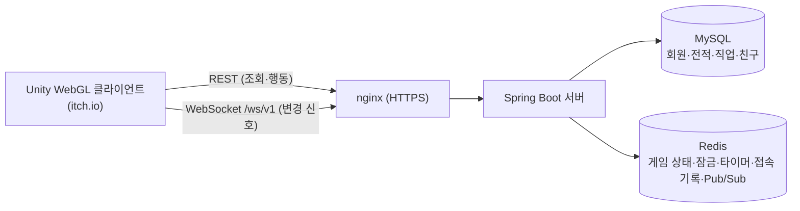

1. 사용자가 로그인하면 JWT를 발급받고 WebSocket에 연결합니다.
2. 방 생성·입장·준비를 거쳐 게임을 시작하면 서버가 직업을 배정합니다.
3. 사용자는 REST로 능력·투표·채팅을 제출합니다. 서버는 잠금 안에서 상태를 읽고 판정한 뒤 저장합니다.
4. 저장 후 잠금을 풀고 변경 신호를 보냅니다. 클라이언트는 REST로 **자신에게 허용된** 최신 정보를 조회합니다.
5. `multi` 모드에서는 Redis Pub/Sub으로 다른 서버에 접속한 사용자에게도 신호를 전달합니다.
6. 정상 종료 시 승패와 전적을 처리하고 대기실로 돌아갑니다. 취소된 게임은 전적에 반영하지 않습니다.


### 프로젝트 구조

패키지 루트: `src/main/java/com/WhoisntCitizen_server/`

```text
├── member/    회원가입·로그인·소셜 로그인·토큰
├── user/      유저 프로필·전적·닉네임·프로필 이미지
├── lobby/     방 생성/입장/설정, 대기실 접속 기록(presence), 방 잠금
├── game/      게임 상태·페이즈 타이머·저장소(memory/redis)·잠금·접속 기록·직업 구성
├── night/     밤 능력 사용·판정·결과
├── vote/      투표·처형
├── jobs/      직업 정의(RoleDefinition, ActionCode, Faction)
├── chat/      채팅(로비·방·해적·유령), 욕설 필터, 도배 방지
├── friend/    친구
├── realtime/  WebSocket(/ws/v1) 핸들러, Redis Pub/Sub 신호
├── common/    서버 모드(single/multi), 서버 ID, 예외 처리, Redis·분산 잠금 설정
└── global/    공통 설정·유틸
src/main/resources/
├── application*.properties   공통 / local(기본) / prod
├── db/migration/             Flyway 마이그레이션
├── profanity/                욕설·허용어 사전
└── static/kakao-callback.html
deploy/          운영 배포 (app.env.example, docker-compose.prod.yml, systemd, nginx)
postman/         Postman 컬렉션 (REST, WebSocket 점검)
loadtest/        k6 부하 테스트 스크립트·결과·트러블슈팅 기록
Claude outputs/  게임 진행·멀티서버·WebSocket 설계 문서
```

## 6. ERD

MySQL에는 오래 남아야 하는 데이터(회원·프로필·친구·직업 정의·전적)만 둡니다. 진행 중인 게임과 방, 채팅, 접속 기록은 Redis에 있습니다. 스키마 원본은 [`V1__create_tables.sql`](src/main/resources/db/migration/V1__create_tables.sql) 입니다.

<!-- 📷 [사진 9] (선택) dbdiagram.io 등으로 그린 ERD 이미지가 있다면 → docs/images/erd.png. 없으면 아래 mermaid로 충분합니다 -->

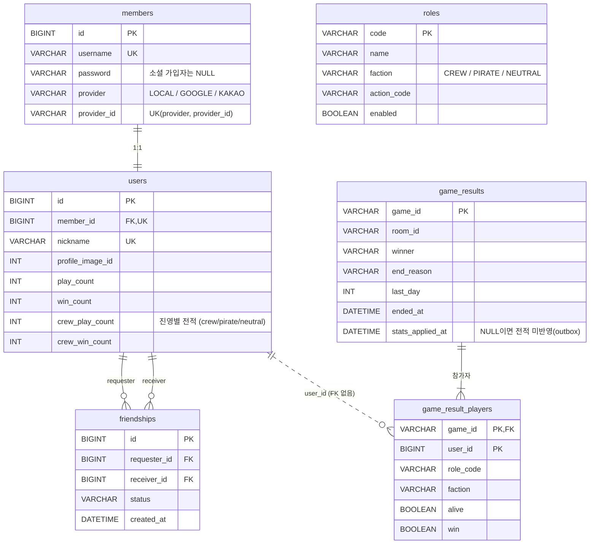

- `game_results` 는 게임이 끝나는 순간 게임 잠금 안에서 저장되고, `game_id` 가 기본 키라 같은 게임은 한 번만 들어갑니다. `stats_applied_at` 이 비어 있는 행을 `PendingGameStatsRelay` 가 찾아 전적에 **정확히 한 번** 반영합니다(outbox).
- `game_result_players.user_id` 는 탈퇴한 회원이 있어도 결과가 남도록 외래 키를 걸지 않았습니다.

## 7. API 명세

- REST API 매핑 54개(개발용 포함), WebSocket 채널 1개(`/ws/v1`)
- 인증이 필요한 API는 `Authorization: Bearer <JWT>` 를 사용합니다.
- **전체 요청·응답 예시**: [`postman/mafia-game.postman_collection.json`](postman/mafia-game.postman_collection.json) (Postman에서 Import)
- **WebSocket 점검**: [`postman/websocket-check.postman_collection.json`](postman/websocket-check.postman_collection.json), 프로토콜 문서 [`Claude outputs/websocket-protocol.md`](Claude%20outputs/websocket-protocol.md)

<!-- 📷 [사진 10] (선택) Postman 컬렉션 화면 캡처 → docs/images/postman.png -->

| 영역 | 경로 (요약) |
| --- | --- |
| 회원 | `POST /api/members/signup` · `login` · `guest` · `login/{google,kakao}` · `login/{google,kakao}/code` · `link/{google,kakao}` · `link/{google,kakao}/code` |
| 토큰 | `POST /api/auth/refresh` · `logout` |
| 유저 | `GET /api/users/me` · `/{userId}` · `/search`, `PATCH /api/users/me/nickname` · `me/profile-image` |
| 친구 | `GET /api/friends` · `/requests`, `POST /api/friends/request` · `/{id}/accept`, `DELETE /api/friends/{id}` |
| 방(로비) | `POST/GET /api/v1/rooms`, `GET /{roomId}`, `/players`(입장·조회·나가기·준비), `PUT /host` · `/settings` · `/role-setup`, `DELETE /players/{userId}`(추방), `POST /{roomId}/games`(게임 시작) |
| 직업 | `GET /api/v1/roles`, `GET /api/v1/role-setup/options` |
| 게임 | `GET /api/v1/games/{gameId}` · `/me` · `/result`, `POST /day/skip` · `/day/extend` |
| 밤 | `POST /api/v1/games/{gameId}/night-actions` · `/night-actions/skip`, `GET /night-result` |
| 투표 | `POST /api/v1/games/{gameId}/votes`, `GET /execution-result` |
| 채팅 | `GET/POST /api/v1/lobby/messages`, `GET/POST /api/v1/rooms/{roomId}/messages`, `POST /system-messages` |
| 실시간 | WebSocket `/ws/v1` (브라우저는 `?token=<JWT>`). 신호: `game.changed` / `room.changed` / `chat.changed`, ping 10초, 30초 무응답 시 `4408`, 토큰 만료 시 `4401` 로 종료 |
| 운영 | `GET /actuator/health` (liveness/readiness) |
| 개발용(`local` 전용) | `POST /api/v1/games`, `GET /api/v1/games/{id}/dev/roles` |

### 구글·카카오 로그인 구조

**웹(WebGL) — 인가 코드 방식**

```text
브라우저(게임) ──팝업──▶ 구글/카카오 로그인
        ◀── 인가 코드 (카카오는 서버가 서비스하는 /kakao-callback.html 로 돌아옴)
브라우저 ──POST /api/members/login/{google,kakao}/code ──▶ 서버
서버 ──코드를 토큰으로 교환 (client secret 사용)──▶ 구글/카카오
서버 ◀── 토큰 → 사용자 정보 확인 → 회원 생성/조회 → 서비스 JWT 발급
```

- 클라이언트 시크릿은 서버 환경변수에만 둡니다. 클라이언트에는 공개 값(구글 클라이언트 ID, 카카오 REST API 키)만 있습니다.
- 카카오 Redirect URI는 `KAKAO_ALLOWED_REDIRECT_URIS` 허용 목록에 있는 값만 받습니다.
- **모바일 — 토큰 방식**: 앱이 SDK로 받은 토큰을 `POST /api/members/login/{google,kakao}` 로 보내면 서버가 검증 후 JWT를 발급합니다.
- 소셜 가입 시 닉네임은 구글 `G숫자`, 카카오 `K숫자` 로 자동 생성됩니다.

## 8. 개발 환경

| 항목 | 버전 |
| --- | --- |
| JDK | 21 |
| Spring Boot | 4.1.1 (Gradle Wrapper 포함) |
| MySQL / Redis | 8.4 / 7 (Docker Compose로 실행) |
| Docker | Docker Desktop 또는 Docker Engine + Compose |
| 클라이언트 | Unity 6000.3.11f1 |
| 부하 테스트(선택) | k6 |

## 9. 핵심 사용자 시나리오와 검증 결과

### 시나리오별 검증

| # | 시나리오 | 서버에서 보장하는 것 | 검증 |
| --- | --- | --- | --- |
| 1 | 게스트로 들어와 나중에 구글·카카오로 연동한다 | 소셜 계정 연동, 중복 로그인 시 기존 접속 강제 퇴장 | `MemberOAuthLoginTest`, `MemberOAuthCodeLoginTest`, `SocialCodeExchangeTest`, `AuthServiceTest` |
| 2 | 토큰이 만료돼도 끊기지 않고 계속 플레이한다 | Refresh Token 1회용 교체, 동시 재발급 차단 | `AuthServiceTest`, 동시 20회 요청 시 성공 **1회** ([트러블슈팅 4](#4-같은-리프레시-토큰으로-여러-번-재발급됨)) |
| 3 | 방을 만들고 친구들이 들어와 준비 후 게임을 시작한다 | 방장 권한, 전원 준비, 직업 구성 검증(서버 시작·저장·게임 시작 3시점) | `RoleSetupControllerTest`, `RoleAssignerSetupTest`, `RoleAssignerCompositionTest`, `GameServiceRoleSetupTest` |
| 4 | 대기실에서 잠깐 네트워크가 흔들려도 쫓겨나지 않는다 | 대기실 접속 기록 기준 45초 | k6 200명·누락률 10%에서 억울한 퇴장 **15.5% → 2.0%** ([트러블슈팅 1](#1-대기실에서-멀쩡한-참가자가-로비로-튕기는-문제)) |
| 5 | 방이 많아도 로비 목록이 빠르게 뜬다 | 방 목록을 Redis `MGET` 1회로 조회 | `LobbyRoomRepositoryFindAllTest`, 방 1000개·동시 100명 p95 **1,485ms → 33ms** ([트러블슈팅 2](#2-방-목록-조회의-n1-redis-호출)) |
| 6 | 밤에 능력을 쓰고 아침에 결과를 본다 | 제출 순서와 상관없이 같은 결과(고정 순서 판정), 원숭이 위장 유지 | `NightActionResolverTest`, `NightBlockAndWatchTest`, `MonkeyTest`, `SirenTest`, `KrakenTest`, `CookTest`, `ParrotContactTest` |
| 7 | 낮에 토론하고 투표해 처형한다 | 토론 넘기기·연장, 기권, 득표 결과를 Unity가 읽을 수 있는 형식으로 | `DaySkipTest`, `DayExtendTest`, `VoteServiceExecutionResultTest`, `GameApiJsonContractTest` |
| 8 | 내 직업과 전용 채팅은 볼 사람만 본다 | 조회 API 한 곳에서 가리기, 전용 채팅 신호는 볼 수 있는 사람에게만 | `GameServiceStateTest`, `ChatGameLockTest`, `RealtimeChatListenerTest` |
| 9 | 누가 나가도 게임이 끝나지 않고 멈추지 않는다 | 60초 무응답 사망 처리, 전원 이탈 시 취소, 멈춘 게임 타이머 재예약 | `GameFlowServiceInactivePrecheckTest`, `GameFlowServiceEndlessGameTest`, `StuckGameWatchdogTest` |
| 10 | 게임이 끝나면 결과를 보고 전적이 쌓인 채 대기실로 돌아간다 | 전적을 게임당 정확히 한 번 반영(outbox) | `GameResultRecordingTest`, `GameStatsOutboxTest`, `WinConditionCheckerTest`, `NeutralWinConditionTest` |
| 11 | 서버가 여러 대여도 같은 게임을 본다 | 상태·잠금·타이머·신호 Redis 외부화, 잠금 순서 방 → 게임 | `DistributedLockMultiServerTest`, `RedisRealtimeNotifierMultiServerTest`, `RedisActivityMultiServerTest`, `LockOrderTest`, `RedisTimerGameFlowTest` |

<!-- 📷 [사진 11] (선택) ./gradlew test 결과 화면 또는 테스트 리포트(build/reports/tests/test/index.html) 캡처 → docs/images/test-report.png -->

### 부하 테스트 요약 (k6)

측정 환경은 노트북 한 대에서 서버·MySQL·Redis·k6를 함께 실행한 것이라, 절대 수치보다 **같은 환경에서의 전후 비교**에 의미가 있습니다.

| 항목 | 조건 | 개선 전 | 개선 후 |
| --- | --- | --- | --- |
| 대기실 억울한 퇴장 | 200명, 조회 누락률 10%, 5분 | 31/200 (15.5%) | **4/200 (2.0%)** |
| 방 목록 조회 p95 | 방 1000개, 동시 100명 | 1,485ms | **33ms** |
| 방 목록 처리량 | 위와 같음 | 34.7 req/s | **59.5 req/s** |
| 리프레시 토큰 동시 재발급 성공 | 같은 토큰 동시 20회 × 5회 | 6회 | **1회** |
| 친구 목록 조회 p95 | 친구 500명 유저, 최대 200명 동시 | 1,775ms (후속 과제) | - |

<!-- 📷 [사진 12] (선택) k6 결과 터미널 또는 Grafana 화면 캡처 → docs/images/loadtest.png -->

## 10. 기술적 의사결정

### 1. WebSocket은 "내용"이 아니라 "신호"만 보내고 폴링과 함께 쓴다

- **배경**: 처음에는 GET 폴링만 썼습니다. 12인 게임에서 변화가 없어도 약 18 req/s가 계속 나갔고, 변경은 폴링 간격만큼 늦게 반영됐습니다.
- **검토한 선택지**
  - 폴링 간격 단축: 요청 수가 그만큼 늘어 탈락.
  - WS로 전체 상태 전송: 플레이어별 가리기 규칙을 소켓 경로에도 따로 구현해야 하고, 메시지를 놓치면 화면이 어긋나 탈락.
  - WS로 변경분 전송: 순서·버전·재동기화 관리가 복잡해 탈락.
  - SSE: Unity 기본 클라이언트가 없어 탈락.
- **결정**
  - `/ws/v1` 으로 `game.changed` / `room.changed` / `chat.changed` 신호만 보냅니다. 신호에는 id와 `phaseVersion`·`lastMessageId` 만 담습니다.
  - 클라이언트는 신호를 받으면 기존 REST GET으로 조회합니다. 신호는 잠금을 푼 뒤(`GameLockScope.afterUnlock`) 한 번 발행합니다.
  - 연결 중에도 15초 안전망 폴링을 유지하고, 끊기면 1초/2초 폴링으로 돌아갑니다.
- **이유**: 화면 내용의 출처를 권한을 검증하는 REST 하나로 유지하기 위해서입니다. 턴제라 GET 왕복 1번은 체감되지 않습니다.
- **결과**: 12인 게임에서 변화가 없을 때 요청이 약 18 → 1.6 req/s 로 줄어듭니다(폴링 간격으로 계산한 값).

### 2. 서버 메모리 → Redis 외부화 (멀티 서버 대비)

- **배경**: 상태와 타이머가 메모리에만 있으면 서버가 꺼질 때 게임이 사라지고, 서버가 2대면 서로 다른 게임을 봅니다. `synchronized` 는 같은 JVM 안에서만 막습니다.
- **결정**
  - `GameRepository` / `GameLock` / `RoomLock` / `GameTimer` / `PlayerActivityTracker` 를 인터페이스로 나누고 구현만 Redis로 바꿨습니다. 서비스 코드는 거의 고치지 않았습니다.
  - 게임 상태는 JSON 스냅샷으로 저장하고, 저장과 목록 갱신은 `MULTI/EXEC` 로 묶습니다.
  - 잠금은 Redisson 분산 잠금을 쓰고, 교착을 막기 위해 순서를 **방 → 게임** 한 방향으로만 허용합니다.
  - 타이머는 Redis ZSET + Lua CLAIM(30초 lease)으로 어느 서버에서든 한 번만 실행합니다. 중복 실행은 `phaseVersion` 으로 무시합니다.
  - `StuckGameWatchdog` 이 30초마다 멈춘 게임의 타이머를 다시 예약합니다.
  - `SERVER_MODE` 로 메모리 구현과 Redis 구현을 바꿉니다.

### 3. 게임 판정 권한을 서버에 집중

- 클라이언트는 능력 사용이나 투표 결과를 확정하지 않습니다. 서버가 페이즈·대상·사용 가능 여부를 검증하고 결과와 승패를 계산합니다.
- 모든 플레이어에게 같은 규칙을 적용하고, 화면과 판정 로직을 분리하기 위해서입니다.
- 밤 능력은 도착 순서대로 처리하면 같은 선택에도 결과가 달라질 수 있어, 밤 동안 행동을 모았다가 끝날 때 `NightActionResolver` 가 정해진 순서로 계산합니다.

### 4. 끊김 판정은 WebSocket close가 아닌 활동 기록으로

- 탭 이동이나 일시적인 네트워크 끊김만으로 탈락하지 않도록, **GET·ping 기록이 60초 동안 없을 때만** 사망 처리합니다.

### 5. WebGL 배포 방식

- itch.io는 HTTPS만 허용해 HTTP 서버와 연결할 수 없었습니다. 그래서 EC2에 nginx + Let's Encrypt로 HTTPS/WSS 입구를 두었습니다.
- WebGL에서는 `ClientWebSocket` 을 쓸 수 없어, 클라이언트에서 `IRealtimeTransport` 로 분리하고 WebGL은 브라우저 WebSocket(jslib)을 씁니다. 서버는 브라우저를 위해 `?token=<JWT>` 쿼리 인증도 받습니다.

## 11. 트러블슈팅

### 1. 대기실에서 멀쩡한 참가자가 로비로 튕기는 문제

- **문제**: WebSocket을 도입한 뒤, 대기실에 가만히 있던 참가자가 갑자기 로비로 튕겼습니다.
- **원인**
  - 서버는 마지막 방 조회 후 30초가 지난 사람을 방에서 뺍니다.
  - WebSocket 도입으로 방 조회 주기가 1초 → 15초로 바뀌었는데 기준 시간은 그대로였습니다. 견딜 수 있는 조회 누락이 29번에서 1번으로 줄었습니다.
  - k6로 재현해 보니 서버 응답은 p95 14ms로 빨랐습니다. 원인은 성능이 아니라 **설계**였습니다.
- **해결**: 기준 시간을 45초로 늘렸습니다(15초 조회를 연속 2번 놓쳐도 버팀). WebSocket ping을 대기실 기록에 반영하는 근본 해결은 후속 과제입니다.
- **결과** (방 50개 × 4명, 조회 누락률 10%, 5분)

  | 기준 시간 | 억울한 퇴장 | 확률 계산 예상 |
  | --- | --- | --- |
  | 30초 | 31/200 (15.5%) | 약 17% |
  | **45초** | **4/200 (2.0%)** | 약 2% |

  누락률 5%, 600명 조건에서는 0~1명이었습니다.

### 2. 방 목록 조회의 N+1 Redis 호출

- **문제**: 로비 새로고침 부하에서 방 목록 조회가 방 상세 조회보다 10배 이상 느렸습니다.
- **원인**: `SMEMBERS` 1번 후 방마다 `GET` 을 직렬로 보내 요청 1번에 Redis를 N+1번 왕복했습니다. Redis `commandstats` 로 GET ÷ SMEMBERS 가 방 수와 정확히 같음을 확인했습니다.
- **해결**: `MGET` 한 번으로 읽도록 바꿨습니다. 파이프라인(같은 효과에 코드가 더 복잡), 캐시(N+1 구조가 남음), 페이지네이션(Unity 화면까지 변경 필요)보다 변경 범위가 가장 작았습니다. 그 사이 지워진 방(null)은 걸러냅니다.
- **결과** (방 1000개)

  | 조건 | 개선 전 avg / p95 | 개선 후 avg / p95 |
  | --- | --- | --- |
  | 동시 100명 | 912 / 1,485ms | **22 / 33ms** |
  | 처리량 | 34.7 req/s | **59.5 req/s** |
  | 요청당 Redis 왕복 | 1,001번 | **2번** |

### 3. 게임 중 채팅이 게임 잠금을 막아 페이즈 전환이 밀리던 문제

- **문제**: 채팅이 많아지면 페이즈 전환이 늦어졌습니다. 1인 초당 2회 채팅에서 전환 지연 p95가 2,026ms, 최대 6.07초였습니다(채팅이 없을 때 112ms).
- **원인**: 채팅 전송이 게임 잠금을 잡아, 투표·상태 조회·페이즈 전환과 같은 줄에서 기다렸습니다.
- **해결**: 채팅은 잠금 없이 게임 스냅숏을 한 번 읽어(`readActiveGame`) 규칙을 판단합니다. Redis GET 한 번으로 전체 JSON을 읽으므로 쓰다 만 상태가 섞이지 않습니다.
- **결과** (방 20개 × 8명, `SERVER_MODE=multi`): 전환 지연 p95 2.03초 → **1.00초**, 최대 6.07초 → **2.54초**, 채팅 처리량 212 → 239건/초. 503/5xx는 0건이었습니다.
- ⚠️ 측정용 사본에서 검증한 단계이며, 현재 저장소에는 아직 반영되지 않았습니다.

### 4. 같은 리프레시 토큰으로 여러 번 재발급됨

- **문제**: 같은 토큰으로 동시에 20번 요청하면 5회 측정 모두 6번 성공했습니다(기대값 1번). 정상 사용자가 로그아웃되거나 탈취된 토큰도 재발급될 수 있었습니다.
- **원인**: 비교(`GET`)와 저장(`SET`)을 따로 하는 check-then-act 경쟁 상태였습니다.
- **해결**: `RefreshTokenStore.rotate()` 가 Lua 스크립트로 비교와 교체를 한 번에 처리합니다. Redisson 락(왕복·대기 증가), `WATCH/MULTI`(코드 복잡), `synchronized`(서버 여러 대에서 무력)보다 단순하고 원자적입니다. 교체에 진 요청은 401을 받습니다.
- **결과**: 동시 20회 × 5회 측정에서 성공 횟수 **6 → 1**, 서로 다른 새 토큰 6개 → 1개.

### 5. 게임 로직 관련

| 문제 | 원인 | 해결 |
| --- | --- | --- |
| 전원이 이탈했는데 한 팀의 승리로 기록됨 | 끊김 검사가 지금 시간을 넘긴 사람만 보고 바로 승패를 계산 | 다음 검사 시점까지 생존자 전원이 끊김 대상이면 전원 이탈 취소를 우선. `MutableClock` 으로 회귀 테스트 |
| 원숭이의 정체가 드러남 | 이번 판에 없는 직업으로 위장하거나, 같은 대상을 다시 조사하면 가짜 진영이 바뀜 | 이번 판 구성에 있는 직업 중에서 위장 직업 배정, 대상별 가짜 결과를 저장해 재사용 |
| Unity가 득표 결과를 읽지 못함 | `JsonUtility` 가 `Map<Long, Integer>` 를 처리하지 못함 | 정렬된 리스트 `votes` 추가(기존 필드는 호환용 유지), 서버 JSON 계약 테스트 추가 |
| 남은 시간이 기기마다 어긋남 | 기기 시계와 늦게 도착한 응답의 영향 | `serverTime` 과 `phaseEndsAt` 으로 계산, `phaseVersion` 이 낮은 응답은 무시 |

### 후속 과제

- **친구 목록 조회**: 친구 500명인 유저는 최대 200명 동시에서 p95 1,775ms였습니다. 풀 스캔이나 N+1은 아니었고(`EXPLAIN` 확인, 혼자 호출 시 약 40ms), 약 140KB 응답을 동시에 보내는 비용으로 추정합니다. 페이징·필드 축소를 검토 중입니다.
- **대기실 접속 기록**: WebSocket ping을 대기실 기록에 반영해 HTTP 조회와 분리합니다.

## 12. 팀원별 역할 분담

6조 "저진짜 시민이조" (내일배움캠프 단기심화 9기 최종 프로젝트)

5명 전원이 서버와 클라이언트를 함께 맡아, 기능 단위로 서버 API부터 Unity 화면까지 끝까지 책임졌습니다.

| 이름 | 포지션 | 담당 | GitHub |
| --- | --- | --- | --- |
| 박재영 (팀장) | Server / Client (채팅) | 로비·룸·게임 채팅, 채팅 탭·필터, 시스템 공지 UI, 게임 종료 시 메시지 정리, 욕설 필터·도배 방지, WebGL 한글 채팅 버그 수정, 낮 토론 넘기기, 투표 기권·결정 로직 | [kimdandy](https://github.com/kimdandy) |
| 정원우 | Server / Realtime | 게임 상태·잠금·타이머·접속 기록 Redis 외부화, Redisson 분산 잠금, Lua 기반 분산 타이머·Watchdog, WebSocket 신호 서버(`/ws/v1`)·Unity RealtimeClient, WebGL 브라우저 WebSocket 전송층 | [klik075](https://github.com/klik075) |
| 정지용 | Server / Client (게임 진행) | 직업 능력, 신규 직업 5종(요리사·세이렌·크라켄·유령 선장·인어), 직업 배정(추천·커스텀·랜덤), 끝나지 않는 게임 방지, 게임씬 레이아웃, 투표·처형 컷씬, 밤 결과 연출, 토론 시간 연장 | [ST0PDragon](https://github.com/ST0PDragon) |
| 장현교 | Server / Client (인증·소셜) | 회원가입·로그인, JWT·Refresh Token, 중복 로그인 강제 퇴장, 게스트·구글·카카오 로그인 및 연동, 프로필·친구, WebSocket 기반 접속 상태(Presence), 타이틀 씬 UI | [DoroNyong](https://github.com/DoroNyong) |
| 김유진 | Server / Client (로비·룸·사운드) | 방 생성·참가, 비밀방, 제목 검색, 준비, 방장 위임·추방, 방 설정 변경, 대기실 접속 기록 Redis 저장·연결 끊긴 참가자 제외, 로비 부하 테스트, 사운드 시스템·볼륨·해상도 설정, WebGL 빌드 설정·용량 최적화 | [youjin-43](https://github.com/youjin-43) |

## 13. 문서

- [`loadtest/README.md`](loadtest/README.md): 로비·대기실 부하 테스트 계획과 실행 방법
- [`loadtest/TROUBLESHOOTING.md`](loadtest/TROUBLESHOOTING.md): 대기실 튕김·방 목록 N+1 상세 분석
- `Claude outputs/00_README.md` 외 `01`~`08`: 게임 진행(시작 → 역할 배정 → 밤 → 낮·투표 → 종료) 설계
- `Claude outputs/멀티서버_*.md`: 게임 상태·분산 잠금·타이머·WebSocket 멀티서버 설계
- `Claude outputs/마피아게임_서버_아키텍처_변천사.md`: 아키텍처 변천사
- `Claude outputs/websocket-protocol.md`: 실시간 프로토콜
