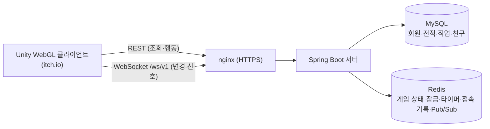

# CrewCheck Server

> 해적과 선원이 한 배를 타고 채팅으로 속고 속이는 **실시간 웹 마피아 게임 "CrewCheck"** 의 서버입니다.
> **서버가 판정하고, 클라이언트는 보여주기만 합니다.** 밤·낮·투표 전환, 능력 판정, 승패 판정, "누가 무엇을 볼 수 있는지"는 모두 이 서버가 결정합니다.

- 🎮 플레이: https://youjin-43.itch.io/crewcheck
- 🌐 API 서버: https://3-38-222-51.sslip.io
- 📄 개인정보처리방침 · 홈페이지: https://doronyong.github.io/CrewCheck/
- 🖥 클라이언트 저장소: TODO(클라이언트 저장소 링크)

<!-- 사진: 타이틀 화면 또는 게임 진행 화면 스크린샷 → docs/images/hero.png -->
<!--  -->

## 목차

1. [게임 소개](#게임-소개)
2. [주요 기능](#주요-기능)
3. [기술 스택](#기술-스택)
4. [시스템 구조](#시스템-구조)
5. [프로젝트 구조](#프로젝트-구조)
6. [로컬 실행 방법](#로컬-실행-방법)
7. [환경변수](#환경변수)
8. [API 개요](#api-개요)
9. [구글·카카오 로그인 구조](#구글카카오-로그인-구조)
10. [테스트](#테스트)
11. [배포](#배포)
12. [문서](#문서)
13. [팀](#팀)

## 게임 소개

- 4~12명이 한 배에 탑니다. **3개 진영, 14개 직업** (해적 / 선원 / 중립).
- 한 판은 `밤(능력 사용) → 밤 결과 공개 → 낮(채팅 토론) → 투표 → 처형` 을 승리 조건이 충족될 때까지 반복합니다.
- 모든 페이즈 전환은 서버 타이머가 주도하고, 전원이 제출하면 시간을 기다리지 않고 바로 넘어갑니다.
- 채팅은 낮에는 전체, 밤에는 해적끼리만, 죽은 사람은 유령 채팅으로 나뉩니다. 누가 볼 수 있는지는 서버가 정합니다.
- 설치·가입 없이 링크 하나로 들어오는 WebGL 웹 게임입니다.

<!-- 사진: 로비/대기실 화면 → docs/images/lobby.png -->
<!-- 사진: 투표 화면 → docs/images/vote.png -->
<!-- 사진: 결과 화면 → docs/images/result.png -->

## 주요 기능

| 영역 | 내용 |
| --- | --- |
| 회원·인증 | 게스트 / 아이디 가입 / 구글·카카오 소셜 로그인, JWT + Refresh Token, 게스트 → 소셜 계정 연동 |
| 로비·대기실 | 방 생성·검색, 비밀방, 방장 위임·추방, 준비 상태, 대기실 연결 끊김 처리 |
| 직업 구성 | 추천 / 커스텀 / 랜덤 3가지 (`/api/v1/role-setup/options`) |
| 게임 진행 | 밤 능력 · 밤 결과 · 낮 토론(넘기기, +10초 연장) · 투표(임시 선택/확정/기권) · 처형 · 승패 판정 |
| 끝나지 않는 게임 방지 | 무응답 플레이어 사망 처리, 전원 이탈 시 게임 취소, 사망자 없는 날이 계속되면 취소 |
| 채팅 | 로비 / 방 / 해적 / 유령 채팅, 욕설 필터(마스킹), 도배 방지(경고 후 채팅 금지) |
| 친구 | 친구 요청·수락·삭제, 유저 검색 |
| 실시간 알림 | WebSocket `/ws/v1` — "바뀌었다"는 **신호만** 보내고, 상태는 REST로 다시 조회 |
| 멀티서버 | 상태·잠금·타이머·접속 기록·실시간 신호를 Redis로 외부화 (`SERVER_MODE=multi`) |
| 운영 | `/actuator/health`, 정상 종료(graceful shutdown), 응답 헤더 `X-Server-Id` |

## 기술 스택

- Java 21, Spring Boot 4.1 (Web MVC, WebSocket, Security + OAuth2 Resource Server, Validation, Actuator)
- MySQL 8.4 (JPA/Hibernate, **Flyway** 마이그레이션), Redis 7 (Spring Data Redis, **Redisson** 분산 잠금)
- JWT (jjwt 0.12), Google API Client
- 테스트: JUnit 5, H2, Testcontainers(Redis)
- 배포: AWS EC2, nginx(HTTPS) + Let's Encrypt, Docker Compose(MySQL·Redis·nginx), systemd(서버 jar)

## 시스템 구조

<!-- 사진: 시스템 구조도 → docs/images/architecture.png -->
<!--  -->



핵심 설계 (발표 자료 기준):

- **WebSocket은 신호만, 상태는 REST로**: 직업 비공개·해적/유령 채팅 같은 "가리기 규칙"을 조회 API 한 곳에만 두기 위해서입니다. 신호를 놓쳐도 다음 조회가 최신 상태입니다.
- **Redis 외부화**: 게임 저장소·잠금·타이머·접속 기록을 인터페이스로 나누고 구현만 `memory/local` ↔ `redis`로 바꿀 수 있습니다. 서버가 여러 대여도 어느 서버로 요청이 가도 같은 결과가 나옵니다.
- **분산 잠금(Redisson)**: 잠금 순서는 방 → 게임 한 방향. 10초 안에 잠금을 못 얻으면 503.
- **타이머**: Redis에서 가져갈 때 30초 임대(lease)를 걸고, 같은 페이즈가 두 번 실행돼도 페이즈 버전으로 무시합니다.
- **멀티서버 실시간 신호**: Redis Pub/Sub으로 모든 서버에 전달합니다.
- 토큰 만료 시 WebSocket은 연결을 받은 뒤 코드 `4401`로 닫아 클라이언트가 만료를 알 수 있게 합니다.

> TODO: 위 "18 → 1.6 req/s" 같은 수치는 설정값 기준 추정치라 README에는 적지 않았습니다. 부하 테스트(k6) 결과가 나오면 추가하세요.

## 프로젝트 구조

패키지 루트: `src/main/java/com/WhoisntCitizen_server/`

```text
├── member/    회원가입·로그인·소셜 로그인·토큰 (AuthController, MemberController)
├── user/      유저 프로필·전적·닉네임·프로필 이미지
├── lobby/     방 생성/입장/설정, 대기실 접속 기록(presence), 방 잠금
├── game/      게임 상태·페이즈 타이머·저장소(memory/redis)·잠금·접속 기록·직업 구성
├── night/     밤 능력 사용·판정·결과
├── vote/      투표·처형
├── jobs/      직업 정의(RoleDefinition, ActionCode, Faction)
├── chat/      채팅(로비·방·해적·유령), 욕설 필터, 도배 방지
├── friend/    친구
├── realtime/  WebSocket(/ws/v1) 핸들러, Redis Pub/Sub 신호
├── common/    서버 모드(single/multi), 서버 ID, 예외 처리, Redis·분산 잠금 설정
└── global/    공통 설정·유틸
src/main/resources/
├── application.properties         공통 설정
├── application-local.properties   로컬(기본) — 개발용 API 활성화, 긴 페이즈 시간
├── application-prod.properties    운영 — 환경변수로 비밀값 주입
├── db/migration/                  Flyway (V1~V5)
├── profanity/                     욕설·허용어 사전
└── static/kakao-callback.html     카카오 로그인 콜백 페이지
deploy/        운영 배포 (app.env.example, docker-compose.prod.yml, systemd, nginx)
postman/       Postman 컬렉션 (REST, WebSocket 점검)
Claude outputs/  게임 진행·멀티서버·WebSocket 설계 문서
```

## 로컬 실행 방법

필요한 것: **JDK 21**, **Docker** (MySQL·Redis 용)

```bash
# 1. MySQL 8.4 + Redis 7 실행
docker compose up -d

# 2. 서버 실행 (기본 프로필 = local, 포트 8080)
./gradlew bootRun
```

Windows PowerShell에서는 `.\gradlew.bat bootRun` 입니다.

- 로컬 기본값은 `docker-compose.yml`의 DB 계정과 맞춰져 있어 환경변수 없이 실행됩니다.
- 테이블은 서버 시작 시 Flyway가 만듭니다.
- 헬스 체크: http://localhost:8080/actuator/health
- `local` 프로필에서는 개발용 API(`POST /api/v1/games`, `GET /api/v1/games/{id}/dev/roles`)가 켜지고, 페이즈 시간이 길고 연결 끊김 검사는 꺼져 있어 Postman으로 한 단계씩 테스트할 수 있습니다. 연결 끊김 검사를 Unity 클라이언트로 확인하려면 `mafia.phase.inactive-timeout-seconds` 를 바꾸세요.
- 종료: `docker compose down` (데이터까지 삭제: `docker compose down -v`)
- 웹 소셜 로그인(`/code`)을 로컬에서 시험하려면 아래 [환경변수](#환경변수)의 `GOOGLE_CLIENT_SECRET` 등이 필요합니다. 비워 두면 해당 엔드포인트만 실패하고 서버는 정상 시작합니다.

## 환경변수

운영은 `deploy/app.env.example` 을 EC2의 `/opt/mafia/.env` 로 복사해 값을 채웁니다 (`chmod 600`). **실제 비밀값은 저장소에 커밋하지 마세요.**

| 변수 | 필수 | 설명 |
| --- | --- | --- |
| `SPRING_PROFILES_ACTIVE` | 운영 | `prod` (기본은 `local`) |
| `JWT_SECRET` | 운영 | JWT 서명 키. `openssl rand -base64 64 \| tr -d '\n'` 로 생성 (Base64, 256비트 이상) |
| `DB_URL` / `DB_USER` / `DB_PASSWORD` | 운영 | MySQL 접속 정보. 로컬 기본값은 `docker-compose.yml` 기준 |
| `MYSQL_ROOT_PASSWORD` | 운영 | `docker-compose.prod.yml`의 MySQL root 비밀번호 |
| `REDIS_HOST` / `REDIS_PORT` | 선택 | 기본 `localhost:6379` |
| `SERVER_MODE` | 선택 | `single`(서버 1대, 기본) / `multi`(게임 저장소·잠금·타이머·접속 기록·실시간 신호 전부 Redis) |
| `GAME_REPOSITORY`, `GAME_LOCK`, `ROOM_LOCK`, `GAME_TIMER`, `GAME_ACTIVITY`, `REALTIME_NOTIFIER` | 선택 | 항목 하나만 `memory`/`local` ↔ `redis` 로 덮어쓰기 |
| `SERVER_ID` | 선택 | 서버마다 다르게 지정(예: `server-a`). 비우면 자동 생성. 응답 헤더 `X-Server-Id`, 로그에 사용 |
| `GAME_REDIS_HOST` / `GAME_REDIS_PORT` | 선택 | 게임용 Redis를 따로 둘 때만 |
| `CHAT_ADMIN_KEY` | 선택 | 공지 채팅 API 보호 키. 비우면 누구나 공지를 보낼 수 있음 (`openssl rand -hex 32`) |
| `CHAT_PROFANITY_ENABLED`, `CHAT_SPAM_ENABLED` | 선택 | 욕설 필터·도배 방지 on/off (기본 `true`) |
| `GOOGLE_CLIENT_ID` | 운영 | 구글 OAuth 클라이언트 ID (Google Cloud Console) |
| `GOOGLE_CLIENT_SECRET` | 웹 로그인 | 구글 인가 코드 → 토큰 교환용 |
| `KAKAO_REST_API_KEY` | 웹 로그인 | 카카오 REST API 키 |
| `KAKAO_CLIENT_SECRET` | 웹 로그인 | 카카오 인가 코드 → 토큰 교환용 (콘솔에서 사용 설정한 경우) |
| `KAKAO_ALLOWED_REDIRECT_URIS` | 웹 로그인 | 쉼표 구분. 서버가 서비스하는 콜백 페이지 주소. 카카오 개발자 콘솔의 Redirect URI와 같아야 함 (예: `https://3-38-222-51.sslip.io/kakao-callback.html`) |

> 모바일 로그인만 쓴다면 웹 로그인용 변수(`*_CLIENT_SECRET`, `KAKAO_*`)는 생략할 수 있습니다.

## API 개요

REST API는 약 51개(발표 기준 수치, TODO: 최신 개수 확인), WebSocket 채널은 하나(`/ws/v1`)입니다. 인증이 필요한 API는 `Authorization: Bearer <JWT>` 를 사용합니다. 전체 요청·응답 예시는 `postman/mafia-game.postman_collection.json` 을 참고하세요.

| 영역 | 경로 (요약) |
| --- | --- |
| 회원 | `POST /api/members/signup` · `login` · `guest` · `login/{google,kakao}` · `login/{google,kakao}/code` · `link/{google,kakao}` · `link/{google,kakao}/code` |
| 토큰 | `POST /api/auth/refresh` · `logout` |
| 유저 | `GET /api/users/me` · `/{userId}` · `/search`, `PATCH /api/users/me/nickname` · `me/profile-image` |
| 친구 | `GET /api/friends` · `/requests`, `POST /api/friends/request` · `/{id}/accept`, `DELETE /api/friends/{id}` |
| 방(로비) | `POST/GET /api/v1/rooms`, `GET /{roomId}`, `/players`(입장·조회·나가기·준비), `PUT /host` · `/settings` · `/role-setup`, `DELETE /players/{userId}`(추방), `POST /{roomId}/games`(게임 시작) |
| 직업 | `GET /api/v1/roles`, `GET /api/v1/role-setup/options` |
| 게임 | `GET /api/v1/games/{gameId}` · `/me` · `/result`, `POST /day/skip` · `/day/extend` |
| 밤 | `POST /api/v1/games/{gameId}/night-actions` · `/night-actions/skip`, `GET /night-result` |
| 투표 | `POST /api/v1/games/{gameId}/votes`, `GET /execution-result` |
| 채팅 | `GET/POST /api/v1/lobby/messages`, `GET/POST /api/v1/rooms/{roomId}/messages`, `POST /system-messages` |
| 실시간 | WebSocket `/ws/v1` (브라우저는 `?token=<JWT>` 쿼리 사용) — 프로토콜은 `Claude outputs/websocket-protocol.md` |
| 운영 | `GET /actuator/health` (liveness/readiness) |

## 구글·카카오 로그인 구조

서버는 두 가지 방식을 모두 지원합니다.

**웹(WebGL) — 인가 코드 방식**

```text
브라우저(게임) ──팝업──▶ 구글/카카오 로그인
        ◀── 인가 코드 (카카오는 서버가 서비스하는 /kakao-callback.html 로 돌아옴)
브라우저 ──POST /api/members/login/{google,kakao}/code ──▶ 서버
서버 ──코드를 토큰으로 교환 (client secret 사용)──▶ 구글/카카오
서버 ◀── 토큰 → 사용자 정보 확인 → 회원 생성/조회 → 서비스 JWT 발급
```

- 클라이언트 시크릿은 서버 환경변수에만 둡니다. 클라이언트에는 공개 값(구글 클라이언트 ID, 카카오 REST API 키)만 있습니다.
- 카카오 Redirect URI는 `KAKAO_ALLOWED_REDIRECT_URIS` 허용 목록에 있는 값만 받습니다.
- 이미 로그인한 게스트가 소셜 계정을 연동할 때는 `POST /api/members/link/{google,kakao}/code` 를 씁니다.

**모바일 — 토큰 방식**

- 앱이 구글/카카오 SDK로 받은 토큰을 `POST /api/members/login/{google,kakao}` 로 보내면, 서버가 토큰을 검증하고 서비스 JWT를 발급합니다. (연동: `link/{google,kakao}`)

공통 규칙: 소셜 가입 시 닉네임은 구글 `G숫자`, 카카오 `K숫자` 로 자동 생성됩니다.

## 테스트

```bash
./gradlew test
```

- 테스트는 H2를 사용하며, Redis 통합 테스트(`RedisGameRepositoryTest` 등)는 Testcontainers로 Redis를 띄웁니다. **Docker가 없으면 해당 테스트만 건너뜁니다.**
- 테스트 파일 117개(약 1.6만 줄)는 발표 자료 기준 수치입니다. TODO: 최신 수 확인
- 부하 테스트는 아직 하지 않았습니다.
- TODO: CI 설정 여부 확인 (현재 저장소에서 CI 설정 파일을 확인하지 못했습니다)

## 배포

현재는 수동 배포입니다. (TODO: 실제 배포 절차를 팀에서 확인해 보완)

1. EC2에서 MySQL·Redis·nginx·certbot을 Docker Compose로 실행: `docker compose -f deploy/docker-compose.prod.yml --env-file .env up -d`
2. `./gradlew bootJar` 로 만든 jar를 서버에 올리고 systemd 서비스(`deploy/mafia-server.service`)로 재시작
3. nginx(`deploy/nginx/`)가 HTTPS 입구 역할 — itch.io(HTTPS)에서 호출하므로 HTTPS/WSS가 필수입니다.

## 문서

`Claude outputs/` 폴더에 설계 문서가 있습니다.

- `00_README.md` 외 `01`~`08`: 게임 진행(시작 → 역할 배정 → 밤 → 낮·투표 → 종료)
- `멀티서버_*.md`: 게임 상태·분산 잠금·타이머·WebSocket 멀티서버 설계
- `websocket-protocol.md`: 실시간 프로토콜

## 팀

6조 "저진짜 시민이조" (내일배움캠프 단기심화 9기 최종 프로젝트)

5명 전원이 서버와 클라이언트를 함께 맡아, 기능 단위로 서버 API부터 Unity 화면까지 끝까지 책임졌습니다. (튜터: 하승우)

| 이름 | 역할 | 담당 | GitHub |
| --- | --- | --- | --- |
| 박재영 | 팀장 | 채팅: 로비·룸·게임 채팅, 욕설 필터, 도배 방지, 낮 토론 넘기기, 투표 기권·결정 | TODO |
| 정원우 | 팀원 | 실시간: 게임 상태·잠금·타이머·접속 기록 Redis 외부화, Redisson 분산 잠금, WebSocket 신호(`/ws/v1`), WebGL 브라우저 WebSocket 전송층 | TODO |
| 정지용 | 팀원 | 게임 진행: 직업 능력, 신규 직업 5종, 직업 배정(추천·커스텀·랜덤), 게임씬 레이아웃, 투표·처형 컷씬 | TODO |
| 장현교 | 팀원 | 인증·소셜: 로그인, JWT·Refresh Token, 게스트, 구글·카카오 로그인·계정 연동, 프로필, 친구, 타이틀 씬 | TODO |
| 김유진 | 팀원 | 로비·룸·사운드·웹 빌드: 방 관리, 대기실 접속 기록, 사운드 시스템, WebGL 빌드·한글 입력 | TODO |

> 출처: 결과보고서 팀 구성 및 역할 슬라이드. GitHub 계정은 확인되지 않아 TODO로 남겼습니다.

## 라이선스

TODO
