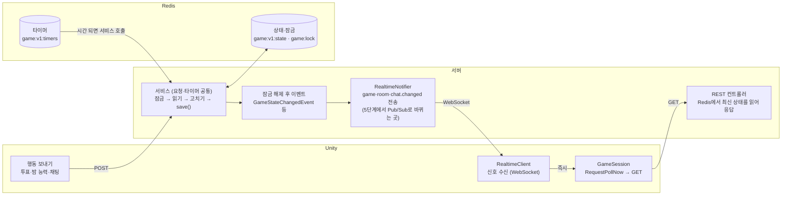

# 마피아 게임 서버 아키텍처 변천사: Polling → Redis → WebSocket

2026-10-12 · 원우

## 한눈에 보기

지금 구조를 한 문장으로: **게임의 원본은 Redis에 있고, 서버는 요청·타이머가 올 때마다 Redis에서 읽어 잠금 안에서 고친 뒤 저장하며, 저장되면 WebSocket으로 "바뀌었다" 신호만 보내고 Unity는 그 신호를 받으면 기존 REST GET으로 내용을 가져간다.**

바뀐 것은 "어디에 두느냐"(메모리 → Redis)와 "언제 가져가느냐"(1초마다 → 신호 받을 때)뿐입니다. 게임 규칙, REST API, 화면에 그리는 데이터는 처음 설계와 같습니다.

| 구분 | 처음: Polling + 서버 메모리 | 중간: Redis 외부화 (1~3.5단계) | 지금: WebSocket 신호 (4단계) |
| --- | --- | --- | --- |
| 게임 상태 | 서버 메모리 `InMemoryGameRepository` | Redis `game:v1:state:{id}` (JSON 스냅샷) | 같음 |
| 잠금 | `synchronized` / JVM `ReentrantLock` | Redisson 분산 잠금 `game:lock`, `room:lock` | 같음 |
| 페이즈 타이머 | `TaskScheduler` (메모리) | Redis ZSET `game:v1:timers`, 어느 서버든 실행 | 같음 |
| 접속 기록 (끊김 판정) | 메모리 Map, GET할 때 기록 | Redis Hash `game:v1:activity:{id}` | GET + WebSocket ping이 기록 |
| 화면 갱신 | Unity가 1초(채팅 2초)마다 GET | 같음 | 신호 오면 바로 GET, 평소 15초 폴링(안전망) |
| 클라 → 서버 요청 | REST | REST | REST (WebSocket은 신호 받기용) |
| 서버 2대 이상 | 불가 | 상태·잠금·타이머는 공유됨 | 신호만 아직 서버 1대 (`LocalRealtimeNotifier`) |
| 서버 재시작 | 진행 중 게임 사라짐 | 게임·타이머 유지 | 같음 + 클라 자동 재연결 |

**현재 위치**: 4단계(WebSocket, 서버 1대)까지 완료. 다음은 5단계 Redis Pub/Sub으로 신호를 서버끼리 나누는 것입니다.

## 처음 설계: Polling + 서버 메모리 (서버 1대)

처음에는 서버 한 대의 메모리가 게임의 원본이었고, Unity가 1초마다 "지금 어때?"를 물어봤습니다. 서버가 먼저 말을 거는 방법은 없었습니다.

### 역할 나눔 (지금도 그대로)

- **서버가 게임을 주도**: 페이즈 전환은 서버 타이머가 합니다. 클라이언트가 "다음 단계로"를 요청하는 API는 없습니다. 밤·투표는 전원이 제출하면 타이머를 기다리지 않고 바로 넘어갑니다.
- **클라이언트는 보여 주기만**: 행동(밤 능력, 투표, 채팅)을 REST로 보내고, 상태는 GET으로 가져와 그립니다. 승패도 서버가 판정합니다.
- **정보 가리기는 REST 응답에서**: `GET /games/{id}`는 공개 정보만, 내 직업은 `/me`, 밤 개인 결과는 `/night-result`에서만 내려줍니다.

### Polling 흐름

1. Unity `GameSession`이 1초마다 `GET /api/v1/games/{id}` → `phase`, `phaseVersion`, `phaseEndsAt`, `serverTime`, 생존자를 받습니다.
2. `phaseVersion`이 바뀌면 페이즈가 넘어간 것 → `/me`, `/night-result`, `/execution-result` 등을 추가로 GET합니다.
3. 남은 시간은 `phaseEndsAt - serverTime`으로 계산해 기기 시계가 틀려도 맞게 보입니다.
4. 방 화면은 1초, 채팅은 2초마다 `?afterId=`로 새 메시지만 가져옵니다.
5. 이 GET이 곧 **"살아 있음" 신호**입니다. 서버는 GET마다 접속 시각을 기록하고, `InactivePlayerMonitor`가 5초마다 확인해 60초 동안 요청이 없는 사람을 사망 처리합니다.

### 서버 안의 구조

- 페이즈 전환 `GameFlowService.moveTo`: `phaseVersion++` → 저장 → `TaskScheduler`에 "이 시각에 `onPhaseTimeout(gameId, version)` 호출" 예약.
- 타이머가 울리면 버전을 비교해, 이미 넘어간 페이즈면 무시합니다. 예약을 취소하는 대신 버전으로 거르는 방식이고, 이 설계 덕분에 뒤에서 타이머를 Redis로 옮기기 쉬웠습니다.
- 모듈 사이는 Spring 이벤트로 끊어 두었습니다. 게임은 `GameEndedEvent`, `RoomNoticeEvent` 등을 발행만 하고 로비·채팅·전적이 각자 받습니다.
- 방과 채팅은 처음부터 Redis(`room:{id}`)에 있었고, 게임만 메모리에 있었습니다.

### 한계

| 문제 | 원인 |
| --- | --- |
| 화면이 최대 1~2초 늦음, 요청이 많음 | 변화가 없어도 매초 GET |
| 서버가 꺼지면 진행 중인 게임이 사라짐 | 상태·타이머가 메모리에만 있음 |
| 서버 2대면 서로 다른 게임을 봄 | 각 서버가 자기 메모리를 봄 |
| 서버 2대면 같은 게임을 동시에 고침 | `synchronized`는 같은 JVM만 막음 |
| 멀쩡한 사람이 사망 처리될 수 있음 | 서버 A가 받은 GET을 서버 B의 끊김 검사가 모름 |

이 한계를 풀기 전에 **0단계**에서 동작은 그대로 두고 `GameRepository`, `GameLock`, `RoomLock`, `GameTimer`, `PlayerActivityTracker`를 인터페이스로 분리했습니다. 그래서 이후 단계는 서비스 코드를 거의 안 건드리고 구현(Bean)만 갈아 끼웠습니다.

## 중간 단계: 상태·잠금·타이머·접속 기록을 Redis로 (1~3.5단계)

서버 메모리에 있던 네 가지를 Redis로 옮겨, **서버는 상태를 들고 있지 않는(stateless) 실행기**가 되었습니다. 어느 서버가 요청을 받든 Redis에서 같은 게임을 읽고 씁니다. 이 단계까지 클라이언트는 여전히 1초 폴링입니다.

| 단계 | 무엇을 | Redis 키 | 핵심 방식 |
| --- | --- | --- | --- |
| 1 | 게임 상태 | `game:v1:state:{gameId}` (String), `game:v1:active-expiry` (ZSET) | `Game` → `GameSnapshot` JSON. 저장·목록 갱신을 `MULTI/EXEC`로 묶음. TTL 진행 중 6시간 / 끝나면 10분 |
| 2 | 게임·방 잠금 | `game:lock:{id}`, `room:lock:{id}` | Redisson 분산 잠금. 최대 10초 대기 후 `503 LOCK_BUSY`. 서버가 죽으면 최대 30초 뒤 풀림 |
| 3 | 페이즈·정리 타이머 | `game:v1:timers` (ZSET) | member `phase:{id}:{ver}`, score = 실행 시각. 서버마다 100ms마다 Lua로 가져감 |
| 3.5 | 접속 기록 | `game:v1:activity:{gameId}` (Hash) | field = playerId, value = 마지막 요청 시각. 더 늦은 시각만 반영(Lua) |

### 새로 생긴 핵심 규칙: 잠금 → 읽기 → 고치기 → 저장

메모리에서는 같은 `Game` 객체를 고치면 끝이었지만, 이제 `findById`는 매번 JSON에서 **새 객체**를 만듭니다. 그래서 게임을 바꾸는 모든 곳(`GameService`, `GameFlowService`, `NightService`, `VoteService`)은 다음 순서를 지킵니다.

1. `gameLock.withLock(gameId)`로 잠금을 먼저 잡는다.
2. 잠금 **안에서** Redis에서 게임을 읽는다 (잠금 밖에서 읽은 객체는 낡은 복사본).
3. 규칙대로 고치고 `save()`한다. 빼먹으면 변경이 사라집니다.
4. 잠금을 푼 뒤에 채팅 안내·신호 같은 "알리는 일"을 한다 (`GameLockScope.afterUnlock`).
5. 방 잠금이나 DB가 필요한 후속 처리(방 복귀, 전적)는 다른 스레드에서 한다 (`DeferredEventPublisher`).

잠금 순서는 **방 → 게임만** 허용합니다. 게임 잠금 안에서 방 잠금을 잡으려 하면 `GameLockScope.requireNotHeld`가 즉시 막아 서버 여러 대 사이의 교착을 예방합니다.

### 타이머가 어느 서버에서든 도는 방식

1. `moveTo`가 게임을 저장한 뒤 `ZADD game:v1:timers {endsAt} phase:{id}:{ver}`.
2. 각 서버의 `RedisTimerPoller`가 100ms마다 `RedisTimerDispatcher`를 부릅니다.
3. Lua **CLAIM**: 시간이 된 예약을 가져가면서 score를 `now + 30초`로 밀어 둔다 (lease). 다른 서버는 같은 예약을 못 가져갑니다.
4. `GameFlowService.onPhaseTimeout(gameId, ver)` 실행 → 게임 잠금 안에서 버전 확인 후 다음 페이즈로.
5. 성공하면 예약을 지웁니다. 실행 도중 서버가 죽으면 30초 뒤 lease가 풀려 다른 서버가 다시 가져갑니다 (적어도 한 번 실행, 중복은 `phaseVersion`으로 무시).
6. 저장과 예약 사이에 서버가 죽는 경우는 `StuckGameWatchdog`이 30초마다 "끝날 시각이 지났는데 예약이 없는 게임"을 찾아 다시 겁니다.

### 설정 한 줄로 고르기

`SERVER_MODE=single`이면 네 가지 모두 메모리 구현, `multi`면 모두 Redis 구현이 붙습니다 (`ServerSettings.resolve`, `@ConditionalOnServerSetting`). `GAME_REPOSITORY`, `GAME_LOCK`, `ROOM_LOCK`, `GAME_TIMER`, `GAME_ACTIVITY`로 항목별 덮어쓰기도 됩니다. 서버 시작 로그에 최종 조합이 찍힙니다.

## 지금 설계: WebSocket은 신호만, 내용은 REST (4단계)

서버는 게임·방·채팅이 **저장되는 순간** 그 방을 구독한 연결에 "바뀌었다"만 보내고, Unity는 받자마자 기존 GET을 한 번 부릅니다. 폴링 코드는 그대로이고 "언제 GET할지"만 바뀌었습니다.

바꾸는 쪽이 Unity 요청이든 타이머든 같은 서비스와 `save()`를 지나고, 화면에 그리는 데이터는 항상 마지막 GET 응답입니다. WebSocket이 끊기면 `GameSession`이 같은 GET을 1초마다 반복합니다(처음 설계의 폴링으로 복귀).

### 왜 내용이 아니라 신호만 보내나

- **정보 가리기 규칙이 한 곳에만 있게**: 직업 비공개, 해적 밤 채팅, 사망자 채팅 같은 규칙은 REST 응답에만 있습니다. WebSocket으로 내용을 보내면 같은 규칙을 두 곳에 짜야 하고, 하나만 틀려도 정보가 샙니다.
- **신호를 놓쳐도 괜찮음**: 다음 GET이 항상 최신 상태를 가져오므로 메시지 순서·보관·재전송을 신경 쓸 필요가 없습니다.
- **끊겨도 게임은 진행**: WebSocket이 끊기면 폴링이 1초(채팅 2초)로 돌아가 처음 설계처럼 동작합니다.

### 주고받는 메시지 (`/ws/v1`)

| 방향 | type | 언제 | Unity가 하는 일 |
| --- | --- | --- | --- |
| 서버 → 클라 | `connected` | 연결 직후 (JWT 검사 통과) | 보고 있는 방을 `room.subscribe` |
| 클라 → 서버 | `room.subscribe` | 방 입장 때, 재연결 때 | — |
| 서버 → 클라 | `subscribed` | 방 참가자가 맞으면 | 방·게임·채팅 GET 한 번 (`Resynced`, 놓친 변경 메우기) |
| 서버 → 클라 | `game.changed` | 게임이 저장될 때 (타이머가 넘긴 페이즈 포함) | `GET /api/v1/games/{id}` |
| 서버 → 클라 | `room.changed` | 방이 저장·삭제될 때 | `GET /api/v1/rooms/{id}` |
| 서버 → 클라 | `chat.changed` | 채팅 저장 (볼 수 있는 사람에게만) | `lastMessageId`가 새 것이면 `GET .../messages?afterId=` |
| 클라 → 서버 | `ping` (10초마다) | 항상 | `pong` 받음. 서버는 접속 기록도 남김 |
| 서버 → 클라 | close `4408` / `4401` | 30초 무응답 / 토큰 만료 | 재연결 / 다시 로그인 |

### 서버 쪽: 신호가 나가는 길

게임을 바꾸는 코드가 여러 곳이라 각자 알리면 빠뜨리기 쉽습니다. 그래서 **모든 변경이 반드시 지나는 `save()`** 에서 이벤트를 냅니다.

1. 서비스가 잠금 안에서 `save(game)` → `ChangeEventGameRepository`가 `GameStateChangedEvent`를 `afterUnlock`에 예약 (같은 잠금 안의 여러 저장은 1번).
2. 잠금이 풀리면 이벤트 발행 → `RealtimeGameListener` → `RealtimeNotifier.sendToRoom(roomId, game.changed)`.
3. `LocalRealtimeNotifier`가 `RealtimeSessionRegistry`(방 → 연결 목록, 서버 메모리)에서 그 방 연결을 찾아 보냅니다.
4. 방은 `LobbyRoomRepository` 저장·삭제 → `RoomStateChangedEvent` → `RealtimeRoomListener`, 채팅은 `ChatMessageSavedEvent(audience)` → `RealtimeChatListener`로 같은 모양입니다.

잠금이 풀린 뒤에 보내는 이유: 신호를 받은 Unity의 GET이 잠금을 기다리지 않게 하기 위해서입니다.

### Unity 쪽: 신호를 받는 길

1. 로그인 `AuthSession.SetSession` → `RealtimeSession.OnLoggedIn` → `RealtimeClient.Connect()` (앱 전체에 연결 1개, `DontDestroyOnLoad`).
2. 방 입장 시 화면이 `EnterRoom(roomId)` → 연결돼 있으면 `room.subscribe`, 아니면 연결 후 자동.
3. 수신 스레드 → `ConcurrentQueue` → `Update`(메인 스레드)에서 꺼냄 → `RealtimeSignalFilter`가 다른 방 신호를 버리고 한 프레임 안 중복을 합칩니다.
4. `GameChanged` / `RoomChanged` / `ChatChanged` 이벤트 → `GameController`·`RoomUIController`·`GameChatController`가 즉시 GET (`GameSession.RequestPollNow`).
5. 연결 상태에 따라 폴링 간격을 바꿉니다: 구독 중 15초, 끊김 1초(채팅 2초). 재연결은 1→2→4…최대 30초 백오프(±20%).

## 게임 한 판 따라가기 (지금 설계 기준)

모든 단계는 같은 리듬을 반복합니다: **누군가(Unity 요청 또는 서버 타이머)가 바꾸고 → Redis에 저장 → 잠금 해제 → 신호 → Unity가 GET**. 아래 표의 "바꾸는 쪽"만 단계마다 다릅니다.

| 순서 | 장면 | 바꾸는 쪽 | 서버가 하는 일 | 나가는 신호 | Unity가 가져가는 것 |
| --- | --- | --- | --- | --- | --- |
| 1 | 로그인 | Unity `POST /api/members/guest` | JWT 발급 | — | WebSocket `/ws/v1` 연결 → `connected` |
| 2 | 방 입장·준비 | Unity REST (방 만들기, 입장, 준비) | 방 잠금 안에서 `room:{id}` 저장 | `room.changed` | `room.subscribe` → `subscribed` → `GET /rooms/{id}` |
| 3 | 게임 시작 | 방장 `POST /rooms/{id}/games` | 방 → 게임 잠금, 역할 배정, `game:v1:state` 저장, 접속 기록 전원 초기화, 첫 밤 타이머 `ZADD` | `game.changed`, `room.changed` | GameScene으로 이동(같은 방이라 구독 유지), `GET /games/{id}`, `/me` |
| 4 | 밤 능력 | Unity `POST /night-actions` (또는 `/skip`) | 게임 잠금 → 읽기 → 제출 반영 → 저장. 전원 제출이면 바로 밤 판정 | `game.changed` | `GET /games/{id}` |
| 5 | 밤 종료 | 서버 타이머 (또는 4의 전원 제출) | `NightActionResolver` 판정 → `NIGHT_RESULT`, 승리 조건 검사, 다음 타이머 | `game.changed` + `chat.changed`(시스템 안내) | `GET /games/{id}`, `/night-result`, 채팅 |
| 6 | 낮 → 투표 | 서버 타이머 | `DAY` → `VOTE` 전환 | `game.changed` | `GET /games/{id}` |
| 7 | 투표·처형 | Unity `POST /votes`, 전원 투표 또는 타이머 | `VoteResolver` → `EXECUTION`, 승리 조건 검사 | `game.changed` | `/execution-result` |
| 8 | 반복 또는 종료 | 서버 타이머 | 승패 미결이면 다시 `NIGHT`, 결정되면 `ENDED` + `GameEndedEvent` | `game.changed` | `GET /result` |
| 9 | 방 복귀 | `DeferredEventPublisher` (게임 잠금 밖, 다른 스레드) | 방 잠금으로 방을 `WAITING`으로, 전적 DB 저장, 60초 뒤 게임 정리 타이머 | `room.changed` | Room 씬으로, `GET /rooms/{id}` |

### 인게임 내내 돌고 있는 것

- **채팅**: 저장 시점에 게임 잠금 안에서 `audience`(볼 수 있는 사람)를 정합니다. 밤 해적 채팅·사망자 채팅은 그 사람들에게만 신호가 갑니다. 못 보는 사람에게 신호를 보내면 "지금 숨은 대화가 있다"는 사실이 새기 때문입니다.
- **끊김 판정**: Unity가 10초마다 `ping` → 서버가 `game:v1:activity`에 기록. `InactivePlayerMonitor`가 5초마다 보고 60초 동안 GET도 ping도 없으면 사망 처리 → `PlayersDepartedEvent` → 방에서 제외. WebSocket이 닫힌 것만으로는 빠지지 않습니다.
- **안전망 폴링**: 구독 중에도 15초마다 GET해 혹시 놓친 신호를 메웁니다.

## 코드 지도: 어느 파일이 무엇을 맡나

서버는 `com.WhoisntCitizen_server`, Unity는 `Assets/02_Scripts` 기준입니다. "인터페이스 → Local / Redis 구현"으로 나뉜 것은 `SERVER_MODE`가 고릅니다.

### 서버

| 역할 | 인터페이스 / 진입점 | 구현 | 패키지 |
| --- | --- | --- | --- |
| 게임 규칙·페이즈 전환 | `GameService`, `GameFlowService` (`moveTo`, `onPhaseTimeout`) | — | `game/service` |
| 밤 능력·판정 | `NightService`, `NightActionResolver` | — | `night` |
| 투표·처형 | `VoteService`, `VoteResolver` | — | `vote` |
| 승리 조건, 역할 배정 | `WinConditionChecker`, `RoleAssigner` | — | `game/service` |
| 게임 저장소 | `GameRepository` | `InMemoryGameRepository` / `RedisGameRepository` (+ `GameSnapshotCodec`), 밖을 `ChangeEventGameRepository`가 감쌈 | `game/repository` |
| 게임 잠금 | `GameLock`, `GameLockScope`(afterUnlock) | `LocalGameLock` / `RedisGameLock` | `game/lock` |
| 방 잠금 | `RoomLock` | `LocalRoomLock` / `RedisRoomLock` | `lobby` |
| 타이머 | `GameTimer` → `GameTimeoutHandler` | `LocalGameTimer` / `RedisGameTimer` + `RedisTimerPoller`, `RedisTimerDispatcher`, `StuckGameWatchdog` | `game/scheduling` |
| 잠금 밖 후속 처리 | `DeferredEventPublisher` | `SchedulerDeferredEventPublisher` | `game/scheduling` |
| 접속 기록·끊김 판정 | `PlayerActivityTracker`, `InactivePlayerMonitor` | `LocalPlayerActivityTracker` / `RedisPlayerActivityTracker` | `game/activity` |
| 서버 모드 선택 | `ServerSettings`, `@ConditionalOnServerSetting` | `ServerSettingsCheck`(시작 로그) | `common/servermode` |
| WebSocket 연결 | `RealtimeWebSocketHandler`, `RealtimeHandshakeInterceptor`(JWT) | `RealtimeConnectionMonitor`(4408/4401) | `realtime` |
| 연결 목록 | `RealtimeSessionRegistry` (사용자·방 → 연결) | 서버 메모리 | `realtime` |
| 신호 보내기 | `RealtimeNotifier` | `LocalRealtimeNotifier` (5단계에서 Redis 구현 추가 예정) | `realtime` |
| 이벤트 → 신호 | `RealtimeGameListener`, `RealtimeRoomListener`, `RealtimeChatListener` | — | `realtime` |
| ping → 접속 기록 | `GameActivityRecorder` | `RealtimeActivityRecorder` | `realtime` |
| 메시지 형식 | `ServerMessage`, `ClientMessage`, `RealtimeMessageCodec`, `RealtimeProtocol` | — | `realtime/protocol` |

### Unity

| 역할 | 파일 |
| --- | --- |
| 로그인 → 연결/해제 | `Auth/AuthSession.cs` → `Network/RealtimeSession.cs` |
| WebSocket 본체 (수신 스레드, 큐, ping, 재연결, 이벤트) | `Network/RealtimeClient.cs` |
| 규칙 코드 (순수 C#, 테스트 있음) | `Network/Realtime/` — `RealtimeProtocol`, `RealtimeMessageCodec`, `ReconnectBackoff`, `RealtimeConnectionTracker`, `RealtimeSignalFilter`, `RealtimePolling`, `RealtimeFailurePolicy` |
| REST 호출 | `Network/ApiClient.cs`, `Game/RealGameApi.cs`, `Lobby/RoomApi.cs`, `Chat/ChatApiClient.cs` |
| 게임 상태 GET·폴링 간격 | `Game/Core/GameSession.cs` (`RequestPollNow`, `SetPollInterval`), `PhaseTracker`, `PhaseClock` |
| 신호 → 화면 갱신 | `Game/GameController.cs`, `Room/RoomUIController.cs`, `Chat/GameChatController.cs` |

## 다음 단계: Pub/Sub으로 서버 여러 대

상태·잠금·타이머·접속 기록은 이미 Redis에 있어서 서버 여러 대가 공유합니다. **서버 메모리에 남은 것은 WebSocket 연결 목록 하나**이고, 5단계는 이것만 해결하면 됩니다.

### 문제 상황

Unity A는 서버 1에, Unity B는 서버 2에 WebSocket이 붙어 있습니다. A의 투표를 서버 1이 처리하면 `LocalRealtimeNotifier`는 서버 1의 연결 목록만 보므로 B는 신호를 못 받습니다. 게임은 깨지지 않지만(다음 15초 폴링에서 보임) 화면이 최대 15초 늦습니다. 타이머가 서버 2에서 돌아 페이즈가 넘어간 경우도 같습니다.

### 바뀌는 부분

1. `RealtimeNotifier`의 Redis 구현(예: `RedisRealtimeNotifier`)을 추가하고 `SERVER_MODE`로 고릅니다. 리스너·서비스·Unity는 그대로입니다.
2. `sendToRoom` / `sendToUsersInRoom`은 직접 보내지 않고 Redis 채널에 PUBLISH합니다 (방 id, 대상 사용자, 메시지).
3. 모든 서버가 그 채널을 SUBSCRIBE하고, 받으면 **자기 `RealtimeSessionRegistry`** 에서 해당 연결을 찾아 보냅니다. 연결 목록 자체는 계속 서버 메모리에 둡니다.
4. Pub/Sub은 저장되지 않아 잠깐 끊기면 놓칩니다. 하지만 신호는 "놓쳐도 되는" 설계(GET이 최신 상태, 15초 안전망, 재구독 시 `Resynced`)라 Streams 같은 보관형은 필요 없습니다.
5. `DeferredEventPublisher`(방 복귀·전적)는 이벤트를 만든 서버가 직접 처리하고 결과를 Redis에 저장하므로, 여러 서버로 퍼뜨릴 필요는 없을 것으로 보입니다. 0단계 문서는 5단계 대상으로 적어 두었으니 팀에서 한 번 확인하세요.

### 남은 일

- [ ] 5단계: `RealtimeNotifier` Redis Pub/Sub 구현
- [ ] 6단계: 재연결 정리 (`room.subscribe` 때 접속 기록 `touch` 등)
- [ ] 7단계: 서버 2대 이상 + 로드밸런서 통합 검증 (WebSocket은 연결이 한 서버에 고정되므로 Upgrade 헤더 전달 확인)
- [ ] 보류: 저장 시 버전 확인(잠금을 잃는 극단 상황 대비), JWT 만료 시간 연장

### 더 자세한 문서

단계별 상세(시퀀스·테스트·커밋)는 프로젝트 문서 `멀티서버_00_개요` ~ `멀티서버_04_WebSocket_클라이언트`, `websocket-protocol`, 처음 설계는 `00_README` ~ `08_공통_타이머_동시성_예외`에 있습니다.
