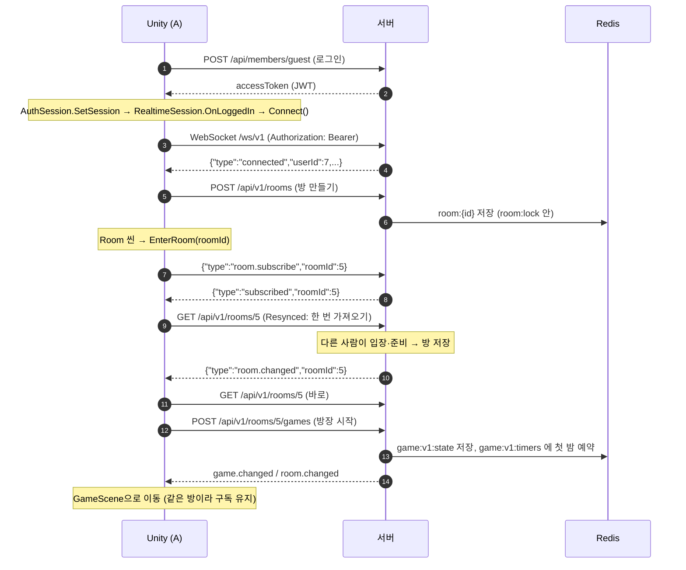
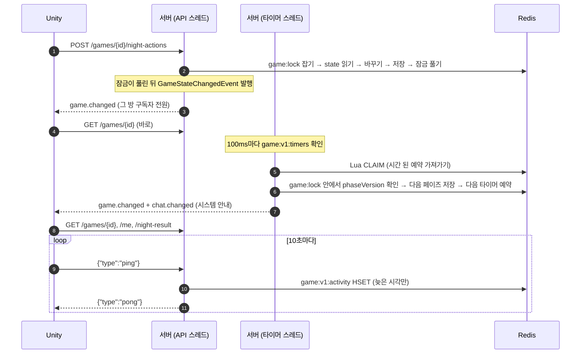
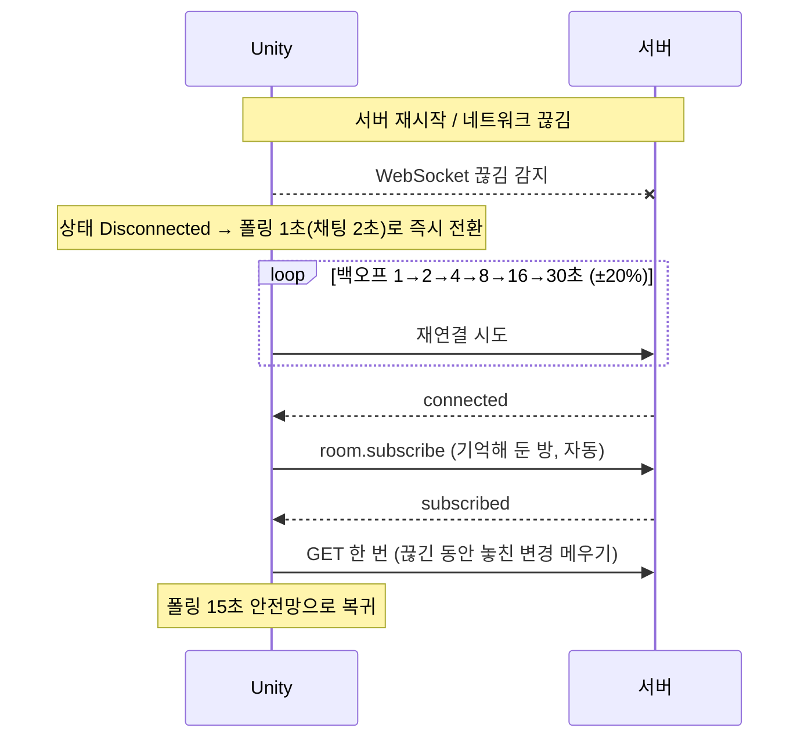

# 멀티 서버 전환 작업 정리 (1~4단계) — 개요

작성: 원우 (klik075) · 기준: `project_server` `dev` (4단계 커밋 `882f508`까지) + `project_client` 4-8~4-10 작업분 · 2026-10-12

## 이 문서 묶음

| 문서 | 내용 |
| --- | --- |
| **00_개요 (이 문서)** | 왜 바꿨는지, 전체 구조, 클라와 서버 사이의 통신 흐름, 서버 모드 설정, Redis 키 지도 |
| [멀티서버_01_게임상태_Redis.md](멀티서버_01_게임상태_Redis.md) | 1단계: 게임 상태를 서버 메모리 → Redis (스냅샷, 저장소, 서버 모드) |
| [멀티서버_02_분산잠금.md](멀티서버_02_분산잠금.md) | 2단계: 게임 잠금·방 잠금을 Redisson 분산 잠금으로, 잠금 순서, 잠금 밖 작업 |
| [멀티서버_03_타이머_Redis.md](멀티서버_03_타이머_Redis.md) | 3단계: 페이즈 타이머를 Redis ZSET으로 + 3.5단계: 접속 기록(연결 끊김 판정)을 Redis로 |
| [멀티서버_04_WebSocket_서버.md](멀티서버_04_WebSocket_서버.md) | 4단계 서버: `/ws/v1` 실시간 신호(서버 1대 기준) |
| [멀티서버_04_WebSocket_클라이언트.md](멀티서버_04_WebSocket_클라이언트.md) | 4단계 Unity: `RealtimeClient`와 화면 연동, 검증 결과 |
| [websocket-protocol.md](websocket-protocol.md) | WebSocket 메시지 규칙 원문 (4단계에서 함께 씀) |

각 문서는 같은 순서로 썼습니다: **한눈에 보기 → 동작 흐름 → 스크립트별 역할 → 규칙/예외 → 테스트 → 남은 일**.

---

## 1. 왜 바꿨나

처음 구조(`00_README.md` 기준)는 **서버 1대**를 전제로 했습니다.

| 무엇 | 예전 | 문제 |
| --- | --- | --- |
| 게임 상태 | 서버 메모리 (`InMemoryGameRepository`) | 서버가 꺼지면 진행 중인 게임이 사라짐. 서버 2대면 서로 다른 게임을 봄 |
| 잠금 | `synchronized(game)`, roomId별 `synchronized` | 같은 JVM 안에서만 막힘. 서버 2대면 같은 게임을 동시에 고칠 수 있음 |
| 페이즈 타이머 | `TaskScheduler` (서버 메모리) | 서버가 꺼지면 예약이 사라져 게임이 그 페이즈에 멈춤 |
| 접속 기록 | 서버 메모리 Map | 서버 A가 받은 요청을 서버 B의 연결 끊김 검사가 모름 → 멀쩡한 사람이 사망 처리 |
| 화면 갱신 | 클라이언트 1~2초 폴링 | 최대 1~2초 늦게 보임, 요청이 많음 |

목표: **서버를 여러 대로 늘려도 같은 게임을 함께 보고, 한 대가 죽어도 게임이 이어지게** 하고, 화면 갱신은 **서버가 "바뀌었다"고 알려 주는 방식**으로 바꾼다.

## 2. 단계 요약

| 단계 | 한 줄 요약 | 핵심 Redis 키 | 설정 |
| --- | --- | --- | --- |
| 1 | 게임 한 판을 JSON 스냅샷으로 Redis에 저장 | `game:v1:state:{id}`, `game:v1:active-expiry` | `mafia.game.repository` (memory/redis) |
| 2 | 게임·방 잠금을 Redisson 분산 잠금으로, 잠금 안에서는 상태만 바꾸고 알림은 잠금 밖으로 | `game:lock:{id}`, `room:lock:{id}` | `mafia.game.lock`, `mafia.room.lock` (local/redis) |
| 3 | 페이즈 타이머·정리 타이머를 Redis ZSET에 예약, 어느 서버든 시간이 되면 가져가 실행 | `game:v1:timers` | `mafia.game.timer` (local/redis) |
| 3.5 | 접속 기록(마지막 요청 시각)을 Redis Hash에, 늦은 시각만 반영 | `game:v1:activity:{id}` | `mafia.game.activity` (local/redis) |
| 4 | WebSocket `/ws/v1`로 "바뀌었다" 신호 전송, 내용은 기존 REST로 가져감 | (없음, 서버 메모리) | 항상 켜짐 |

> 4단계 신호 전송(`RealtimeNotifier`)은 아직 **서버 메모리** 구현(`LocalRealtimeNotifier`)입니다. 서버 1대에서는 완전히 동작하고, 서버 2대 이상은 5단계(Redis Pub/Sub)가 필요합니다.

## 3. 전체 구조

```mermaid
flowchart LR
    subgraph Unity["Unity 클라이언트"]
        UI[화면<br/>Room / Game / Chat]
        RC[RealtimeClient<br/>WebSocket 1개]
        API[ApiClient<br/>REST]
        UI -- "EnterRoom / 이벤트 구독" --> RC
        UI -- "GET·POST" --> API
    end

    subgraph Server["Spring 서버 (1대 기준, 여러 대로 확장 가능)"]
        REST[REST 컨트롤러<br/>Room·Game·Night·Vote·Chat]
        WS[RealtimeWebSocketHandler<br/>/ws/v1]
        SVC[서비스<br/>GameService·GameFlowService·RoomService·ChatMessageService]
        EVT[Spring 이벤트<br/>GameStateChanged·RoomStateChanged·ChatMessageSaved]
        NOTI[RealtimeNotifier<br/>서버 메모리]
        TIMER[게임 타이머<br/>RedisTimerPoller·Dispatcher]
        MON[InactivePlayerMonitor<br/>연결 끊김 검사]
        REST --> SVC
        SVC --> EVT --> NOTI --> WS
        TIMER --> SVC
        MON --> SVC
    end

    subgraph Redis
        GS[(game:v1:state)]
        GL[(game:lock / room:lock)]
        GT[(game:v1:timers)]
        GA[(game:v1:activity)]
        RM[(room:{id} · 채팅)]
    end

    API -- "HTTP + JWT" --> REST
    RC <-- "ws + JWT<br/>신호만" --> WS
    SVC <--> GS
    SVC <--> GL
    TIMER <--> GT
    SVC <--> GA
    WS -- "ping → touch" --> GA
    SVC <--> RM
```

원칙 세 가지:

1. **판정과 상태는 서버, Redis가 원본.** 서버는 요청마다 Redis에서 게임을 읽고, 잠금 안에서 바꾸고, 저장한다.
2. **WebSocket은 신호만.** 서버는 `game.changed` / `room.changed` / `chat.changed`처럼 "바뀌었다"만 보내고, 클라이언트는 **기존 REST GET**으로 내용을 가져간다. 클라이언트의 모든 행동(투표, 채팅, 준비 …)도 계속 REST다.
3. **폴링은 안전망으로 남긴다.** 신호를 받는 동안은 15초마다, 끊기면 원래 간격(1~2초)으로 폴링한다. WebSocket이 막혀도 게임은 그대로 진행된다.

## 4. 클라이언트 ↔ 서버 통신 흐름 (전체 그림)

### 4-1. 로그인 → 방 → 게임 시작



### 4-2. 게임 진행 (밤 → 낮 → 투표)



### 4-3. 끊겼을 때



## 5. 서버 모드 (`SERVER_MODE`)

`common/servermode` 패키지가 담당합니다. 설정 하나로 1~3.5단계 구현을 한꺼번에 고릅니다.

| 설정 (환경변수) | 항목 | single 기본값 | multi 기본값 |
| --- | --- | --- | --- |
| `mafia.server.mode` (`SERVER_MODE`) | 묶음 모드 | — | — |
| `mafia.game.repository` (`GAME_REPOSITORY`) | 게임 저장소 | `memory` | `redis` |
| `mafia.game.lock` (`GAME_LOCK`) | 게임 잠금 | `local` | `redis` |
| `mafia.room.lock` (`ROOM_LOCK`) | 방 잠금 | `local` | `redis` |
| `mafia.game.timer` (`GAME_TIMER`) | 게임 타이머 | `local` | `redis` |
| `mafia.game.activity` (`GAME_ACTIVITY`) | 접속 기록 | `local` | `redis` |

- 개별 항목을 **비워 두면 모드를 따르고**, 값을 넣으면 **그 항목만 덮어씁니다**. (`ServerSettings.resolve`)
- 서버가 켜질 때 `ServerSettingsCheck`가 최종 조합을 로그로 남기고, 섞인 조합(multi인데 일부 local 등)이면 **경고**합니다. 막지는 않습니다.
- Bean 선택은 `@ConditionalOnServerSetting`이 같은 `resolve()`를 써서 하므로, 로그에 찍힌 값과 실제로 등록된 구현이 어긋나지 않습니다.

| 스크립트 | 역할 |
| --- | --- |
| `ServerMode` | `single` / `multi` 두 값. 비어 있으면 single |
| `ServerSetting` | 모드를 따르는 항목 목록(위 표 5개). 새 항목은 여기에 추가 |
| `ServerSettings` | 모드 + 항목별 최종 값 계산(`resolve`), 시작 로그 요약 |
| `ConditionalOnServerSetting` / `OnServerSettingCondition` | "이 항목의 최종 값이 X일 때만 이 Bean 등록" 조건 |
| `ServerSettingsCheck` | 시작 시 조합 로그 + 경고 |

> 유저 테스트·운영은 **`SERVER_MODE=multi`** 로 띄우고 개별 항목은 비워 두는 것을 권장합니다. 시작 로그에 5개 항목이 모두 redis로 찍히는지 확인하세요.

## 6. Redis 키 지도

| 키 | 타입 | 단계 | 내용 | TTL |
| --- | --- | --- | --- | --- |
| `game:v1:state:{gameId}` | String | 1 | 게임 스냅샷 JSON | 진행 중 6시간 / 끝나면 10분 |
| `game:v1:active-expiry` | ZSET | 1 | member=진행 중 gameId, score=상태 키 만료 시각 | — |
| `game:lock:{gameId}` | Hash (Redisson) | 2 | 게임 잠금 (누가 몇 번) | Redisson watchdog 30초 |
| `room:lock:{roomId}` | Hash (Redisson) | 2 | 방 잠금 | 〃 |
| `game:v1:timers` | ZSET | 3 | member=`phase:{id}:{ver}` / `cleanup:{id}`, score=실행 시각 | — |
| `game:v1:activity:{gameId}` | Hash | 3.5 | field=playerId, value=마지막 요청 epoch ms | 6시간 (기록마다 갱신) |
| `room:{id}`, `rooms`, `room:id:sequence`, 채팅 키 | — | (기존) | 로비·채팅 (팀원 담당) | — |

- Redis는 **용도별 그룹**으로 나눴습니다. 게임 그룹(`mafia.redis.game.*`, 기본은 `spring.data.redis.*`와 같은 Redis)과 로비 그룹(`spring.data.redis.*`). 게임용 Redis를 따로 두려면 `GAME_REDIS_HOST`만 바꾸면 됩니다.
- 데이터 키에는 버전(`v1`)이 붙고, 잠금 키에는 붙지 않습니다(보존할 데이터가 없어서).

## 7. 동시성 규칙 한 장 요약

| 규칙 | 이유 | 어디서 |
| --- | --- | --- |
| 게임을 바꾸는 모든 일은 `gameLock.withLock(gameId)` 안에서 **읽기 → 바꾸기 → 저장** | Redis에 있으므로 잠금 밖에서 읽은 객체는 낡은 값 | `GameService`, `GameFlowService`, `NightService`, `VoteService` |
| 잠금 순서는 **방 → 게임**만 | 서버 여러 대에서 교착 방지 | `GameLockScope.requireNotHeld` (`LockOrderTest`) |
| 잠금 안에서는 상태 변경·저장만. 채팅 안내·WebSocket 신호는 **잠금이 풀린 뒤** | 잠금 대기 줄을 짧게 | `GameLockScope.afterUnlock` |
| 방 잠금·DB가 필요한 후속 처리(방 복귀, 전적)는 **다른 스레드에서 잠금 밖** | 게임→방 잠금 순서 위반 방지 | `DeferredEventPublisher` |
| 잠금 대기 10초 초과 → API는 `503 LOCK_BUSY`, 타이머는 1초 뒤 재시도 | 서버 하나가 멈춰도 줄줄이 멈추지 않게 | `LockTimeoutException`, `GlobalExceptionHandler` |
| 타이머는 **적어도 한 번** 실행, 받는 쪽은 `phaseVersion`으로 지난 페이즈 무시 | 서버가 실행 도중 죽어도 다른 서버가 이어서 | `RedisGameTimer`, `GameFlowService.onPhaseTimeout` |
| 접속 기록은 **늦은 시각만** 반영(Lua) | 늦게 도착한 옛 요청이 최신 기록을 덮지 않게 | `RedisPlayerActivityTracker` |

## 8. 남은 일

| 항목 | 상태 |
| --- | --- |
| 5단계: `RealtimeNotifier`를 Redis Pub/Sub로 (서버 2대 이상에서 신호 공유) | 예정 |
| 6단계: 재연결 정리 (`room.subscribe` 시 접속 기록 `touch` 등) | 예정 |
| 7단계: 서버 여러 대 통합 검증 | 예정 |
| 2-9: 저장 시 버전 확인(잠금을 잃는 극단 상황 대비) | 보류, 7단계 전에 다시 검토 |
| 3.5-4, 3.5-5 | 보류 |
| JWT 1시간 → 연장(예: 12시간) 권장 | 미정 |
| 게스트 로그인에 UUID가 아닌 값이 오면 500 → 400으로 | 미정 |
