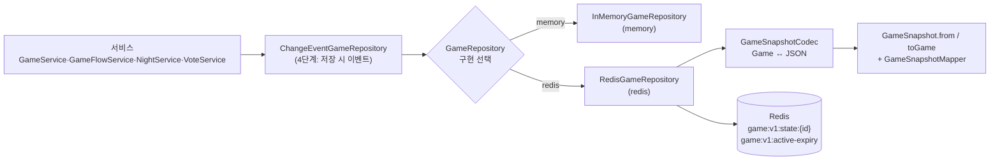
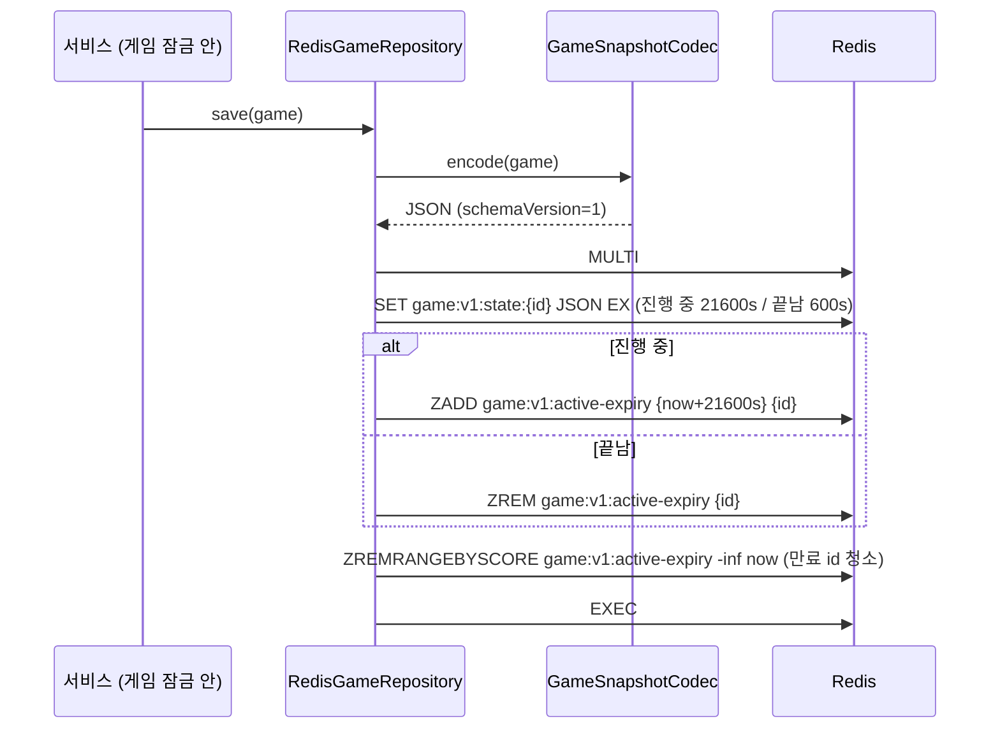

# 1단계 — 게임 상태를 Redis로

작성: 원우 (klik075) · 기준: `project_server` `dev` · 관련 커밋: `df4c6c3` ~ `ffd2203` · 2026-10-12
← [00_개요](멀티서버_00_개요.md) · 다음 → [02_분산잠금](멀티서버_02_분산잠금.md)

## 1. 한눈에 보기

| 항목 | 예전 | 지금 |
| --- | --- | --- |
| 게임 한 판 저장 위치 | 서버 메모리 Map (`InMemoryGameRepository`) | **Redis** `game:v1:state:{gameId}` (JSON 문자열) |
| 조회 결과 | 매번 **같은 Game 객체** | 매번 **새 Game 객체** (JSON에서 다시 만듦) |
| 진행 중 게임 목록 | Map의 값 전체 | `game:v1:active-expiry` ZSET (점수 = 만료 시각) |
| 서버 재시작 | 진행 중 게임 사라짐 | 게임이 남아 있음 (타이머는 3단계에서 해결) |
| 고르는 방법 | 없음 | `mafia.game.repository=memory/redis` (비우면 `SERVER_MODE`를 따름) |

핵심 한 줄: **"게임을 불러와(load) → 고치고 → 저장(save)"** 하는 규칙이 생겼습니다. 예전에는 메모리의 같은 객체를 고치기만 하면 끝이었지만, 이제는 `save()`를 빼먹으면 변경이 사라집니다.

## 2. 왜 이렇게 바꿨나

- 서버 메모리에 있으면 서버가 꺼질 때 진행 중인 게임이 다 사라지고, 서버 2대면 서로 다른 게임을 봅니다.
- `Game` 엔티티를 그대로 JSON으로 만들면 게임 규칙 코드(필드 이름, getter)를 바꿀 때마다 저장 형식이 깨집니다. 그래서 **"무엇을 저장하는가"를 `GameSnapshot` record로 따로 정하고**, `Game ↔ GameSnapshot` 변환으로 잇습니다.
- Spring 기본 Redis 연결(로비·채팅이 쓰는 `spring.data.redis.*`)을 건드리지 않으려고 **게임 그룹 Redis 연결(`GameRedis`)** 을 따로 둡니다. 지금은 같은 Redis를 보지만 나중에 host만 바꾸면 게임용 Redis를 분리할 수 있습니다.

## 3. 동작 흐름

### 3-1. 저장 / 조회 경로



- 서비스는 `GameRepository` 인터페이스만 압니다. 어떤 구현이 붙었는지 모릅니다.
- 4단계에서 `ChangeEventGameRepository`가 모든 구현을 한 번 더 감싸 "저장됨" 이벤트를 냅니다. ([04_서버](멀티서버_04_WebSocket_서버.md))

### 3-2. 저장 (`save`)



- 상태 키·목록·청소를 `MULTI/EXEC`로 묶어 "상태만 바뀌고 목록은 안 바뀐" 중간 상태가 남지 않게 합니다.
- 저장할 때마다 TTL과 만료 점수가 함께 늘어납니다. 6시간 동안 한 번도 저장이 없으면 버려진 게임으로 보고 사라집니다.
- 동시에 두 서버가 같은 게임을 고치는 것은 여기서 막지 않습니다. **그건 2단계 게임 잠금이 맡습니다.**

### 3-3. 조회 (`findById`, `findActiveIds`)

| 메서드 | Redis 명령 | 설명 |
| --- | --- | --- |
| `findById(id)` | `GET game:v1:state:{id}` | JSON → `GameSnapshot` → **새 `Game`**. JSON이 깨졌거나 모르는 `schemaVersion`이면 예외 (조용히 "없는 게임"으로 취급하지 않음) |
| `findActiveIds()` | `ZRANGEBYSCORE active-expiry now +inf` | 만료 시각이 아직 안 지난 id만. 연결 끊김 검사·멈춘 게임 감시·재시작 복구가 씀 |
| `delete(id)` | `MULTI; DEL state; ZREM active; EXEC` | 끝난 게임 정리 타이머가 부름 |

> `findActiveIds`로 받은 id를 `findById` 했는데 비어 있을 수 있습니다(서버 시계와 Redis TTL 시계 차이, 그 사이 삭제). **받은 쪽은 비어 있으면 건너뜁니다.** 이 규칙은 `GameRepository.findActiveIds` 주석에 있습니다.

### 3-4. 클라이언트 입장에서 달라진 것

**없습니다.** REST API·응답 모양은 그대로입니다. 클라이언트가 `GET /api/v1/games/{id}`를 부르면 서버가 잠금 안에서 Redis에서 읽어 응답합니다. 서버를 재시작해도(`redis` 모드면) 같은 게임 id로 계속 조회됩니다.

## 4. 스크립트별 역할

### 4-1. 저장 형식 (`game/repository/snapshot/`, `game/entity/`)

| 파일 | 역할 |
| --- | --- |
| `GameSnapshot.java` | 게임 한 판의 **저장 형식** record. `schemaVersion`(현재 1), 페이즈·버전·날짜·플레이어·밤 행동·투표·처형 결과·`daySkippers` 등. `from(Game)` / `toGame()` |
| `PlayerSnapshot.java` | 플레이어 한 명의 저장 형식 (생존, 역할, 능력 사용 기록 등) |
| `RoleSnapshot.java` | 역할 상태 저장 형식 (역할마다 다른 내부 값) |
| `GameSnapshotMapper.java` (`game/entity`) | `Game ↔ GameSnapshot` 실제 변환. **`Game`과 같은 패키지**에 둬서 규칙에 안 쓰이는 내부 상태(밤 행동 확정자, 투표 완료자 등)를 package-private getter로만 열고, 규칙 검사 없이 상태를 채우는 `restoreState`도 이 패키지에서만 부르게 함 |
| `GameSnapshotCodec.java` | `Game ↔ JSON 문자열`. Spring의 `JsonMapper`를 주입받지 않고 **직접 만든다** (`spring.jackson.*`이 바뀌어도 저장 형식이 안 바뀌게) |

> **규칙**: `Game`/`GamePlayer`에 필드를 추가하면 `GameSnapshot`/`PlayerSnapshot`/`GameSnapshotMapper`를 같이 고칩니다. 빠뜨리면 `GameSnapshotFullRoundTripTest`가 실패합니다. 저장 형식이 바뀌면 `schemaVersion`을 올리고 옛 형식 읽는 방법을 정합니다.

### 4-2. 저장소와 연결 (`game/repository/`, `game/repository/redis/`)

| 파일 | 역할 |
| --- | --- |
| `GameRepository.java` | 인터페이스. `save`, `findById`, `findActiveIds`(1단계 추가), `delete` |
| `InMemoryGameRepository.java` | 서버 메모리 구현. `@ConditionalOnServerSetting(GAME_REPOSITORY, "memory")` |
| `RedisGameRepository.java` | Redis 구현. 키 구조·MULTI/EXEC·만료 ZSET (위 3-2, 3-3) |
| `GameRedisConfig.java` | `GAME_REPOSITORY=redis`일 때 `RedisGameRepository` Bean 등록 |
| `GameRedis.java` | 게임 그룹 Redis 연결(Lettuce + `StringRedisTemplate`)을 **감싼 클래스**. `RedisConnectionFactory`를 Bean으로 바로 등록하면 Spring Boot가 기본 연결을 안 만들어 로비·채팅이 깨지므로 감싼다. 첫 명령 때 접속 (Redis가 꺼져 있어도 서버는 뜸) |
| `GameRedisConnectionConfig.java` | `GameRedis` Bean 등록. 아래 조건일 때만 |
| `OnGameRedisNeededCondition.java` | 게임 저장소·게임 타이머·접속 기록 중 **하나라도 redis면** `GameRedis`가 필요하다고 판단 (게임 잠금은 Redisson 연결을 따로 씀) |
| `GameRedisProperties.java` | `mafia.redis.game.*`: host, port, database, password, `activeTtlSeconds`(21600), `endedTtlSeconds`(600) |

### 4-3. 서버 모드 (`common/servermode/`)

1단계 마지막에 저장소를 고르는 설정이 생겼고, 2~3.5단계에서 항목이 늘었습니다.

| 파일 | 역할 |
| --- | --- |
| `ServerSetting.java` | 모드를 따르는 설정 목록 enum: `GAME_REPOSITORY`(memory/redis), `GAME_LOCK`, `ROOM_LOCK`, `GAME_TIMER`, `GAME_ACTIVITY`(local/redis) |
| `ServerSettings.java` | 실제 값 계산. **① 개별 설정에 값이 있으면 그 값 ② 비어 있으면 모드 기본값** (single → 메모리, multi → redis) |
| `ConditionalOnServerSetting.java` / `OnServerSettingCondition.java` | `@ConditionalOnServerSetting(value=..., havingValue=...)`로 Bean을 고르는 조건 |
| `ServerSettingsCheck.java` | 서버 시작 시 `서버 설정: ...` 로그 + 맞지 않는 조합이면 **경고만** (multi인데 일부가 메모리 / single인데 일부만 redis / 게임 잠금은 redis인데 저장소는 memory) |

`application.properties`:

```properties
mafia.server.mode=${SERVER_MODE:single}
mafia.game.repository=${GAME_REPOSITORY:}          # 비우면 모드를 따름
mafia.redis.game.host=${GAME_REDIS_HOST:${spring.data.redis.host}}
mafia.redis.game.port=${GAME_REDIS_PORT:${spring.data.redis.port}}
```

### 4-4. 재시작 복구 (`game/service/GameTimerRecovery.java`)

- `mafia.game.timer=local`일 때만 켜집니다. 메모리 타이머는 재시작하면 예약이 사라지므로, 서버가 켜질 때(`ApplicationReadyEvent`) `findActiveIds()`로 진행 중 게임을 읽어 **페이즈 타이머를 다시 겁니다.**
- 이미 끝날 시각이 지났으면 바로 실행. 잠금을 못 잡으면 최대 `MAX_ROUNDS`(3)번 다시 돌립니다.
- Redis 타이머(3단계)에서는 예약이 Redis에 남으므로 필요 없고, 대신 `StuckGameWatchdog`이 비슷한 일을 합니다.

### 4-5. 함께 바뀐 서비스 코드

- 모든 서비스 메서드가 **잠금 안에서 `findById` → 수정 → `save`** 순서를 지키도록 정리했습니다. 예전처럼 잠금 밖에서 가져온 `Game` 객체를 들고 다니면 낡은 값이 됩니다.
- `daySkippers`(낮 스킵 투표자)처럼 엔티티에만 있고 저장 형식에 빠져 있던 상태를 스냅샷에 넣었습니다 (`0558e5d`).

## 5. 규칙 / 예외

| 규칙 | 이유 |
| --- | --- |
| 바꿨으면 반드시 `save()` | 조회할 때마다 새 객체라 안 저장하면 변경이 사라짐 |
| 잠금 안에서 load → save | 잠금 밖 객체는 낡은 값일 수 있음 (2단계) |
| 저장 형식 변경 시 `schemaVersion` | 이미 Redis에 있는 게임을 읽을 수 있어야 함 |
| JSON이 깨지면 예외 | "게임이 없음(404)"으로 덮으면 버그를 못 찾음 |
| `findActiveIds` 결과의 `findById`가 비면 건너뜀 | 시계 차이·그사이 삭제 |
| TTL은 안전장치일 뿐 | 정상 삭제는 종료 60초 후 정리 타이머(`onCleanup`)가 함 |

## 6. 테스트

| 테스트 | 확인하는 것 |
| --- | --- |
| `GameSnapshotConversionTest` | `Game → GameSnapshot → Game` 변환 |
| `GameSnapshotJsonTest` | JSON 모양, `schemaVersion`, 모르는 버전 거절 |
| `GameSnapshotFullRoundTripTest` | 모든 필드가 왕복 후 같은지 (필드를 빠뜨리면 실패) |
| `support/CopyingGameRepository` (+ `ContractTest`, `Test`) | **테스트용 저장소**. 저장/조회 때마다 코덱으로 JSON 복사 → 메모리 테스트에서도 "save를 안 하면 사라짐"이 재현됨 |
| `GameSaveDisciplineTest` | 서비스가 고친 뒤 빠짐없이 `save()` 하는지 |
| `RedisGameRepositoryTest` | 실제 Redis에서 키·TTL·active-expiry 청소 |
| `GameTimerRecoveryTest` | 재시작 시 페이즈 타이머 다시 걸기 |

## 7. 남은 일 / 주의

- 잠금을 잃는 극단적인 경우(Redis 장애 전환, 아주 긴 GC)까지 막으려면 저장할 때 버전을 비교하는 낙관적 잠금이 필요합니다 (2-9, 선택, 미구현).
- 게임 그룹 Redis와 로비 Redis를 실제로 나누는 것은 설정만 바꾸면 되지만, 아직 해 보지 않았습니다.
