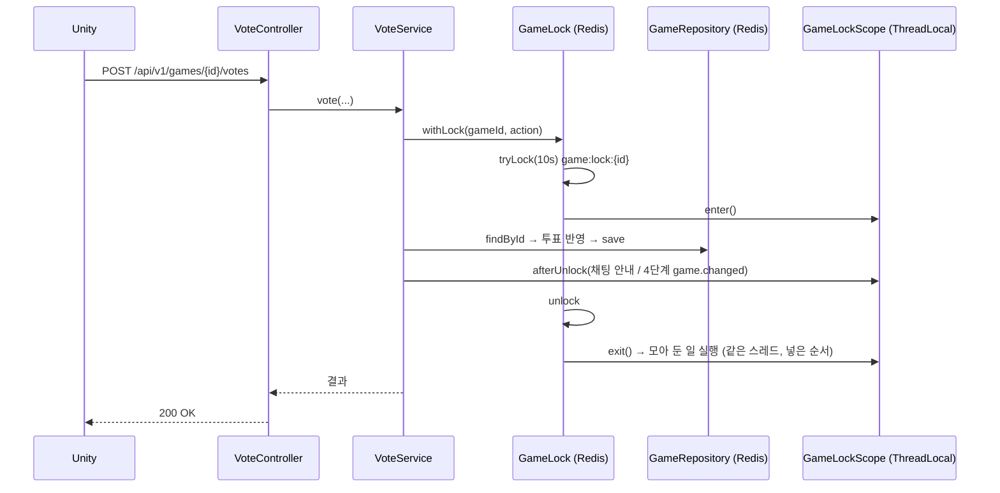
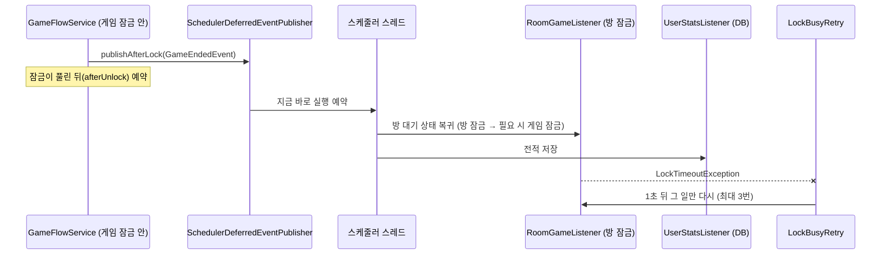
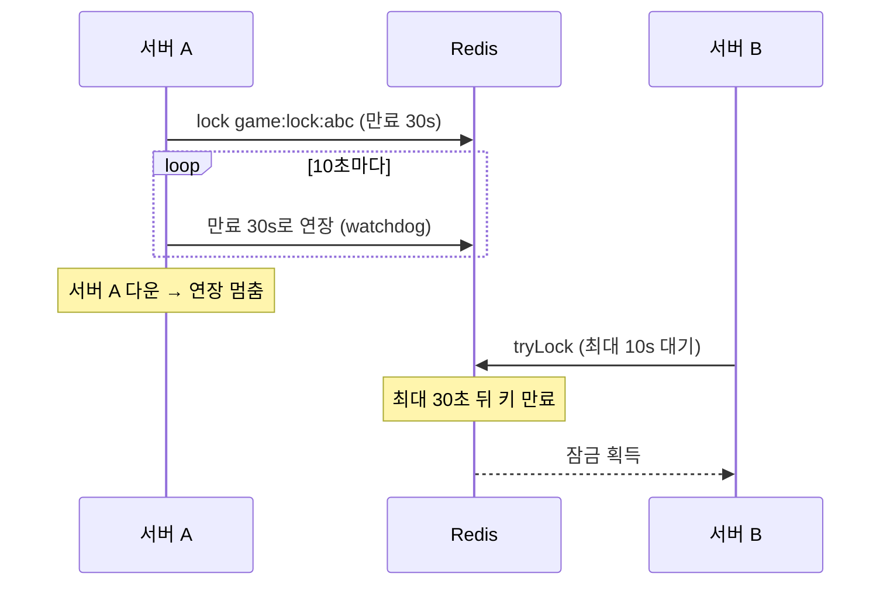

# 2단계 — 분산 잠금 (게임 잠금·방 잠금)

작성: 원우 (klik075) · 기준: `project_server` `dev` · 관련 커밋: `418b75e` ~ `63546ac` · 2026-10-12
← [01_게임상태_Redis](멀티서버_01_게임상태_Redis.md) · 다음 → [03_타이머_Redis](멀티서버_03_타이머_Redis.md)

## 1. 한눈에 보기

| 항목 | 예전 | 지금 |
| --- | --- | --- |
| 게임 잠금 | `synchronized(game)` | `GameLock` 인터페이스 → `LocalGameLock`(ReentrantLock) / `RedisGameLock`(Redisson, `game:lock:{id}`) |
| 방 잠금 | roomId별 `synchronized` | `RoomLock` → `LocalRoomLock` / `RedisRoomLock`(`room:lock:{id}`) |
| 잠금 대기 | 무한정 | **최대 10초** → 넘기면 `LockTimeoutException` → REST `503 LOCK_BUSY` + `Retry-After: 1` |
| 잠금 순서 | 규칙 없음 | **방 잠금 → 게임 잠금만 허용** (반대면 즉시 예외) |
| 잠금 안에서 하는 일 | 상태 변경 + 채팅 안내 + 로비/전적 이벤트 | **상태 변경·저장만**. 알리는 일은 `afterUnlock`, 다른 잠금·DB 쓰는 일은 `DeferredEventPublisher` |
| 서버가 죽으면 | — | Redisson watchdog이 연장을 멈춰 **최대 30초 뒤 잠금이 풀림** |

설정: `mafia.game.lock`, `mafia.room.lock` (local/redis, 비우면 `SERVER_MODE`), `mafia.lock.wait-timeout-millis=10000`

## 2. 왜 필요한가

1단계로 게임이 Redis에 있으니 서버 2대가 같은 게임을 동시에 `load → 수정 → save` 하면 한쪽 변경이 덮어써집니다(lost update). `synchronized`는 같은 JVM 안에서만 막으므로 **Redis에 있는 잠금**이 필요합니다. 방(로비, `room:{id}`)도 마찬가지입니다.

잠금이 Redis로 가면 느려지거나 막힐 수 있어서 함께 정한 것들:

- **대기 시간 제한**: 무한정 기다리면 요청 스레드가 다 묶임 → 10초 후 실패하고 클라이언트가 다시 시도.
- **잠금 안을 짧게**: 잠금 안에서 채팅 저장·WebSocket 전송을 하면 그만큼 다른 요청이 줄 섬.
- **잠금 순서**: 서버 A가 "게임 → 방", 서버 B가 "방 → 게임"으로 잡으면 서로 기다리며 멈춤(교착).

## 3. 동작 흐름

### 3-1. REST 요청 하나 (예: 투표)



- 모아 둔 일은 **API 응답 전에** 같은 스레드에서 끝나므로 순서가 바뀌지 않습니다.
- 잠금을 10초 안에 못 잡으면 `action`은 실행되지 않고 `LockTimeoutException` → `GlobalExceptionHandler`가 아래처럼 응답합니다.

```http
HTTP/1.1 503 Service Unavailable
Retry-After: 1

{"code":"LOCK_BUSY","message":"요청이 몰려 처리하지 못했습니다. 잠시 후 다시 시도해 주세요."}
```

### 3-2. 게임 종료처럼 다른 모듈이 받는 이벤트



- 받는 쪽이 방 잠금이나 DB 트랜잭션을 잡으므로 **게임 잠금을 쥔 채로 처리하면 교착 위험**이 있습니다. 그래서 잠금이 풀린 뒤 다른 스레드에서 발행합니다.
- 리스너 하나가 잠금 실패로 실패하면 이벤트 전체를 다시 발행하지 않고 **실패한 그 일만** 다시 시도합니다. (전체 재발행 시 이미 성공한 전적 저장이 두 번 쌓임)

### 3-3. 타이머가 잠금을 못 잡을 때

`GameFlowService.onPhaseTimeout` / `onCleanup`은 `LockTimeoutException`을 받으면 **`LOCK_RETRY_DELAY`(1초) 뒤로 같은 타이머를 다시 예약**합니다. 그사이 다른 경로로 페이즈가 넘어갔으면 다시 실행할 때 버전이 달라 무시됩니다.

### 3-4. 서버가 잠금을 쥔 채 죽으면



B의 요청은 10초 대기 후 503이 될 수 있지만, 클라이언트가 다시 시도하면 늦어도 30초 안에 이어집니다.

### 3-5. 클라이언트 입장에서 달라진 것

- 드물게 `503 LOCK_BUSY`가 올 수 있습니다. 클라이언트는 1초 뒤 같은 요청을 다시 보내면 됩니다. (폴링 GET은 다음 주기에 저절로 다시 감)
- 그 외 API는 그대로입니다.

## 4. 스크립트별 역할

### 4-1. 게임 잠금 (`game/lock/`)

| 파일 | 역할 |
| --- | --- |
| `GameLock.java` | 인터페이스. `withLock(gameId, Supplier)`, `runWithLock(gameId, Runnable)`. 계약: 재진입, 대기 시간 초과 시 `LockTimeoutException`(작업 미실행), 잠금 안에서는 상태 변경·저장만, 잡은 직후 `GameLockScope.enter()`/푼 직후 `exit()` |
| `LocalGameLock.java` | `ReentrantLock` + `tryLock(waitTimeout)`. 서버 1대용. `DEFAULT_WAIT_TIMEOUT` 10초 |
| `redis/RedisGameLock.java` | Redisson `RLock`, 키 `game:lock:{gameId}`(데이터가 없어 버전 없음). 재진입은 Redisson이 서버+스레드별로 셈. leaseTime 미지정 → watchdog 자동 연장. 잠금을 잃은 채 끝나면 unlock 대신 경고만 (작업 결과·예외를 덮지 않게) |
| `redis/GameLockRedisConfig.java` | `GAME_LOCK=redis`일 때 **게임 그룹 Redis**(`mafia.redis.game.*`)로 `gameRedisson` 연결을 만들고 `RedisGameLock` 등록 |
| `GameLockConfig.java` | `GAME_LOCK=local`일 때 `LocalGameLock` 등록 |
| `GameLockScope.java` | ThreadLocal로 "이 스레드가 게임 잠금을 쥐었나"와 "잠금이 풀린 뒤 할 일"을 기억. `afterUnlock(action)`, `isHeld()`, `requireNotHeld(lockName, key)`, `enter()`/`exit()`. 모아 둔 일 하나가 실패해도 나머지는 실행, 작업이 예외로 끝나도 실행 |

### 4-2. 방 잠금 (`lobby/lock/`, `lobby/config/`)

| 파일 | 역할 |
| --- | --- |
| `RoomLock.java` | 인터페이스. 게임 잠금과 같은 계약 + **게임 잠금 안에서 부르면 `IllegalStateException`** (`GameLockScope.requireNotHeld`) |
| `LocalRoomLock.java` | ReentrantLock 구현 |
| `redis/RedisRoomLock.java` | Redisson, 키 `room:lock:{roomId}` |
| `redis/RoomLockRedisConfig.java` | `ROOM_LOCK=redis`일 때 **로비 그룹 Redis**(`spring.data.redis.*`)로 Redisson 연결 |
| `RoomLockConfig.java` | `ROOM_LOCK=local`일 때 `LocalRoomLock` |

### 4-3. 공통 (`common/`)

| 파일 | 역할 |
| --- | --- |
| `redis/RedissonClients.java` | Redisson 연결 생성 도우미. **starter를 안 쓰는 이유**: starter는 Spring 기본 `RedisConnectionFactory`를 Redisson 것으로 바꿔 로비·채팅(Lettuce)까지 바뀜. 풀 크기 16, 최소 idle 2, watchdog 30초. **만드는 순간 접속** → Redis가 꺼져 있으면 서버 시작 실패 (그래서 redis 잠금일 때만 만듦) |
| `exception/LockTimeoutException.java` | 대기 시간 초과 예외 |
| `exception/GlobalExceptionHandler` | `LockTimeoutException` → `503 LOCK_BUSY` + `Retry-After: 1` |
| `lock/LockBusyRetry.java` | 이벤트 리스너용. 잠금 초과만 `RETRY_DELAY`(1초) 간격 최대 `MAX_ATTEMPTS`(3)번. 다른 예외는 첫 시도면 던지고 재시도 중이면 로그만. 다시 하는 일은 **여러 번 실행돼도 결과가 같아야** 함 |

### 4-4. 잠금 밖으로 미루기 (`game/scheduling/`)

| 파일 | 역할 |
| --- | --- |
| `DeferredEventPublisher.java` | "게임 잠금이 풀린 뒤 처리돼야 하는 이벤트" 발행 인터페이스. event는 잠금 안에서 만든 **복사본**이어야 함 |
| `SchedulerDeferredEventPublisher.java` | `afterUnlock`으로 예약 자체를 미루고, 스케줄러에 "지금 바로" 예약 → 다른 스레드에서 발행. 리스너 예외는 로그만 |

### 4-5. 서비스 쪽 변경

| 위치 | 변경 |
| --- | --- |
| `GameFlowService.announce / announceToPirates` | 채팅 안내 발행을 `GameLockScope.afterUnlock`으로 |
| `GameFlowService.publishLater` | 게임 종료·연결 끊김 이벤트를 `DeferredEventPublisher`로 |
| `GameFlowService.onPhaseTimeout / onCleanup` | 잠금 실패 시 1초 뒤 재예약 (`LOCK_RETRY_DELAY`) |
| `RoomGameListener`, 방 복귀/제외/삭제 | `LockBusyRetry`로 감싸고, 잠금 안에서 상태를 다시 확인해 여러 번 실행해도 안전하게 |
| 채팅 조회 (`63546ac`) | 누가 볼 수 있는지(사망자·해적 채팅) 판단을 게임 잠금 안에서 읽도록 정리 (`ChatGameLockTest`) |

## 5. 규칙 / 예외 (꼭 지킬 것)

1. **잠금 순서는 방 → 게임.** 게임 잠금 안에서 `RoomLock`을 부르면 즉시 예외. 새 코드에서 게임 잠금 안에 로비 코드를 부르지 마세요.
2. **잠금 안에서는 load → 수정 → save만.** 알림은 `GameLockScope.afterUnlock`, 로비/DB는 `DeferredEventPublisher`.
3. **잠금 안에서 만든 값만 밖으로.** `Game` 객체를 밖으로 들고 나가지 말고 필요한 값(record)만 꺼냅니다. (예: `CleanupTarget`)
4. **재시도하는 일은 멱등.** 두 번 실행돼도 결과가 같게 잠금 안에서 상태를 다시 확인.
5. `LockTimeoutException`을 받은 타이머는 버리지 말고 다시 예약 (안 그러면 게임이 그 페이즈에 멈춤).

| 상황 | 결과 |
| --- | --- |
| REST 요청이 10초 안에 잠금 못 잡음 | 503 LOCK_BUSY, 작업 안 됨 → 클라 재시도 |
| 타이머가 잠금 못 잡음 | 1초 뒤 같은 타이머 재예약 |
| 이벤트 리스너가 잠금 못 잡음 | 그 일만 1초 간격 최대 3번 |
| 잠금을 쥔 서버가 죽음 | 최대 30초 뒤 자동 해제 |
| 작업 중 예외 | finally에서 unlock, 원래 예외 그대로 전달, 모아 둔 afterUnlock은 실행 |

## 6. 테스트

| 테스트 | 확인하는 것 |
| --- | --- |
| `support/LockContractTest` | 모든 잠금 구현 공통 계약 (재진입, 대기 초과, 예외 시 해제, 다른 키 독립) |
| `LocalGameLockTest`, `LocalRoomLockTest` | 메모리 구현이 계약 통과 |
| `RedisGameLockTest`, `RedisRoomLockTest` | Redisson 구현이 계약 통과 (실제 Redis) |
| `DistributedLockMultiServerTest` | Redisson 연결 2개(서버 2대 흉내)에서 같은 키를 동시에 못 잡음, 한쪽이 죽으면 watchdog 만료 후 다른 쪽이 잡음 |
| `RedissonClientsTest`, `RedissonConnectionSelectionTest`, `LockSelectionTest` | 설정에 따라 연결·구현이 맞게 골라짐 |
| `GameLockScopeTest` | afterUnlock 순서, 재진입 깊이, 예외 시 실행 |
| `LockOrderTest` | 게임 잠금 안에서 방 잠금 → 예외 |
| `GlobalExceptionHandlerLockTimeoutTest` | 503 + Retry-After + LOCK_BUSY |
| `LockBusyRetryTest` | 재시도 횟수·간격·다른 예외 처리 |
| `LockTimeoutRetryTest` | 페이즈/정리 타이머가 잠금 실패 시 재예약 |
| `AnnounceAfterUnlockTest` | 채팅 안내가 잠금이 풀린 뒤 발행 |
| `ChatGameLockTest` | 채팅 공개 범위 판단이 잠금 안에서 |

## 7. 남은 일 / 주의

- 잠금을 잃은 채로 저장하는 극단적인 경우를 막는 **버전 비교 저장(2-9)** 은 선택 사항으로 남겨 둠.
- `redis` 잠금이면 서버 시작 시 Redis가 반드시 켜져 있어야 합니다 (Redisson은 즉시 접속).
