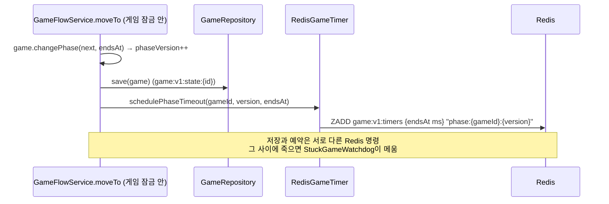
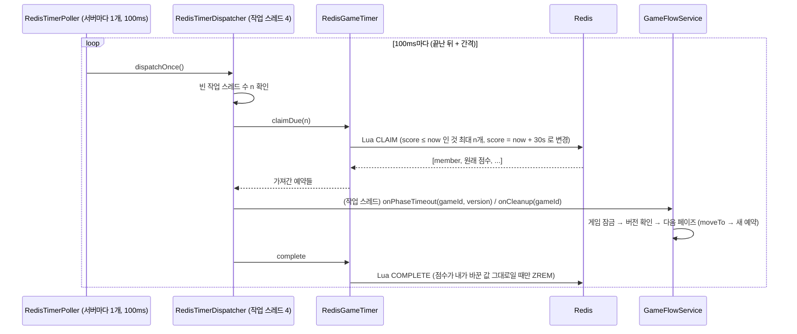
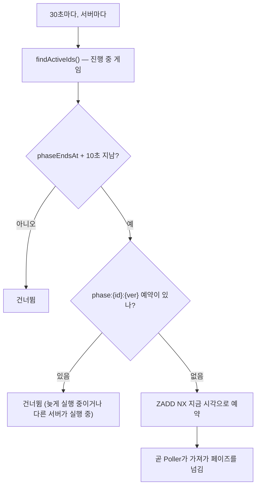
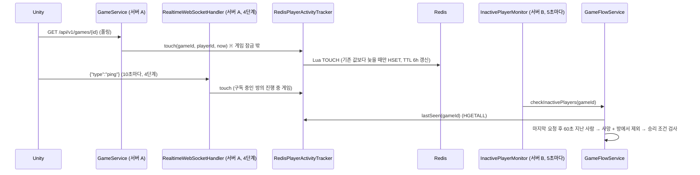

# 3단계 — 타이머를 Redis로 (+ 3.5단계 접속 기록)

작성: 원우 (klik075) · 기준: `project_server` `dev` · 관련 커밋: 3단계 `353119c` ~ `169f8ef`, 3.5단계 `334e246` ~ `4891630` · 2026-10-12
← [02_분산잠금](멀티서버_02_분산잠금.md) · 다음 → [04_WebSocket_서버](멀티서버_04_WebSocket_서버.md)

## 1. 한눈에 보기

| 항목 | 예전 | 지금 (`mafia.game.timer=redis`) |
| --- | --- | --- |
| 페이즈 제한 시간 | `TaskScheduler`에 `Runnable` 예약 (서버 메모리) | Redis ZSET `game:v1:timers`에 **"어떤 게임의 무엇을 언제"** 만 저장 |
| 끝난 게임 정리 (종료 60초 후 삭제) | 서버 메모리 예약 | 같은 ZSET (`cleanup:{gameId}`) |
| 실행하는 서버 | 예약한 서버 | **어느 서버든** 시간이 된 예약을 먼저 가져간 서버 |
| 서버가 꺼지면 | 예약이 사라져 게임이 멈춤 | 예약이 Redis에 남음 → 다른 서버/재시작한 서버가 실행 |
| 저장과 예약 사이에 서버가 죽으면 | — | `StuckGameWatchdog`이 30초마다 찾아 다시 예약 |
| 접속 기록 (3.5) | 서버 메모리 Map | Redis Hash `game:v1:activity:{gameId}` (더 늦은 시각만 반영) |

설정 (`application.properties`):

```properties
mafia.game.timer=${GAME_TIMER:}                      # local / redis, 비우면 모드를 따름
mafia.redis.game.timer.poll-interval-millis=100      # 확인 간격
mafia.redis.game.timer.lease-seconds=30              # 가져간 예약을 막아 두는 시간
mafia.redis.game.timer.batch-size=100
mafia.redis.game.timer.workers=4                     # 실행 스레드 수
mafia.game.activity=${GAME_ACTIVITY:}                # local / redis (3.5)
mafia.phase.ended-retention-seconds=60
```

페이즈 시간 기본값: 밤 30 · 밤 결과 5 · 낮 60 · 투표 30 · 처형 5 · 종료 후 보관 60초.

## 2. 왜 필요한가

- 메모리 타이머는 서버가 꺼지면 사라집니다. 게임 상태는 Redis에 남아도(1단계) "밤을 끝낼 사람"이 없어 영원히 밤입니다.
- 서버 여러 대에서 같은 게임 타이머를 서버마다 걸면 여러 번 실행됩니다. **한 예약은 한 서버만** 실행해야 합니다.
- 그래서 `GameTimer`는 실행할 코드(`Runnable`)가 아니라 **대상 이름 + 시각**만 받도록 바꿨습니다. 이름만 있으면 Redis에 넣었다가 어느 서버에서든 되살릴 수 있습니다.

## 3. 동작 흐름

### 3-1. 페이즈 전환과 타이머 예약



- 대상 이름(`TimerKeys`): 페이즈 `phase:{gameId}:{phaseVersion}`, 정리 `cleanup:{gameId}`.
- member가 대상 이름이라 **같은 대상을 다시 예약하면 점수(시각)만 바뀝니다** ("마지막 예약 하나만 남는다").
- 버전이 다르면 다른 예약입니다. 전원 제출로 밤이 일찍 끝나 다음 페이즈로 가면 옛 버전 예약은 남아 있다가 실행 시 버전이 달라 무시됩니다.

### 3-2. 시간이 되면 — 가져가기 / 실행 / 완료



**왜 Lua인가**: "점수가 지금 이하인 것 꺼내기"와 "점수를 미래로 밀기"가 Redis 안에서 한 번에 실행되므로, 여러 서버가 동시에 확인해도 **한 예약은 한 서버만** 가져갑니다.

**왜 점수를 비교하고 지우나 (COMPLETE)**:

- 실행 중에 같은 대상을 다시 예약했으면(잠금 실패 → 1초 뒤 재시도) 점수가 바뀌어 있으므로 지우지 않음 → 재시도가 살아남음.
- 실행이 30초(lease)보다 오래 걸려 다른 서버가 다시 가져갔으면 그 서버의 점수라 지우지 않음.

**적어도 한 번(at-least-once)**: 실행 도중 서버가 죽으면 점수(now+30s)가 30초 뒤 과거가 되어 다른 서버가 다시 가져갑니다. 드물게 두 번 실행될 수 있지만 `onPhaseTimeout`이 버전으로 지난 페이즈를 무시하므로 안전합니다.

**실패한 실행은 다시 하지 않고 지웁니다.** 같은 버그로 30초마다 계속 실패하지 않게 하기 위해서입니다. 받는 쪽이 스스로 처리합니다 (잠금 실패 → 재예약, 판정 오류 → 게임 취소 `cancelAfterError`).

**늦음 경고**: 예약 시각보다 1초 넘게 늦게 실행되면 경고 로그. 자주 보이면 workers가 모자라거나 잠금이 오래 막히는 것입니다.

### 3-3. 빈 스레드 수만큼만 가져가는 이유

가져간 예약은 30초 안에 실행돼야 합니다. 스레드가 모두 바쁜데 더 가져와 대기열에 쌓으면 기다리는 동안 lease가 지나 다른 서버가 또 실행할 수 있습니다. 그래서 **지금 바로 실행할 수 있는 개수만** 가져가고, 나머지는 Redis에 그대로 둡니다. 한 게임이 잠금을 최대 10초 기다려도 나머지 스레드로 다른 게임 타이머가 돕니다.

`RedisTimerPoller`는 가득 가져왔으면(밀린 예약이 더 있을 수 있음) 바로 다시 확인하되, 한 번에 최대 `MAX_ROUNDS_PER_TICK`(10)번까지만 이어서 돕니다. Redis 연결이 끊겨도 멈추지 않고 다음 간격에 다시 확인하며, 경고는 처음과 100번째마다만 남깁니다.

### 3-4. 멈춘 게임 감시 (`StuckGameWatchdog`)



- 잠금 없이 읽습니다 (바꾸는 것은 타이머 예약뿐). 여러 서버가 동시에 감시해도 `NX`라 예약은 하나만 생깁니다.
- 다루지 않는 것: 첫 밤 시작 전에 죽은 게임(걸 타이머가 없어 경고만), 끝난 게임 정리(상태 키 TTL로 결국 지워짐).
- 메모리 타이머(`local`)에서는 재시작 시 `GameTimerRecovery`가 같은 역할을 합니다.

### 3-5. 접속 기록과 연결 끊김 판정 (3.5단계)



- **잠금 밖에서 기록**: 서버가 잠금 때문에 잠깐 느려진 것만으로 미접속 처리되지 않게.
- **더 늦은 시각만**: 잠금 없이 여러 서버가 동시에 기록하므로, 늦게 도착한 오래된 요청이 최신 기록을 덮지 않게 Lua로 비교 후 저장.
- 게임 시작 시 `markAllSeen`으로 전원을 같은 시각으로 기록 (씬 로딩 중 미접속 판정 방지).
- 정리 타이머(`onCleanup`)가 게임을 지울 때 `activityTracker.clear(gameId)`.
- 4단계 이후 클라이언트는 신호를 받는 동안 폴링을 15초로 늦추지만 **ping(10초)이 접속 기록을 남기므로** 60초 판정에 걸리지 않습니다.

### 3-6. 클라이언트 입장에서 달라진 것

- REST는 그대로입니다. 페이즈가 바뀌는 시각이 최대 약 100ms(확인 간격) 늦어질 수 있습니다.
- 서버를 재시작해도(`multi` 모드) 게임이 그 페이즈에 멈추지 않고 이어집니다.

## 4. 스크립트별 역할

### 4-1. 타이머 공통 (`game/scheduling/`)

| 파일 | 역할 |
| --- | --- |
| `GameTimer.java` | 인터페이스. `schedulePhaseTimeout(gameId, version, at)`, `scheduleCleanup(gameId, at)`. 계약: 시각 전 실행 금지, 지난 시각은 바로, 같은 대상 재예약 시 마지막만, 실행 중 재예약은 남김, 예외는 밖으로 안 던짐 |
| `GameTimeoutHandler.java` | 시간이 되면 불리는 쪽 (`onPhaseTimeout`, `onCleanup`). `GameFlowService`가 구현 |
| `TimerKeys.java` | 대상 이름 생성(`phase:..`, `cleanup:..`)과 `parse()` (버전은 마지막 `:` 뒤에서 읽음) |
| `TimerTarget.java` | 이름을 되살린 대상 record (`kind`, `gameId`, `phaseVersion`). `fire(handler)`로 알맞은 메서드 호출 |
| `LocalGameTimer.java` | 메모리 구현. 작업 취소 대신 "대상별 마지막 예약 번호"로 오래된 예약을 건너뜀 (Redis의 점수 비교와 같은 규칙) |
| `GameTimerConfig.java` | `GAME_TIMER=local`일 때 `LocalGameTimer` 등록 |

> handler를 `Supplier`로 받는 이유: `GameFlowService`가 `GameTimer`를 주입받으면서 동시에 handler이기도 해서, 생성 시점에 바로 받으면 순환 의존이 생깁니다.

### 4-2. Redis 타이머 (`game/scheduling/redis/`)

| 파일 | 역할 |
| --- | --- |
| `RedisGameTimer.java` | ZSET `game:v1:timers`. ZADD 예약, Lua `CLAIM`/`COMPLETE`, `claimDue(limit)` + `runClaimed(c)`, 테스트용 `pollOnce()`, 감시용 `schedulePhaseTimeoutIfAbsent`(ZADD NX). lease 30초, batch 100, 늦음 경고 1초 |
| `RedisTimerDispatcher.java` | 빈 작업 스레드 수만큼 가져가 스레드에 넘김 (workers 기본 4). 종료 시 실행 중인 것을 최대 5초 기다림 |
| `RedisTimerPoller.java` | SmartLifecycle. 서버가 켜지면 바로 1회, 이후 "끝난 시각 + 100ms"마다 (fixed delay, 겹쳐 돌지 않음). `MAX_ROUNDS_PER_TICK` 10, 실패 로그 100번마다 |
| `StuckGameWatchdog.java` | 30초마다, GRACE 10초. 예약이 없는 멈춘 게임에 ZADD NX |
| `RedisTimerProperties.java` | `mafia.redis.game.timer.*` (poll-interval-millis, lease-seconds, batch-size, workers) |
| `GameTimerRedisConfig.java` | `GAME_TIMER=redis`일 때 위 Bean들을 등록 |

### 4-3. 접속 기록 (`game/activity/`, 3.5단계)

| 파일 | 역할 |
| --- | --- |
| `PlayerActivityTracker.java` | 인터페이스. `markAllSeen`, `touch`, `lastSeen`(복사본), `clear`. 계약 7개 (그대로 돌려줌 / 시작 시 전원 기록 / 더 늦은 시각만 / 게임끼리 분리 / 지우면 그 게임만 / 복사본 / null이면 무시) |
| `LocalPlayerActivityTracker.java` | 메모리 구현 |
| `redis/RedisPlayerActivityTracker.java` | Hash `game:v1:activity:{gameId}` (field=playerId, value=epoch ms). Lua `TOUCH`로 비교 후 HSET + TTL 6시간, `markAllSeen`은 전원을 스크립트 1번으로 |
| `PlayerActivityConfig.java` / `redis/PlayerActivityRedisConfig.java` | `GAME_ACTIVITY` 값으로 구현 선택 |
| `game/service/InactivePlayerMonitor.java` | `inactiveCheckSeconds`(5초)마다 `findActiveIds()`의 모든 게임에 `checkInactivePlayers`. 게임마다 예외를 잡아 검사가 멈추지 않게 |
| `GameService.touch` | 상태 조회·내 역할 조회 때 게임 잠금 **밖에서** 참가자 확인 후 기록 |

### 4-4. `GameFlowService` 변경 요약

| 메서드 | 내용 |
| --- | --- |
| `moveTo` | 페이즈 변경 → **저장 → 예약** 순서 (예약을 먼저 하면 저장 전에 타이머가 돌 수 있음) |
| `onPhaseTimeout(gameId, expectedVersion)` | 잠금 → 게임 없음/버전 다름/끝남이면 무시 → 페이즈별 다음 단계. 잠금 실패 시 1초 뒤 재예약 |
| `onCleanup(gameId)` | 잠금 안에서 roomId·취소 여부만 꺼냄 → (취소 게임이면) 방 삭제 이벤트 → 게임 삭제 → 접속 기록 삭제 |
| `scheduleCleanup` | 종료 시 `ended-retention-seconds`(60초) 뒤로 예약 |

## 5. 규칙 / 예외

| 상황 | 동작 |
| --- | --- |
| 같은 예약이 두 번 실행 | 받는 쪽이 버전으로 무시 → 안전 |
| 실행 중 서버 다운 | 30초(lease) 뒤 다른 서버가 다시 실행 |
| 저장 후·예약 전 서버 다운 | 최대 약 40초(30초 주기 + 10초 GRACE) 뒤 감시가 다시 예약 |
| 실행이 예외로 끝남 | 예약은 지우고 다음 예약 계속 (재시도 안 함) |
| 잠금을 못 잡음 | 받는 쪽이 1초 뒤 같은 대상 재예약 → COMPLETE가 지우지 않음 |
| Redis 연결 끊김 | Poller는 계속 다음 간격에 재시도, 복구되면 로그 |
| 서버 시계 차이 | 점수는 각 서버 Clock 기준이라 그만큼 일찍/늦게 실행 (NTP 전제) |

## 6. 테스트

| 테스트 | 확인하는 것 |
| --- | --- |
| `support/GameTimerContractTest` | 모든 타이머 구현 공통 계약 |
| `LocalGameTimerTest`, `RedisGameTimerTest` | 각 구현이 계약 통과 + Lua 가져가기/완료 규칙 |
| `TimerKeysTest` | 이름 생성·`parse` (gameId에 `:`가 있어도) |
| `RedisTimerDispatcherTest` | 빈 스레드 수만큼만 가져감, 종료 처리 |
| `RedisTimerPollerTest` | 간격, 이어서 확인, 실패 후 계속, start/stop |
| `RedisTimerGameFlowTest` | **통합**: 5인 게임을 Redis 타이머 + Redis 저장소로 진행, 서버 여러 대/재시작 흉내 (`MutableClock`) |
| `StuckGameWatchdogTest` | 멈춘 게임만 다시 예약, NX |
| `support/PlayerActivityTrackerContractTest` | 접속 기록 계약 7개 |
| `LocalPlayerActivityTrackerTest`, `RedisPlayerActivityTrackerTest` | 각 구현 |
| `RedisActivityMultiServerTest` | **통합**: 서버 A가 받은 요청을 서버 B의 미접속 검사가 봄 |

## 7. 남은 일 / 주의

- 정리 타이머가 실패한 끝난 게임은 감시 대상이 아니라 상태 키 TTL(600초)로 지워집니다.
- 첫 밤 시작 전에 서버가 죽은 게임은 자동 복구되지 않습니다 (경고 로그만).
