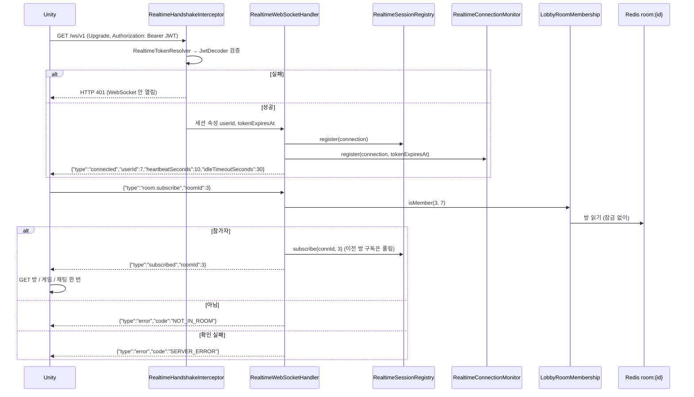
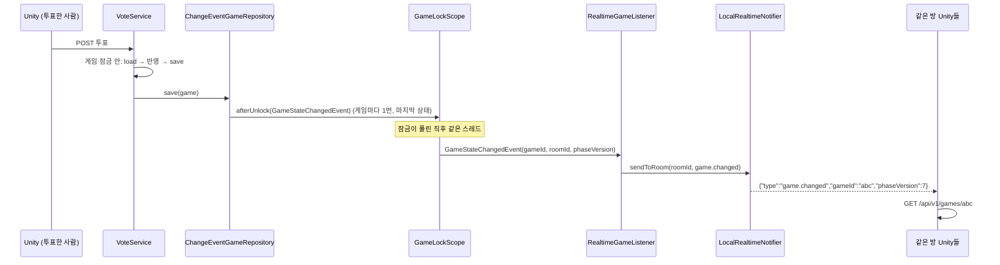
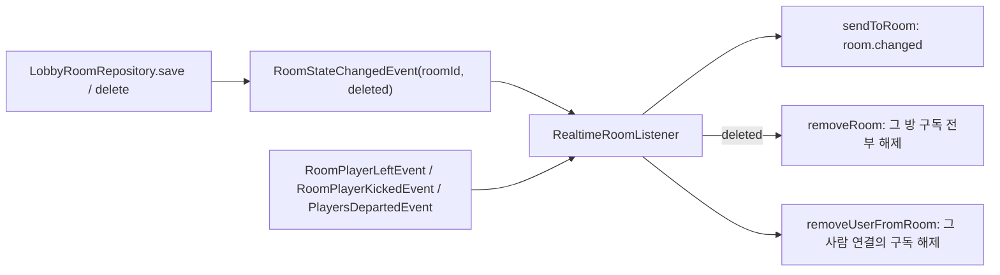
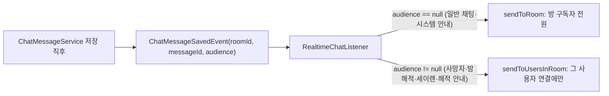
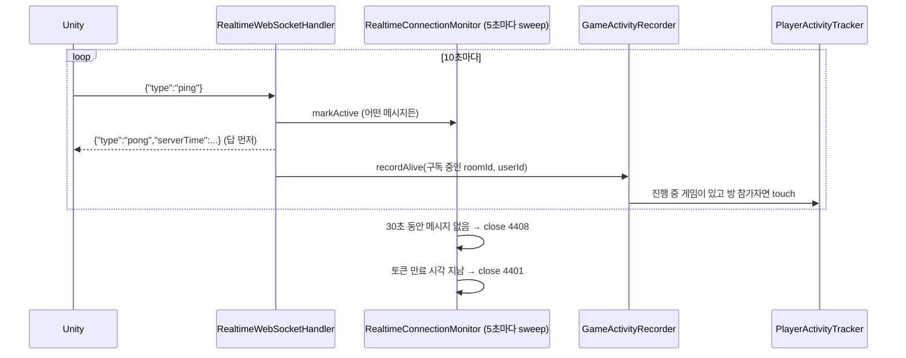

# 4단계 (서버) — WebSocket 실시간 신호 `/ws/v1` (서버 1대 기준)

작성: 원우 (klik075) · 기준: `project_server` `dev` · 관련 커밋: `08045f2` ~ `882f508` · 2026-10-12
← [03_타이머_Redis](멀티서버_03_타이머_Redis.md) · 짝 문서 → [04_WebSocket_클라이언트](멀티서버_04_WebSocket_클라이언트.md) · 메시지 규칙 원문 → [websocket-protocol.md](websocket-protocol.md)

## 1. 한눈에 보기

| 항목 | 내용 |
| --- | --- |
| 주소 | `ws://{서버}/ws/v1` (https면 `wss://`) |
| 인증 | 연결(handshake) 때 JWT. `Authorization: Bearer` 헤더 → 없으면 `?token=` |
| 보내는 것 | **"바뀌었다" 신호만** (`game.changed`, `room.changed`, `chat.changed`). 내용은 없음 |
| 내용 가져오기 | 신호를 받은 클라이언트가 **기존 REST GET**으로 |
| 요청 (투표·밤 행동·채팅 보내기) | 그대로 **REST** |
| 구독 단위 | 연결 하나당 방 하나 (`room.subscribe`) |
| 살아 있음 확인 | 클라 ping 10초마다 → pong. 30초 무응답이면 서버가 close **4408** |
| 토큰 만료 | 연결 중 만료되면 close **4401** |
| 신호 전송 구현 | `LocalRealtimeNotifier` (서버 메모리) → **서버 1대에서만 완전**. 여러 대는 5단계(Redis Pub/Sub) |

### 왜 "신호만" 보내나

- 역할 비공개·해적 전용 채팅 같은 **보이는 정보 처리가 REST 응답 한곳에만** 있습니다. WebSocket으로 내용을 보내면 같은 규칙을 두 곳에 구현해야 하고, 하나만 틀려도 정보가 샙니다.
- 신호를 놓쳐도 다음 GET이 최신 상태를 가져오므로 **메시지를 쌓아 두거나 순서를 맞출 필요가 없습니다.** 연결이 없는 사람에게 갈 신호는 그냥 버립니다.
- 클라이언트는 기존 폴링 코드를 그대로 쓰고 "언제 GET할지"만 바뀝니다.

## 2. 메시지 정리

### 서버 → 클라이언트

| type | 필드 | 언제 | 클라이언트가 할 일 |
| --- | --- | --- | --- |
| `connected` | `userId`, `heartbeatSeconds`(10), `idleTimeoutSeconds`(30) | 연결 직후 1번 | 보고 있는 방을 `room.subscribe` |
| `pong` | `serverTime`(epoch ms) | ping에 대한 답 | 시계 차이 측정 (선택) |
| `subscribed` | `roomId` | 구독 성공 | 방·게임·채팅을 **GET 한 번** (구독 전 변경을 놓치지 않게) |
| `game.changed` | `gameId`, `phaseVersion` | 게임 상태가 저장될 때마다 | `GET /api/v1/games/{gameId}` (항상, 버전은 참고용) |
| `room.changed` | `roomId` | 방 저장·삭제 | `GET /api/v1/rooms/{roomId}` |
| `chat.changed` | `roomId`, `lastMessageId` | 채팅 저장 (볼 수 있는 사람에게만) | 이미 그 id까지 받았으면 무시, 아니면 `GET .../messages?afterId=` |
| `error` | `code`, `message` | 메시지 처리 실패 (연결은 유지) | 아래 표 |

### 클라이언트 → 서버

```json
{"type":"ping"}
{"type":"room.subscribe","roomId":3}
{"type":"room.unsubscribe","roomId":3}
```

### error code / close code

| 코드 | 의미 | 클라이언트 |
| --- | --- | --- |
| `BAD_MESSAGE` | JSON 아님, 값 없음, 4096자 초과 | 버그. 로그 |
| `UNKNOWN_TYPE` | 모르는 type | 버그. 로그 |
| `NOT_IN_ROOM` | 들어 있지 않은 방 구독 | 구독 포기, 폴링 유지 |
| `SERVER_ERROR` | 방 확인 실패 (Redis 등) | 잠시 뒤 다시 구독 |
| close `4408` | 30초 동안 메시지 없음 | 재연결 |
| close `4401` | 토큰 만료 | 재연결 중단, 다시 로그인 |
| handshake HTTP 401 | 토큰 없음/잘못됨/만료 | 재연결 중단, 다시 로그인 |

## 3. 동작 흐름

### 3-1. 연결과 구독



- 게임 중 사망자도 방에 남아 있으므로 구독할 수 있습니다. 연결이 끊겨 게임에서 내보내진 사람은 방에서 빠져 구독할 수 없습니다.

### 3-2. 게임 상태 변경 → `game.changed`



- **왜 저장소에서 발행하나**: 게임을 바꾸는 곳이 `GameFlowService`, `GameService`, `NightService`, `VoteService` 등 여러 곳입니다. 각자 알리면 하나만 빠뜨려도 화면이 안 바뀝니다. 모든 변경은 결국 `save()`를 지나므로 `ChangeEventGameRepository`가 한곳에서 잡습니다.
- **왜 잠금이 풀린 뒤인가**: 신호를 받은 클라이언트가 바로 GET을 보냈을 때 아직 잠금이 잡혀 있어 기다리는 일이 없게. 같은 잠금 안에서 여러 번 저장해도(투표 저장 → 바로 처형 판정 저장) 한 번만 보냅니다.
- **타이머가 넘긴 페이즈도 똑같이** `save()` → 신호입니다. 그래서 클라이언트 폴링이 15초여도 페이즈 전환이 바로 보입니다.
- 삭제(끝난 게임 정리)는 알리지 않습니다. 방 복귀는 `room.changed`로 갑니다.
- `roomId`가 숫자가 아니면(개발용 `POST /api/v1/games` 게임) 무시합니다.

### 3-3. 방 변경 → `room.changed` / 구독 정리



- 방이 저장되면 나간 사람에게도 한 번 신호가 갑니다 → 그 사람은 GET으로 "내가 빠졌음(강퇴 등)"을 압니다 → 그다음 퇴장/강퇴 이벤트로 구독이 풀립니다.
- 모든 방 변경(입장·퇴장·준비·방장 변경·강퇴·게임 시작·복귀·복구·삭제)은 저장소를 지나므로 빠지는 경우가 없습니다.

### 3-4. 채팅 → `chat.changed` (볼 수 있는 사람에게만)



- `audience`는 채팅 조회(GET)와 같은 규칙으로 **저장하는 순간 게임 잠금 안에서** 정합니다.
- 못 보는 사람에게 신호를 보내면 "지금 숨은 대화가 오간다"(밤에 해적이 대화 중)는 사실이 샙니다. 그래서 신호 자체를 보내지 않습니다.

### 3-5. 살아 있음 확인과 접속 기록



- 앱이 멈추거나 네트워크가 끊겨도 TCP 연결은 한동안 열린 채 남습니다. 그런 죽은 연결에 계속 신호를 보내지 않으려고 30초 기준으로 닫습니다 (sweep 주기 때문에 최대 5초 늦게).
- **WebSocket이 닫혀도 게임에서 바로 빠지지 않습니다.** 연결 끊김 판정은 기존처럼 마지막 요청(GET 또는 ping) 후 60초(`InactivePlayerMonitor`)입니다.
- ping이 접속 기록을 남기므로, 폴링을 15초로 늦춘 클라이언트도 미접속 처리되지 않습니다.

### 3-6. 보내기 (느린 클라이언트 보호)

`WebSocketRealtimeConnection`은 `ConcurrentWebSocketSessionDecorator`로 감쌉니다. 요청 스레드·타이머 스레드 등 여러 곳에서 같은 연결로 보내도 한 줄로 세우고, **5초 넘게 못 보내거나 64KB 넘게 쌓이면 연결을 닫습니다.** 느린 클라이언트 하나가 서버 스레드를 붙잡지 않게 하기 위해서입니다. 한 연결의 실패는 예외를 던지지 않아 같은 방의 다른 연결 전송에 영향이 없습니다.

## 4. 스크립트별 역할

### 4-1. 규칙과 메시지 (`realtime/protocol/`)

| 파일 | 역할 |
| --- | --- |
| `RealtimeProtocol.java` | 고정 값: `PATH`(/ws/v1), `TOKEN_QUERY_PARAM`(token), `HEARTBEAT_INTERVAL`(10초), `IDLE_TIMEOUT`(30초), `MAX_CLIENT_MESSAGE_CHARS`(4096), `CLOSE_IDLE_TIMEOUT`(4408), `CLOSE_TOKEN_EXPIRED`(4401) |
| `ServerMessage.java` | 서버 → 클라 sealed 인터페이스 + record들 (`Connected`, `Pong`, `Subscribed`, `GameChanged`, `RoomChanged`, `ChatChanged`, `ErrorMessage`). JSON 맨 앞에 `type` |
| `ClientMessage.java` | 클라 → 서버 (`Ping`, `RoomSubscribe`, `RoomUnsubscribe`) |
| `RealtimeMessageCodec.java` | 메시지 ↔ JSON. `JsonMapper`를 직접 만듦 (REST용 `spring.jackson.*`이 바뀌어도 Unity와 약속한 모양 유지). 모르는 필드 무시 |
| `RealtimeMessageException.java` / `RealtimeErrorCode.java` | 해석 실패 → `error` 메시지로 답 (연결 유지) |
| `RealtimeTokenResolver.java` | handshake에서 토큰 꺼내기 (헤더 우선, 없으면 쿼리) |

### 4-2. 연결 처리 (`realtime/`)

| 파일 | 역할 |
| --- | --- |
| `RealtimeWebSocketConfig.java` | `/ws/v1` 등록과 Bean 조립. Origin 전부 허용 (쿠키가 아니라 JWT 인증이라 안전, Unity는 Origin을 안 보냄). `/ws/**`는 SecurityConfig에서 permitAll, 인증은 인터셉터가 함 |
| `RealtimeHandshakeInterceptor.java` | JWT 검증 (REST와 같은 `JwtDecoder`). 실패 시 401. 성공 시 `userId`, `tokenExpiresAt`을 세션 속성에. **주소(URI)는 로그에 남기지 않음** (토큰이 들어 있을 수 있음) |
| `RealtimeWebSocketHandler.java` | 연결·메시지 처리 (connected, ping/pong, subscribe/unsubscribe, error, 끊김 정리) |
| `RealtimeConnection.java` | 연결 하나의 인터페이스 (`id`, `userId`, `send`, `close`). 연결 목록이 WebSocket을 몰라도 되게 |
| `WebSocketRealtimeConnection.java` | 실제 구현. 보내기 직렬화, 5초/64KB 제한 |
| `RealtimeSessionRegistry.java` | **이 서버의** 연결 목록 (연결→방, 사용자→연결들, 방→연결들). 한 사용자 여러 연결 허용(재연결이 겹치는 순간, 두 기기). 변경은 `synchronized`, 조회는 복사본 → 실제 전송은 잠금 밖 |
| `RealtimeConnectionMonitor.java` | 5초마다 sweep: 30초 무응답 4408, 토큰 만료 4401. SmartLifecycle |
| `RoomMembership.java` / `LobbyRoomMembership.java` | "이 사용자가 이 방에 있나" (로비 Redis `room:{id}`를 잠금 없이 읽음) |
| `RealtimeActivityRecorder.java` / `GameActivityRecorder.java` | ping → 구독 중인 방의 진행 중 게임에 `touch` (방 참가자만) |

### 4-3. 신호 보내기

| 파일 | 역할 |
| --- | --- |
| `RealtimeNotifier.java` | 다른 모듈이 신호를 보내는 **입구 인터페이스**. `sendToRoom`, `sendToUsersInRoom`, `sendToUser`, `removeUserFromRoom`, `removeRoom`. 5단계에서 구현만 바뀌고 보내는 쪽 코드는 그대로 |
| `LocalRealtimeNotifier.java` | 이 서버의 `RealtimeSessionRegistry`로 바로 전송. 메시지는 한 번만 JSON으로 바꿔 같은 문자열을 모든 연결에 |
| `RealtimeGameListener.java` | `GameStateChangedEvent` → `game.changed` |
| `RealtimeRoomListener.java` | `RoomStateChangedEvent` → `room.changed` (+삭제면 구독 해제), 퇴장·강퇴·연결 끊김 → 그 사람 구독 해제 |
| `RealtimeChatListener.java` | `ChatMessageSavedEvent` → `chat.changed` (audience에 따라 전원/일부) |

### 4-4. 다른 모듈에 추가된 것

| 파일 | 역할 |
| --- | --- |
| `game/event/GameStateChangedEvent.java` | `(gameId, roomId, phaseVersion)`. 게임 저장됨 |
| `game/repository/ChangeEventGameRepository.java` | 모든 게임 저장소를 감싸 `save()`마다 이벤트. 잠금 안이면 `afterUnlock`으로 게임당 1번(마지막 상태), 잠금 밖이면 바로 |
| `game/repository/GameChangeEventConfig.java` | `BeanPostProcessor`로 memory/redis 어느 저장소가 등록되든 감쌈 |
| `lobby/event/RoomStateChangedEvent.java` | `(roomId, deleted)`. `LobbyRoomRepository.save/delete` 직후 발행 |
| `chat/event/ChatMessageSavedEvent.java` | `(roomId, messageId, audience)`. `ChatMessageService` 저장 직후 발행 |
| `postman/websocket-check.postman_collection.json` (`882f508`) | WebSocket 확인용 Postman 컬렉션 (기존 컬렉션과 별도 파일) |

## 5. 규칙 / 예외

| 상황 | 동작 |
| --- | --- |
| 받는 사람이 연결돼 있지 않음 | 조용히 버림 (재연결 시 클라가 GET으로 맞춤) |
| 다른 방 구독 | 이전 방 구독 자동 해제 (연결당 방 1개) |
| 늦게 도착한 unsubscribe | 그 방을 구독 중일 때만 해제 (새로 구독한 방을 풀지 않음) |
| 잘못된 메시지 | `error`로 답, 연결 유지 |
| 바이너리 메시지 | `TextWebSocketHandler`가 거절하고 연결 닫음 |
| 한 연결 전송 실패 | 예외 없이 로그, 다른 연결은 계속 |
| 방 확인 중 Redis 오류 | `SERVER_ERROR` (클라가 잠시 뒤 재구독) |

> 새 기능을 만들 때: 게임 상태를 바꾸면 `save()`만 하면 신호는 저절로 갑니다. 방도 `LobbyRoomRepository`를 지나면 저절로 갑니다. **WebSocket으로 내용을 보내는 코드를 따로 만들지 마세요.**

## 6. 테스트

| 테스트 | 확인하는 것 |
| --- | --- |
| `protocol/RealtimeMessageCodecTest` | JSON 모양, 잘못된 메시지 코드 |
| `protocol/RealtimeTokenResolverTest` | 헤더 우선, 쿼리 대체 |
| `RealtimeWebSocketConnectionTest` | 실제 서버·WebSocket으로 연결(헤더/`?token=`), connected, ping/pong, 잘못된 메시지 error, 토큰 문제 시 401 |
| `RealtimeSessionRegistryTest` | 등록/구독/해제/여러 연결 |
| `RealtimeRoomSubscriptionTest` | 실제 연결로 구독 → 구독한 연결에만 신호 도착, NOT_IN_ROOM |
| `LocalRealtimeNotifierTest` | 방·사용자 단위 전송 |
| `RealtimeGameListenerTest`, `RealtimeGameChangeWiringTest` | 저장 → 잠금 해제 후 game.changed, 1번만 |
| `RealtimeRoomListenerTest` | room.changed, 삭제 시 구독 해제, 퇴장/강퇴 정리 |
| `RealtimeChatListenerTest` | audience별 전송 |
| `RealtimeConnectionMonitorTest` | 4408 / 4401 |
| `GameActivityRecorderTest` | ping → touch (참가자만) |
| `FakeConnection` | 테스트용 가짜 연결 |

## 7. 남은 일

| 항목 | 내용 |
| --- | --- |
| **5단계** | `RealtimeNotifier`를 Redis Pub/Sub 구현으로 (서버 여러 대에서 다른 서버의 연결에도 신호) |
| 유저 테스트 전 | `SERVER_MODE=multi` 확인, JWT 만료(현재 1시간) 늘리기, 프록시에 WebSocket Upgrade 헤더 |
| 서버 버그 | 게스트 로그인에 UUID가 아닌 `guestUuid`를 보내면 500 → 400으로 고쳐야 함 |
