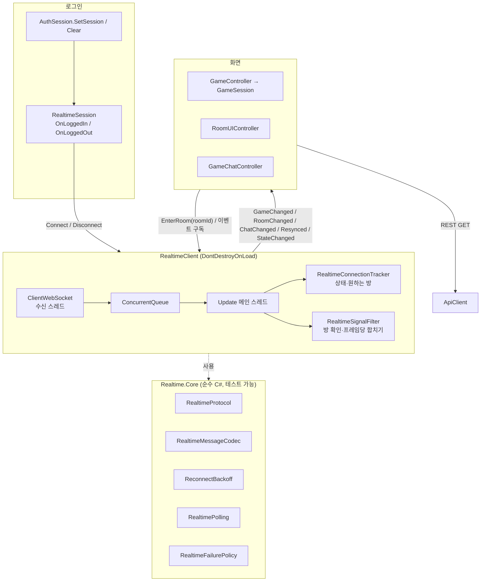
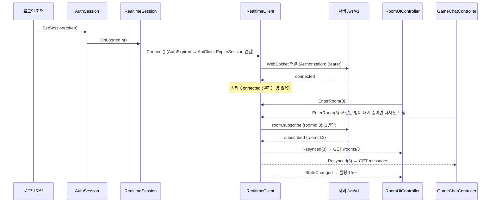
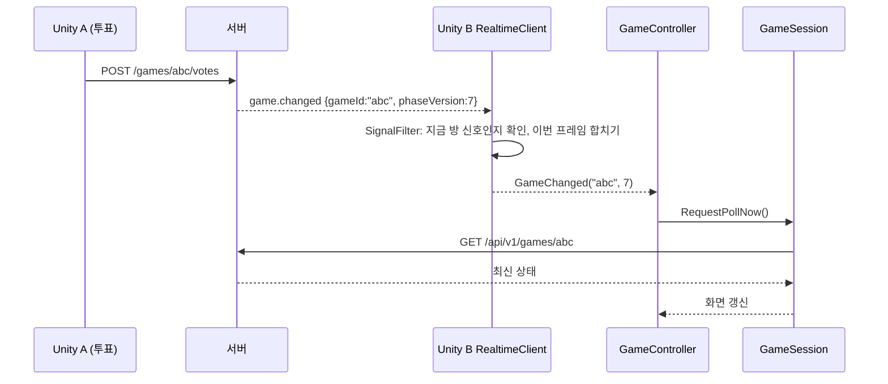
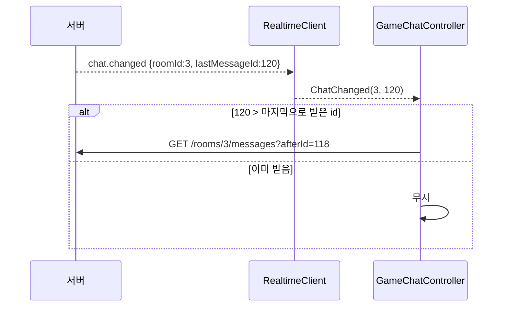
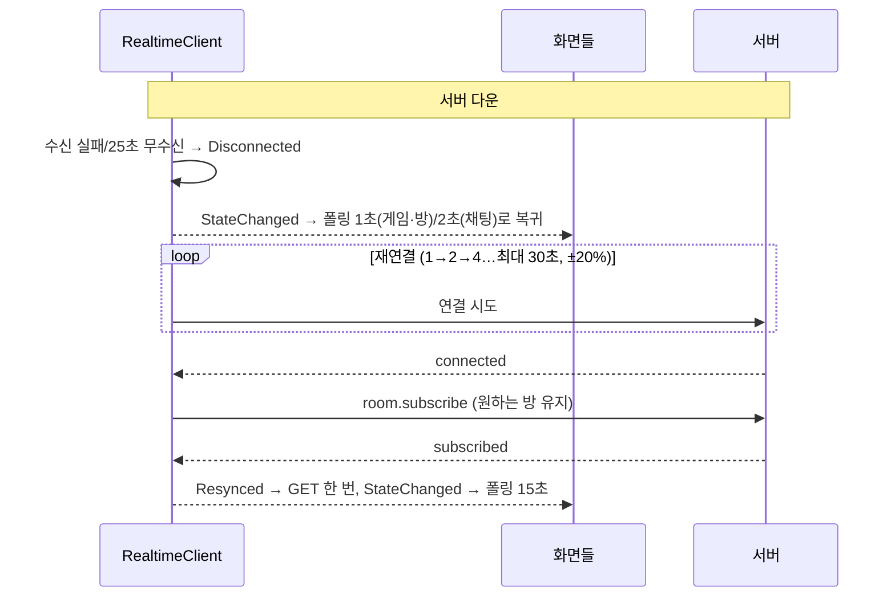

# 4단계 (Unity) — RealtimeClient와 화면 연동

작성: 원우 (klik075) · 기준: `project_client` 4-8 ~ 4-10 작업분 (+ 구독 중복 수정) · 2026-10-12
← [04_WebSocket_서버](멀티서버_04_WebSocket_서버.md) · 개요 → [00_개요](멀티서버_00_개요.md) · 메시지 규칙 원문 → [websocket-protocol.md](websocket-protocol.md)

## 1. 한눈에 보기

| 항목 | 예전 | 지금 |
| --- | --- | --- |
| 게임 화면 | 1초마다 `GET /games/{id}` | `game.changed` 오면 **바로 GET**, 신호를 받는 동안 폴링 **15초**(안전망) |
| 방 화면 | 1초마다 `GET /rooms/{id}` | `room.changed` 오면 바로 GET, 평소 15초 |
| 채팅 | 2초마다 `GET .../messages?afterId=` | `chat.changed` 오면 바로 GET, 평소 15초 |
| WebSocket이 끊기면 | — | 폴링이 **원래 간격(1초/2초)으로 자동 복귀** → 신호 없이도 지금처럼 동작 |
| 연결 수 | — | 앱 전체에 **WebSocket 1개** (`RealtimeClient` 싱글턴) |
| 연결 시점 | — | 로그인 직후 연결, 로그아웃 시 끊음 |

핵심 원칙: **WebSocket은 "언제 GET할지"만 알려 줍니다.** 화면에 그리는 데이터는 항상 기존 REST 응답입니다. 그래서 WebSocket이 없어도(끊겨도) 게임이 진행됩니다.

## 2. 전체 구조

- **`Realtime.Core`**(asmdef): Unity API를 쓰지 않는 규칙 코드만 모았습니다. EditMode 테스트로 확인합니다.
- **`RealtimeClient`**: 실제 소켓, 스레드, 재연결, 이벤트. Core의 규칙을 조합합니다.
- **화면**: 이벤트를 받아 "지금 GET" 요청과 "폴링 간격 변경"만 합니다.

## 3. 동작 흐름 (클라 ↔ 서버)

### 3-1. 로그인 → 연결 → 방 입장 → 구독

- `EnterRoom`은 "이 방을 보고 싶다"는 **희망**을 기록합니다. 연결 전이면 연결된 뒤에, 재연결되면 다시 구독합니다.
- `subscribed`를 받으면 `Resynced`가 나가고 화면은 GET을 한 번 합니다. 구독 전·끊긴 동안 놓친 변경을 메우기 위해서입니다.
- **구독 중복 수정**: Room 씬에서 `RoomUIController`와 `GameChatController`가 같은 프레임에 `EnterRoom(3)`을 불러 `room.subscribe`가 두 번 나가던 문제를 `PendingSubscribeRoomId`로 막았습니다 (구독 요청 중인 방과 같으면 건너뜀).

### 3-2. 게임 중 — 누군가 투표했을 때

- 측정값(4-10): 신호 → GET까지 수 ms. 타이머가 페이즈를 넘긴 경우도 같은 신호가 옵니다.
- GET이 이미 진행 중이면 `pollAgain`을 세워 두었다가 끝나는 즉시 한 번 더 가져옵니다 (신호를 버리지 않음).

### 3-3. 채팅

- 해적 밤 채팅은 해적에게만, 사망자 채팅은 사망자에게만 신호가 옵니다 (서버가 거름). 측정값: 신호 → 화면 표시 14~25ms.

### 3-4. 연결이 끊겼을 때 (서버 재시작 등)

- 4-10 측정: 끊김 즉시 감지 → 1초 폴링 유지 → 재시도 1.2/2.2/3.3/9.1/14.6초 → 재구독 → GET 1번 → 15초 안전망.

### 3-5. 실패별 처리

| 받은 것 | 판단 (`RealtimeFailurePolicy`) | 동작 |
| --- | --- | --- |
| close `4401` 또는 handshake HTTP 401 | 토큰 만료 | **재연결 중단** + `AuthExpired` → `ApiClient.ExpireSession()` → 로그인 화면 |
| close `4408` / 네트워크 오류 | 일시적 | 백오프 후 재연결 |
| `error NOT_IN_ROOM` | 구독 거절 | 그 방 구독 포기(`OnSubscribeRejected`), `SubscribeRejected` 이벤트 → 화면은 GET으로 상태 확인, 폴링 유지 |
| `error SERVER_ERROR` | 서버 일시 문제 | 대기 상태 해제 후 **5초 뒤 재구독** |
| `error BAD_MESSAGE` / `UNKNOWN_TYPE` | 버그 | 로그만 |
| 모르는 type | 앞으로 생길 메시지 | `UnknownServerMessage`로 무시 |

## 4. 스크립트별 역할

### 4-1. `Assets/02_Scripts/Network/Realtime/` — `Realtime.Core` (순수 C#)

rootNamespace `WhoisntCitizen.Network.Realtime`.

| 파일 | 역할 |
| --- | --- |
| `RealtimeProtocol.cs` | 서버와 같은 고정 값: `Path`(/ws/v1), `HeartbeatIntervalSeconds`(10), `IdleTimeoutSeconds`(30), `MaxClientMessageChars`(4096), `CloseIdleTimeout`(4408), `CloseTokenExpired`(4401). `BuildUrl(baseUrl)`: http→ws, https→wss. type 상수 `ServerMessageTypes`, `ClientMessageTypes`, 에러 코드 `RealtimeErrorCodes` |
| `RealtimeMessages.cs` | 서버 메시지 클래스: 추상 `RealtimeServerMessage` + `Connected`, `Pong`, `Subscribed`, `GameChanged`, `RoomChanged`, `ChatChanged`, `RealtimeErrorMessage`, `UnknownServerMessage` |
| `RealtimeMessageCodec.cs` | `TryDecode(json, out msg)`: JsonUtility Envelope로 읽고 type별 필수 값 검사 (없으면 실패). `EncodePing`, `EncodeSubscribe(roomId)`, `EncodeUnsubscribe(roomId)` |
| `ReconnectBackoff.cs` | 재연결 대기: 1→2→4…최대 30초, ±20% 지터. `NextDelaySeconds()`, `Reset()` (연결 성공 시) |
| `RealtimeConnectionTracker.cs` | 상태 기계: `Disconnected / Connecting / Connected / Subscribed`. `DesiredRoomId`(보고 싶은 방), `SubscribedRoomId`, `PendingSubscribeRoomId`(구독 요청 중). 이벤트마다 해야 할 일(`RealtimeAction`: None/Subscribe/Unsubscribe)을 돌려줌. `OnSubscribed`가 true면 Resync 필요. `ReceivesSignalsFor(roomId)` |
| `RealtimePolling.cs` | `IntervalSeconds(receivesSignals, fastSeconds)`: 신호 받는 중이면 15초, 아니면 fast (최소 0.2초) |
| `RealtimeSignalFilter.cs` | `Offer`로 신호를 받아 다른 방 신호·이미 받은 채팅 id를 버리고 **한 프레임 안의 같은 신호를 합침**. `TakePending()`, 재구독 시 `OnResubscribed()`, `Clear()`. 결과는 `RealtimeSignals` 구조체 |
| `RealtimeFailurePolicy.cs` | `ForClose(code)`, `ForError(code)`, `IsUnauthorizedHandshake(ex)`, `IsTokenExpired` → 위 3-5 표의 판단 |
| `Tests/*` (`Realtime.Core.Tests`) | Protocol, Codec, Backoff, Tracker(구독 대기 6개 포함), Polling, SignalFilter, FailurePolicy — **147개 전부 통과** |

### 4-2. `Assets/02_Scripts/Network/` — 연결 본체

| 파일 | 역할 |
| --- | --- |
| `RealtimeClient.cs` (신규) | 싱글턴 MonoBehaviour (`Instance`는 없으면 만듦, `ExistingInstance`는 있을 때만). `ClientWebSocket`에 `Authorization` 헤더, `KeepAliveInterval=0`(앱 ping 사용). **수신은 백그라운드 스레드 → `ConcurrentQueue` → `Update`(메인 스레드)에서 처리** (Unity API는 메인 스레드에서만). `connectionSeq`로 이전 연결의 늦은 이벤트를 버림. 10초 ping, 25초 무수신이면 끊긴 것으로 판단, 보내기는 `SemaphoreSlim`으로 한 줄. 최대 수신 64KB |
| | API: `Connect()`, `Disconnect()`, `EnterRoom(roomId)`, `LeaveRoom()`, `CurrentRoomId`, `ReceivesSignalsFor(roomId)`, `IsAuthExpired`, `ServerClockOffsetMs` |
| | 이벤트: `StateChanged(old,new)`, `MessageReceived`, `Resynced(roomId)`, `RoomChanged(roomId)`, `GameChanged(gameId, phaseVersion)`, `ChatChanged(roomId, lastMessageId)`, `AuthExpired`, `SubscribeRejected(roomId)` |
| | `LogHeartbeat`(static): ping/pong 로그 켜기 (기본 꺼짐) |
| `RealtimeSession.cs` (신규) | 로그인 수명과 연결을 잇는 정적 클래스. `OnLoggedIn()`: 이미 연결 중이면 끊고 새 토큰으로 `Connect()`, `AuthExpired`를 `ApiClient.ExpireSession()`에 연결. `OnLoggedOut()`: `Disconnect()`. 플레이 중이 아니면(에디터) 아무것도 안 함 |
| `ApiClient.cs` (수정) | `ExpireSession()` 공개 메서드 추가: 로그인 상태면 기존 401 처리(`HandleUnauthorized`)와 같은 흐름으로 로그인 화면 |

### 4-3. 로그인·방 세션 (수정)

| 파일 | 변경 |
| --- | --- |
| `Auth/AuthSession.cs` | `SetSession` → `RealtimeSession.OnLoggedIn()`, `Clear` → `RealtimeSession.OnLoggedOut()` |
| `Lobby/RoomSession.cs` | `Clear()`(방에서 나감) → `RealtimeClient.ExistingInstance?.LeaveRoom()` |

### 4-4. 화면 (수정)

| 파일 | 변경 |
| --- | --- |
| `Game/Core/GameSession.cs` | 폴링 간격을 바꿀 수 있게 (`pollInterval`, `PollIntervalSeconds`, `SetPollInterval(s)`: 다음 폴링을 `lastPollAt + 새 간격`으로 다시 계산). `RequestPollNow()`: 즉시 GET, 진행 중이면 `pollAgain` 세팅 → `OnState`에서 처리 |
| `Game/GameController.cs` | 실제 게임일 때 `BeginGame`에서 `AttachRealtime(RoomSession.RoomId)`: `GameChanged`(gameId가 같을 때)·`Resynced` → `RequestPollNow`, `StateChanged` → `ApplyPollInterval`(15초 또는 1초), `EnterRoom`. `EndGame`에서 `DetachRealtime` |
| `Room/RoomUIController.cs` | 코루틴 대신 프레임마다 `PollLoop` (`nextFetchAt`/`lastFetchAt`/`fetchAgain`), `CurrentPollInterval()`(15초 또는 1초), `RequestFetchNow()`. `RoomChanged`·`Resynced`·`SubscribeRejected` → GET, `StateChanged` → 다시 예약. **나가는 중(`isLeaving`)이면 GET 안 함** (퇴장과 `room.changed`가 겹쳐 400 경고가 나던 문제) |
| `Chat/GameChatController.cs` | `CurrentPollInterval()`(15초 또는 2초), `ChatChanged`(받은 id보다 클 때만)·`Resynced` → `RequestFetch`. `RoomSession`이 비면(방을 나감) 폴링 중단 (`_roomFromSession`, 퇴장 후 404 방지). `OnDestroy`에서 이벤트 해제 |
| `Game/Core/Tests/GameSessionPollingTests.cs` | `RequestPollNow`/`SetPollInterval`/`pollAgain` 테스트 15개 |

### 4-5. 확인용 스크립트 (git에 안 올라감)

`Library/AgentScripts/RealtimeSmoke.cs`(연결·방 흐름·로그인 흐름), `RealtimeGameCheck.cs`(봇 B/C/D가 각자 WebSocket으로 4인 게임 진행). 에디터에서 수동 확인할 때만 씁니다.

## 5. 규칙 / 주의

| 규칙 | 이유 |
| --- | --- |
| 화면은 신호로 **데이터를 만들지 않는다**, GET만 부른다 | 보이는 정보 규칙은 REST에만 있음 |
| 폴링 코드를 지우지 않는다 | WebSocket이 끊기면 폴링이 유일한 갱신 수단 |
| 화면은 `EnterRoom`만 부르고, 구독 메시지는 `RealtimeClient`가 보낸다 | 재연결·중복 처리를 한곳에서 |
| 이벤트 구독은 `OnDestroy`/`EndGame`에서 반드시 해제 | 싱글턴이 씬보다 오래 살아 있어 해제 안 하면 파괴된 객체 호출 |
| `GameChanged`는 gameId 확인, `ChatChanged`는 id 비교 | 다른 게임·이미 받은 메시지로 쓸데없는 GET 방지 |
| 백그라운드 스레드에서 Unity API 금지 | 수신은 큐에 넣고 `Update`에서 처리 |

유저 테스트 전 확인할 것:

- `ApiConfig.BaseUrl`을 테스트 서버 주소로 (WebSocket 주소도 여기서 만듦).
- Player Settings의 **Run In Background** 켜기 (창이 비활성이면 `Update`가 멈춰 ping이 안 나가고 30초 뒤 4408).
- JWT 만료가 1시간이라 그 뒤 4401 → 로그인 화면. 서버 쪽에서 늘리는 것이 좋음.

## 6. 검증 결과 (4-10)

| 항목 | 결과 |
| --- | --- |
| 방 신호 → GET | 약 1ms |
| 채팅 신호 → 화면 | 14~25ms |
| 게임 신호 | 행동(투표·밤 행동)과 타이머 전환 모두 도착 |
| 숨은 채팅 | 해적 밤 채팅은 해적만, 사망자 채팅은 사망자만 신호 받음 |
| 서버 재시작 | 즉시 끊김 감지, 1초 폴링 유지, 백오프 재연결, 재구독 후 GET 1번, 15초 안전망 복귀 |
| 구독 중복 | 수정 후 Room 씬 입장 시 `room.subscribe` 1번 |
| 미확인 | 세이렌 채팅 (4인 구성에 세이렌이 없어 직접 확인 못 함) |
| 이미 있던 실패 | `Game.Core` 테스트 2개 (`GameDtoParseTests` 취소 게임 `winner`가 null이 아니라 "") — 이번 작업과 무관 |

> 테스트 서버가 게임 저장소를 memory(서버 메모리)로 둔 상태라 재시작 시 방은 남고 게임은 사라졌습니다. `SERVER_MODE=multi`면 게임도 남습니다.
